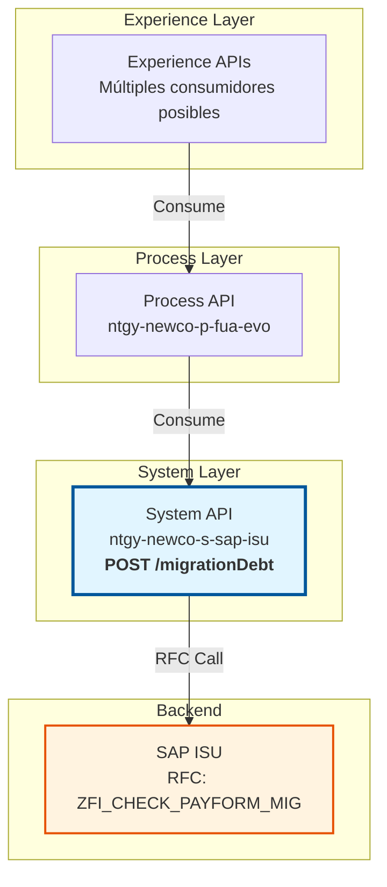
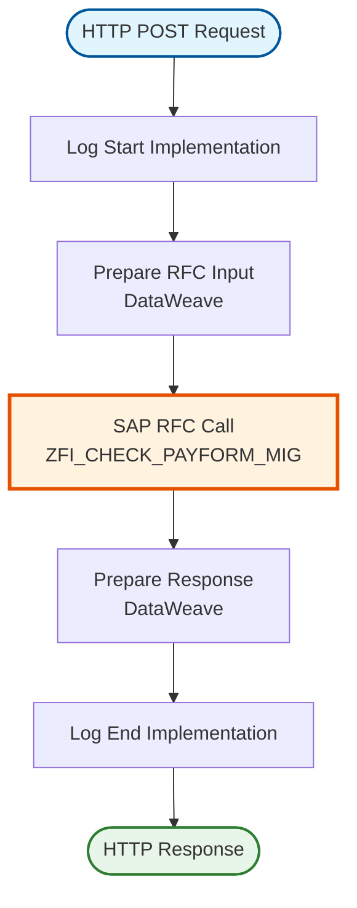
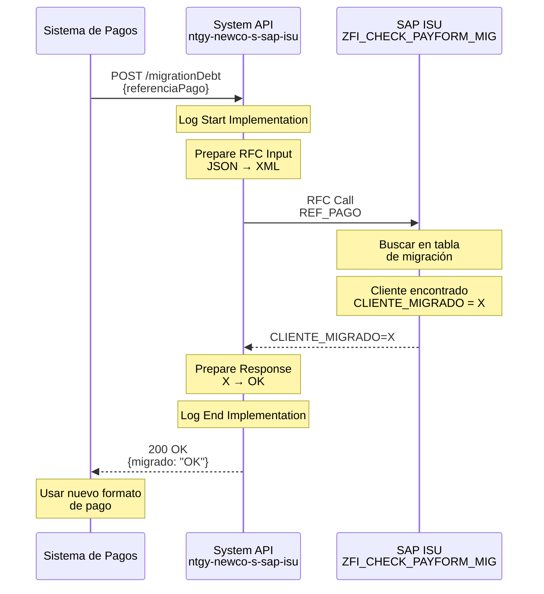
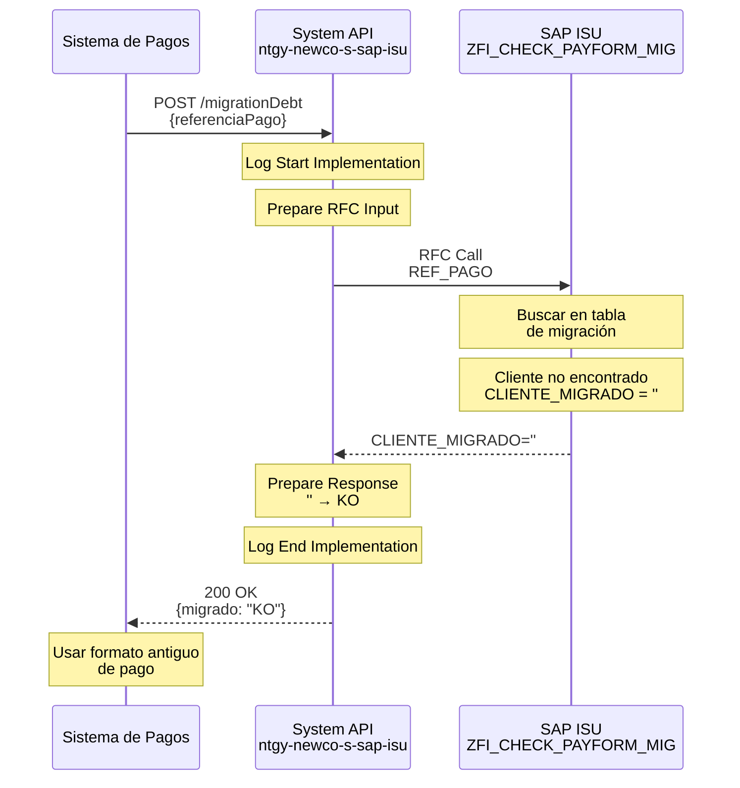
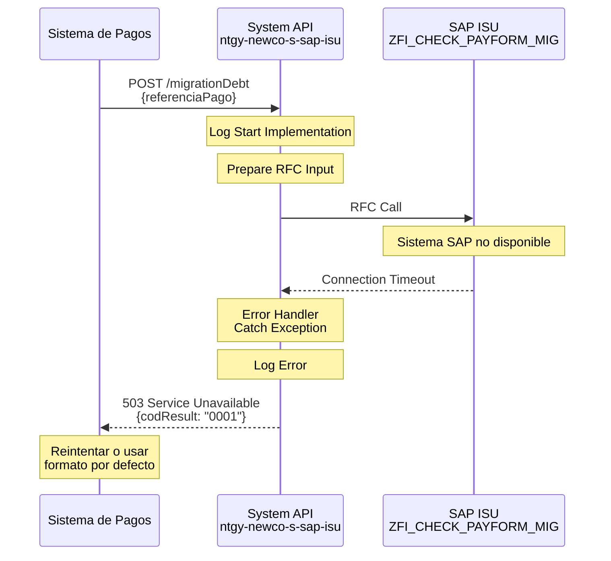

# POST /migrationDebt

## 📌 Descripción General

### Propósito del Endpoint

Este endpoint verifica si un cliente ha sido migrado al nuevo sistema de separación de ficheros de pago NI-NC (Número de Identificación - Número de Cuenta Contrato) en SAP ISU. Es utilizado para validar el estado de migración de clientes en el proceso de pago por ventanilla.

### Tipo de API

**Capa:** System API (Integración directa con SAP ISU)

### Patrón de Integración

**Tipo:** Request-Reply Síncrono con SAP ISU

Este endpoint ejecuta directamente el RFC `ZFI_CHECK_PAYFORM_MIG` en SAP ISU para verificar el estado de migración del cliente.

### Arquitectura API-Led Connectivity



---

## 💼 Propósito del Negocio

### Casos de Uso Principales

1. **Validación de Migración**: Verificar si un cliente está en el nuevo sistema de pagos
2. **Procesamiento de Pagos**: Determinar el formato de fichero de pago a utilizar
3. **Gestión de Ventanilla**: Validar forma de pago en oficinas físicas
4. **Auditoría de Migración**: Seguimiento del proceso de migración de clientes

### Contexto Empresarial

- **Dominio:** Gestión de Pagos y Deuda
- **Sector:** Energía - Utilities
- **División:** Naturgy NewCo
- **Proceso:** Migración de Sistema de Pagos

### Stakeholders

- **Departamento de Pagos**: Gestiona el procesamiento de pagos por ventanilla
- **Equipo de Migración**: Supervisa el proceso de migración de clientes
- **Oficinas de Atención**: Procesan pagos en ventanilla
- **Auditoría**: Verifica el estado de migración

### Valor de Negocio

- **Procesamiento Correcto**: Asegura el uso del formato de pago adecuado
- **Trazabilidad**: Mantiene registro del estado de migración
- **Eficiencia Operativa**: Automatiza la validación de migración
- **Reducción de Errores**: Evita errores en el procesamiento de pagos

### Consumidores Potenciales

Este endpoint puede ser consumido por:
- Sistemas de gestión de pagos
- Aplicaciones de punto de venta (ventanilla)
- Portales de back-office
- Sistemas de auditoría y reporting

---

## 🔧 Especificación Técnica

### URLs por Ambiente

| Ambiente | URL Base | URL Completa |
|----------|----------|--------------|
| Local | `http://localhost:8081` | `http://localhost:8081/api/migrationDebt` |
| Desarrollo | `https://dev-ntgy-newco-s-sap-isu.cloudhub.io` | `https://dev-ntgy-newco-s-sap-isu.cloudhub.io/api/migrationDebt` |
| UAT | `https://uat-ntgy-newco-s-sap-isu.cloudhub.io` | `https://uat-ntgy-newco-s-sap-isu.cloudhub.io/api/migrationDebt` |
| Producción | `https://prod-ntgy-newco-s-sap-isu.cloudhub.io` | `https://prod-ntgy-newco-s-sap-isu.cloudhub.io/api/migrationDebt` |

### Método HTTP

```
POST /migrationDebt
```

### Parámetros de Entrada

#### Headers HTTP

| Header | Tipo | Requerido | Descripción | Ejemplo |
|--------|------|-----------|-------------|---------|
| `Content-Type` | string | Sí | Tipo de contenido | `application/json` |
| `Accept` | string | No | Tipo de respuesta esperada | `application/json` |

#### Body Parameters

| Campo | Tipo | Requerido | Descripción | Ejemplo |
|-------|------|-----------|-------------|---------|
| `referenciaPago` | string | Sí | Referencia de pago a verificar | `"REF123456789"` |

**Estructura del Request:**

```json
{
  "referenciaPago": "REF123456789"
}
```

### Respuestas

#### Respuesta Exitosa (200 OK)

**Estructura:**

```json
{
  "migrado": "OK"
}
```

**Campos de la Respuesta:**

| Campo | Tipo | Descripción | Valores Posibles |
|-------|------|-------------|------------------|
| `migrado` | string | Estado de migración | `"OK"` (migrado), `"KO"` (no migrado) |

#### Respuestas de Error

**400 Bad Request** - Parámetros inválidos:

```json
{
  "result": {
    "codResult": "0001",
    "msgResult": "Referencia de pago inválida"
  }
}
```

**500 Internal Server Error** - Error en SAP ISU:

```json
{
  "result": {
    "codResult": "0001",
    "msgResult": "Error al verificar migración en SAP"
  }
}
```

**503 Service Unavailable** - SAP ISU no disponible:

```json
{
  "result": {
    "codResult": "0001",
    "msgResult": "Sistema SAP ISU no disponible"
  }
}
```

### Códigos de Resultado

| Código | Significado | Acción Recomendada |
|--------|-------------|-------------------|
| `OK` | Cliente migrado | Usar nuevo formato de pago |
| `KO` | Cliente no migrado | Usar formato de pago antiguo |

### Autenticación

- **Tipo:** Client ID & Client Secret (Anypoint Platform)
- **Ubicación:** Headers HTTP
- **Flujo:** OAuth 2.0 Client Credentials

### Timeouts

| Tipo | Valor | Descripción |
|------|-------|-------------|
| Request Timeout | 30s | Tiempo máximo de espera para la respuesta |
| Connection Timeout | 10s | Tiempo máximo para establecer conexión |

### Protocolo

- **Protocolo:** HTTPS
- **TLS Version:** 1.2+
- **Método:** POST

---

## 🏗️ Implementación Técnica

### Arquitectura del Flow



### 🗄️ Base de Datos SAP ISU

#### RFC SAP Invocado

**RFC:** `ZFI_CHECK_PAYFORM_MIG`

**Descripción:** RFC personalizado de SAP ISU para verificar si un cliente ha sido migrado al nuevo sistema de separación de ficheros de pago NI-NC.

**Módulo SAP:** FI-CA (Financial Contract Accounting)

**Tablas SAP Consultadas:**

| Tabla | Descripción | Operación |
|-------|-------------|-----------|
| `FKKVKP` | Contract Account | SELECT |
| `BUT000` | Business Partner | SELECT |

#### Detalles de Tablas SAP

##### Tabla: `FKKVKP` (Contract Account)

**Descripción:** Contiene información de cuentas contrato en SAP ISU.

**Campos Utilizados:**

| Campo | Tipo ABAP | Descripción | Ejemplo |
|-------|-----------|-------------|---------|
| `VKONT` | CHAR(12) | Número de cuenta contrato | `200001234567` |
| `GPART` | CHAR(10) | Business Partner | `0001234567` |
| `VKTYP` | CHAR(2) | Tipo de cuenta contrato | `01` |

**Relaciones:**
- `FKKVKP.GPART` → `BUT000.PARTNER` (Business Partner)

##### Tabla: `BUT000` (Business Partner)

**Descripción:** Contiene datos maestros de Business Partners (clientes).

**Campos Utilizados:**

| Campo | Tipo ABAP | Descripción | Ejemplo |
|-------|-----------|-------------|---------|
| `PARTNER` | CHAR(10) | Número de Business Partner | `0001234567` |
| `TYPE` | CHAR(4) | Tipo de partner | `0001` |
| `NAME_ORG1` | CHAR(40) | Nombre organización | `EMPRESA SA` |

**Relaciones:**
- `BUT000.PARTNER` → `FKKVKP.GPART` (Cuenta contrato)

**Notas de Performance:**
- El RFC utiliza índices primarios en FKKVKP y BUT000
- Tiempo de respuesta típico: 1-2 segundos
- Operación de solo lectura (SELECT)

### Transformaciones DataWeave

#### Transformación de Entrada (Request → SAP RFC)

**Archivo:** `src/main/resources/dw/migration-debt-rfc-input.dwl`

```dataweave
%dw 2.0
output application/xml
---
{
    ZFI_CHECK_PAYFORM_MIG: {
        "import": {
            REF_PAGO: payload.referenciaPago
        }
    }
}
```

**Mapeo de Campos:**

| Campo JSON (Input) | Campo SAP RFC | Transformación |
|-------------------|---------------|----------------|
| `referenciaPago` | `REF_PAGO` | Directo |

#### Transformación de Salida (SAP RFC → Response)

**Ubicación:** Inline en el flow XML

```dataweave
%dw 2.0
output application/json
---
{
    "migrado": if(payload.ZFI_CHECK_PAYFORM_MIG.export.CLIENTE_MIGRADO == "X") "OK" else "KO"
}
```

**Mapeo de Campos:**

| Campo SAP RFC | Campo JSON (Output) | Transformación |
|---------------|-------------------|----------------|
| `CLIENTE_MIGRADO` | `migrado` | Condicional: "X" → "OK", "" → "KO" |

### Patrones de Diseño

**Patrón:** Request-Reply Síncrono

**Justificación:**
- Operación de consulta rápida que requiere respuesta inmediata
- No hay procesamiento complejo ni operaciones de escritura
- El resultado es necesario para continuar con el flujo de pago

**Componentes:**
1. **Logger**: Logging de inicio y fin de operación
2. **DataWeave Transformer**: Transformación de JSON a XML SAP
3. **SAP Connector**: Ejecución del RFC
4. **DataWeave Transformer**: Transformación de respuesta SAP a JSON

### Diagramas de Secuencia

#### 1. Flujo Normal de Éxito - Cliente Migrado



#### 2. Flujo Normal - Cliente No Migrado



#### 3. Flujo con Error Técnico



### Connection Pooling

**Configuración del SAP JCo Connector:**

```xml
<sap:config name="SAP_Config">
    <sap:jco-connection-provider>
        <sap:pool-configuration 
            maxPoolSize="10"
            minPoolSize="2"
            maxIdleTime="300000"
            maxWaitTime="10000"/>
    </sap:jco-connection-provider>
</sap:config>
```

**Optimizaciones:**
- Pool de conexiones reutilizables
- Timeout de 10 segundos para obtener conexión
- Máximo 10 conexiones concurrentes

### Manejo de Errores

**Estrategia:**

1. **Validación de Entrada**: Verificar referencia de pago antes de llamar a SAP
2. **Try-Catch en Flow**: Capturar excepciones de SAP Connector
3. **Error Handler Global**: Transformar errores a formato estándar
4. **Logging**: Registrar todos los errores para troubleshooting

**Códigos de Error Manejados:**

| Código SAP | Código API | Descripción |
|------------|------------|-------------|
| `X` | `OK` | Cliente migrado |
| `''` | `KO` | Cliente no migrado |
| Connection Error | `0001` | Error de conexión con SAP |
| Timeout | `0001` | Timeout en la operación |

---

## 💻 Ejemplos de Uso

### Ejemplo 1: Cliente Migrado

#### cURL

```bash
curl -X POST "https://prod-ntgy-newco-s-sap-isu.cloudhub.io/api/migrationDebt" \
  -H "Content-Type: application/json" \
  -H "client_id: your-client-id" \
  -H "client_secret: your-client-secret" \
  -d '{
    "referenciaPago": "REF123456789"
  }'
```

#### Respuesta

```json
{
  "migrado": "OK"
}
```

### Ejemplo 2: Cliente No Migrado

#### cURL

```bash
curl -X POST "https://prod-ntgy-newco-s-sap-isu.cloudhub.io/api/migrationDebt" \
  -H "Content-Type: application/json" \
  -H "client_id: your-client-id" \
  -H "client_secret: your-client-secret" \
  -d '{
    "referenciaPago": "REF987654321"
  }'
```

#### Respuesta

```json
{
  "migrado": "KO"
}
```

### Ejemplo 3: JavaScript (Fetch API)

```javascript
const checkMigration = async (referenciaPago) => {
  try {
    const response = await fetch('https://prod-ntgy-newco-s-sap-isu.cloudhub.io/api/migrationDebt', {
      method: 'POST',
      headers: {
        'Content-Type': 'application/json',
        'client_id': 'your-client-id',
        'client_secret': 'your-client-secret'
      },
      body: JSON.stringify({
        referenciaPago: referenciaPago
      })
    });

    const data = await response.json();
    
    if (data.migrado === 'OK') {
      console.log('✓ Cliente migrado - usar nuevo formato');
      return true;
    } else {
      console.log('✗ Cliente no migrado - usar formato antiguo');
      return false;
    }
  } catch (error) {
    console.error('Error al verificar migración:', error);
    throw error;
  }
};

// Uso
const isMigrated = await checkMigration('REF123456789');
```

### Ejemplo 4: Python (requests)

```python
import requests
import json

def check_migration(referencia_pago):
    """
    Verifica si un cliente ha sido migrado
    
    Args:
        referencia_pago (str): Referencia de pago
    
    Returns:
        bool: True si migrado, False si no migrado
    """
    url = 'https://prod-ntgy-newco-s-sap-isu.cloudhub.io/api/migrationDebt'
    
    headers = {
        'Content-Type': 'application/json',
        'client_id': 'your-client-id',
        'client_secret': 'your-client-secret'
    }
    
    payload = {
        'referenciaPago': referencia_pago
    }
    
    try:
        response = requests.post(url, headers=headers, json=payload, timeout=30)
        response.raise_for_status()
        
        data = response.json()
        
        if data['migrado'] == 'OK':
            print(f"✓ Cliente migrado: {referencia_pago}")
            return True
        else:
            print(f"✗ Cliente no migrado: {referencia_pago}")
            return False
        
    except requests.exceptions.Timeout:
        print("✗ Error: Timeout en la petición")
        raise
    except requests.exceptions.RequestException as e:
        print(f"✗ Error de conexión: {e}")
        raise

# Uso
is_migrated = check_migration('REF123456789')

# Procesar según resultado
if is_migrated:
    print("Usar formato de pago NI-NC")
else:
    print("Usar formato de pago antiguo")
```

### Ejemplo 5: Postman Collection

```json
{
  "info": {
    "name": "POST /migrationDebt",
    "description": "Verificación de migración de cliente",
    "schema": "https://schema.getpostman.com/json/collection/v2.1.0/collection.json"
  },
  "item": [
    {
      "name": "Verificar Migración",
      "request": {
        "method": "POST",
        "header": [
          {
            "key": "Content-Type",
            "value": "application/json"
          },
          {
            "key": "client_id",
            "value": "{{client_id}}"
          },
          {
            "key": "client_secret",
            "value": "{{client_secret}}"
          }
        ],
        "body": {
          "mode": "raw",
          "raw": "{\n  \"referenciaPago\": \"REF123456789\"\n}"
        },
        "url": {
          "raw": "{{base_url}}/api/migrationDebt",
          "host": ["{{base_url}}"],
          "path": ["api", "migrationDebt"]
        }
      },
      "response": []
    }
  ]
}
```

### Ejemplo 6: Uso en Flujo de Pago

```javascript
// Ejemplo de integración en flujo de procesamiento de pago
async function procesarPago(referenciaPago, montoPago) {
  try {
    // 1. Verificar migración
    const migrationResponse = await fetch('/api/migrationDebt', {
      method: 'POST',
      headers: { 'Content-Type': 'application/json' },
      body: JSON.stringify({ referenciaPago })
    });
    
    const { migrado } = await migrationResponse.json();
    
    // 2. Seleccionar formato de fichero según migración
    const formatoFichero = migrado === 'OK' ? 'NI-NC' : 'ANTIGUO';
    
    // 3. Procesar pago con formato correspondiente
    const pagoResponse = await procesarPagoConFormato(
      referenciaPago,
      montoPago,
      formatoFichero
    );
    
    return {
      success: true,
      migrado: migrado === 'OK',
      formato: formatoFichero,
      resultado: pagoResponse
    };
    
  } catch (error) {
    console.error('Error en procesamiento de pago:', error);
    throw error;
  }
}