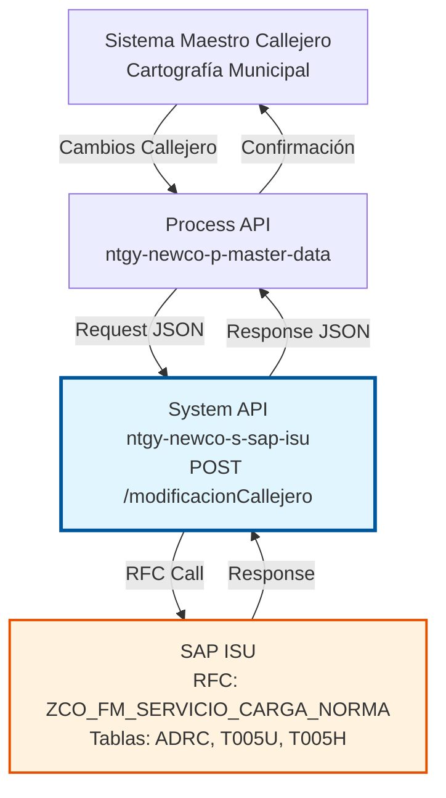
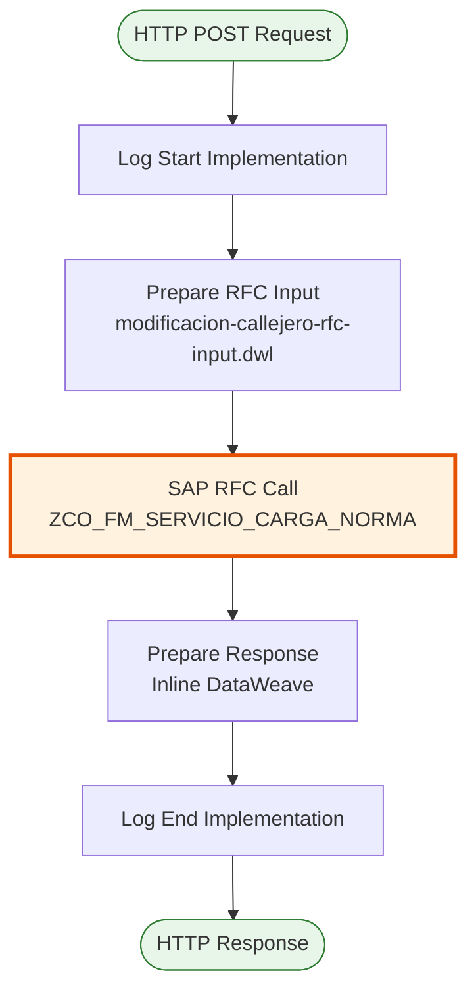
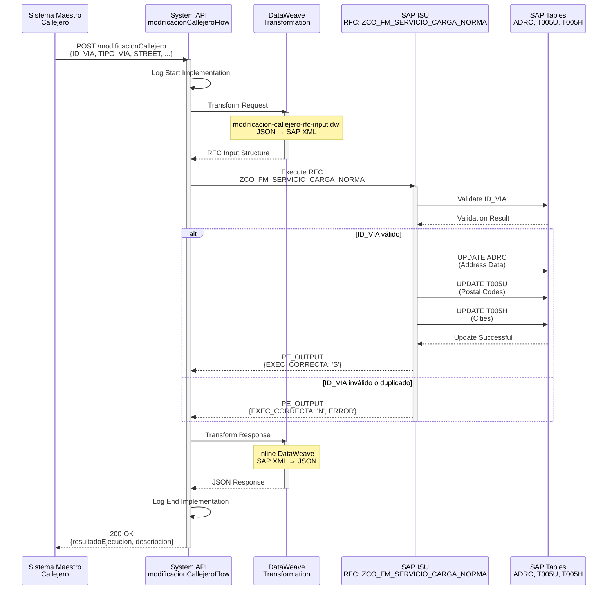
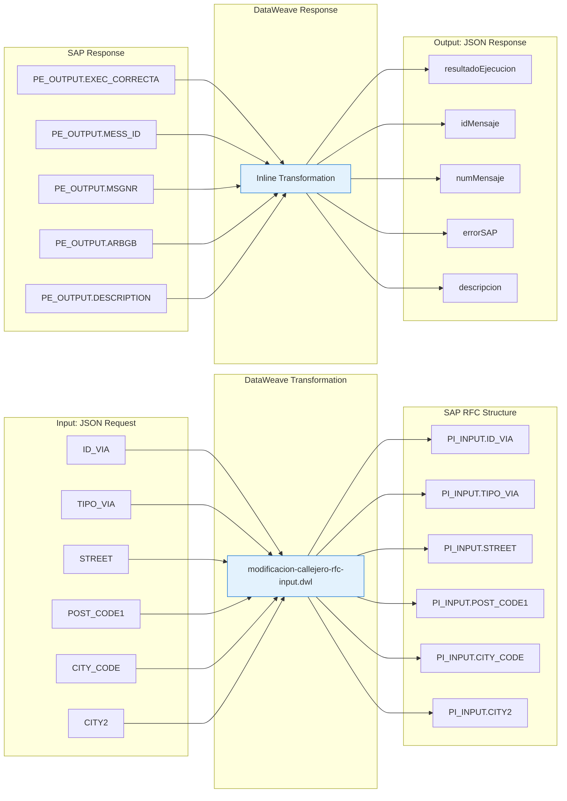

# POST /modificacionCallejero

## 📌 Descripción General

### Propósito del Endpoint

Actualiza el maestro de callejero en SAP ISU cuando hay modificaciones de nombre de vía o tipo de vía informadas por el sistema maestro de callejero externo. Este endpoint permite mantener sincronizada la información de direcciones entre sistemas externos (como sistemas municipales de cartografía o bases de datos de callejero) y SAP ISU.

El endpoint soporta:
- **Actualización de Nomenclatura**: Cambios en el nombre oficial de vías (ej: "Calle Mayor" → "Gran Vía")
- **Cambio de Tipo de Vía**: Modificaciones en la clasificación de vías (ej: CALLE → AVENIDA)
- **Actualización de Códigos Postales**: Cambios en la asignación de códigos postales a vías
- **Sincronización de Municipios**: Actualización de códigos y nombres de ciudades/municipios
- **Normalización de Direcciones**: Estandarización de nomenclaturas según normativa vigente

### Tipo de API

**Capa:** System API (API-Led Connectivity)

**Función:** Integración directa con SAP ISU para sincronización de datos maestros de callejero y direcciones.

### Patrón de Integración

**Tipo:** Request-Reply Síncrono con SAP RFC

**Descripción:** Recibe datos actualizados del maestro de callejero, transforma la información al formato SAP, invoca el RFC `ZCO_FM_SERVICIO_CARGA_NORMA` para actualizar las tablas de direcciones en SAP ISU, y retorna el resultado de la operación.

### Arquitectura API-Led Connectivity



---

## 💼 Propósito del Negocio

### Casos de Uso Principales

1. **Actualización Masiva de Callejero Municipal**
   - Cuando un ayuntamiento realiza cambios oficiales en la nomenclatura de vías
   - Sincronización periódica con bases de datos municipales de callejero
   - Garantiza que SAP ISU tenga la información oficial actualizada

2. **Corrección de Nomenclaturas Incorrectas**
   - Corrección de errores históricos en nombres de vías
   - Normalización de abreviaturas y formatos
   - Estandarización según normativa postal española

3. **Cambios en Clasificación de Vías**
   - Actualización cuando una calle se convierte en avenida
   - Cambios en la tipología oficial de vías
   - Mantenimiento de consistencia con registros oficiales

4. **Sincronización con Sistemas de Cartografía**
   - Integración con sistemas GIS (Geographic Information Systems)
   - Actualización desde bases de datos de cartografía digital
   - Mantenimiento de coherencia entre sistemas

### Contexto Empresarial

- **Dominio:** Gestión de Datos Maestros - Direcciones
- **Sector:** Energía - Utilities
- **División:** Naturgy España - NewCo
- **Proceso de Negocio:** Mantenimiento de Maestro de Callejero y Direcciones
- **Módulo SAP:** Master Data Management / Business Address Services

### Stakeholders

- **Departamento de Facturación**: Necesita direcciones correctas para envío de facturas
- **Atención al Cliente**: Requiere información actualizada de direcciones para gestión de servicios
- **Operaciones de Campo**: Utiliza direcciones para localización de puntos de suministro
- **Sistemas de Información**: Mantiene sincronización entre sistemas corporativos
- **Ayuntamientos y Administraciones**: Fuente oficial de cambios en callejero

### Valor de Negocio

- **Precisión en Facturación**: Reduce devoluciones de correo por direcciones incorrectas
- **Eficiencia Operativa**: Mejora localización de puntos de suministro para operaciones de campo
- **Cumplimiento Normativo**: Mantiene direcciones según nomenclatura oficial vigente
- **Calidad de Datos**: Garantiza consistencia de información de direcciones en SAP ISU
- **Reducción de Costes**: Disminuye costes de correo devuelto y re-envíos

### Consumidores Potenciales

Este endpoint puede ser consumido por:
- Process APIs de gestión de datos maestros
- Sistemas de integración con ayuntamientos
- Plataformas de cartografía y GIS
- Sistemas de normalización de direcciones
- Procesos batch de sincronización de callejero

---

## 🔧 Especificación Técnica

### URLs por Ambiente

| Ambiente | URL Base | URL Completa |
|----------|----------|--------------|
| **Local** | `http://localhost:8081` | `http://localhost:8081/api/modificacionCallejero` |
| **Development** | `https://ntgy-newco-s-sap-isu-dev.us-e2.cloudhub.io` | `https://ntgy-newco-s-sap-isu-dev.us-e2.cloudhub.io/api/modificacionCallejero` |
| **UAT** | `https://ntgy-newco-s-sap-isu-uat.us-e2.cloudhub.io` | `https://ntgy-newco-s-sap-isu-uat.us-e2.cloudhub.io/api/modificacionCallejero` |
| **Production** | `https://ntgy-newco-s-sap-isu-pro.us-e2.cloudhub.io` | `https://ntgy-newco-s-sap-isu-pro.us-e2.cloudhub.io/api/modificacionCallejero` |

### Método HTTP

```
POST /api/modificacionCallejero
```

### Parámetros de Entrada

#### Headers HTTP

| Header | Tipo | Requerido | Descripción | Ejemplo |
|--------|------|-----------|-------------|---------|
| `Content-Type` | string | ✅ Sí | Tipo de contenido del request | `application/json` |
| `Accept` | string | ❌ No | Tipo de contenido esperado en response | `application/json` |

#### Body Parameters

| Campo | Tipo | Requerido | Descripción | Ejemplo |
|-------|------|-----------|-------------|---------|
| `ID_VIA` | string | ✅ Sí | Identificador único de la vía en el sistema maestro de callejero | `"VIA001234"` |
| `TIPO_VIA` | string | ✅ Sí | Tipo de vía según nomenclatura estándar española (CALLE, AVENIDA, PLAZA, PASEO, CAMINO, etc.) | `"CALLE"` |
| `STREET` | string | ✅ Sí | Nombre completo de la vía/calle (máximo 60 caracteres) | `"Gran Via"` |
| `POST_CODE1` | string | ✅ Sí | Código postal de la vía (5 dígitos) | `"28013"` |
| `CITY_CODE` | string | ✅ Sí | Código de ciudad/municipio según nomenclatura INE | `"28079"` |
| `CITY2` | string | ✅ Sí | Nombre de la ciudad/municipio (máximo 40 caracteres) | `"Madrid"` |

### Respuestas

#### Respuesta Exitosa (200 OK)

```json
{
  "resultadoEjecucion": "OK",
  "idMensaje": "S",
  "numMensaje": "001",
  "errorSAP": "",
  "descripcion": "Callejero actualizado correctamente en SAP ISU"
}
```

**Campos de Respuesta:**

| Campo | Tipo | Descripción |
|-------|------|-------------|
| `resultadoEjecucion` | string | Resultado de la operación: "OK" (éxito) o "KO" (error) |
| `idMensaje` | string | Identificador del tipo de mensaje de SAP (S=Success, E=Error, W=Warning) |
| `numMensaje` | string | Número del mensaje de SAP |
| `errorSAP` | string | Área funcional del error en SAP (ARBGB), vacío si no hay error |
| `descripcion` | string | Descripción detallada del resultado de la operación |

#### Respuesta de Error de Negocio (200 OK con resultadoEjecucion = "KO")

```json
{
  "resultadoEjecucion": "KO",
  "idMensaje": "E",
  "numMensaje": "002",
  "errorSAP": "ZMASTER_DATA",
  "descripcion": "ID_VIA ya existe en el sistema con datos diferentes"
}
```

#### Respuesta de Error Técnico (400 Bad Request)

```json
{
  "result": {
    "codResult": "0001",
    "msgResult": "Formato de código postal inválido. Debe ser 5 dígitos numéricos"
  }
}
```

#### Respuesta de Error Técnico (500 Internal Server Error)

```json
{
  "result": {
    "codResult": "0001",
    "msgResult": "Error al conectar con SAP ISU. Intente nuevamente"
  }
}
```

### Códigos de Estado HTTP

| Código | Descripción | Cuándo Ocurre |
|--------|-------------|---------------|
| **200 OK** | Operación procesada | Request procesado correctamente (verificar `resultadoEjecucion` en body) |
| **400 Bad Request** | Error de validación | Formato de datos incorrecto, campos requeridos faltantes |
| **500 Internal Server Error** | Error del servidor | Error de conexión con SAP, timeout, error interno |

### Autenticación y Autorización

- **Tipo:** Client ID & Client Secret (Anypoint Platform)
- **Autorización SAP:** El usuario SAP configurado debe tener permisos para:
  - Ejecutar RFC `ZCO_FM_SERVICIO_CARGA_NORMA`
  - Acceso de lectura a tablas ADRC, T005U, T005H
  - Acceso de escritura a tablas de direcciones
  - Autorización para modificar datos maestros de callejero

### Timeouts

| Tipo | Valor | Descripción |
|------|-------|-------------|
| **Request Timeout** | 30 segundos | Tiempo máximo de espera para la respuesta |
| **SAP RFC Timeout** | 60 segundos | Tiempo máximo para ejecución del RFC en SAP |
| **Connection Timeout** | 10 segundos | Tiempo máximo para establecer conexión con SAP |

---

## 🏗️ Implementación Técnica

### Arquitectura del Flow



### Diagrama de Secuencia Detallado



### Transformación de Datos

#### Input Transformation (JSON → SAP RFC)

**Archivo:** `modificacion-callejero-rfc-input.dwl`

```dataweave
%dw 2.0
output application/xml
---
{
    ZCO_FM_SERVICIO_CARGA_NORMA: {
        "import": {
            PI_INPUT: {
                ID_VIA: payload.ID_VIA,
                TIPO_VIA: payload.TIPO_VIA,
                STREET: payload.STREET,
                POST_CODE1: payload.POST_CODE1,
                CITY_CODE: payload.CITY_CODE,
                CITY2: payload.CITY2
            }
        }
    }
}
```

**Mapeo de Campos:**

| Campo JSON | Campo SAP RFC | Transformación | Descripción |
|------------|---------------|----------------|-------------|
| `ID_VIA` | `PI_INPUT.ID_VIA` | Directo | Identificador de vía |
| `TIPO_VIA` | `PI_INPUT.TIPO_VIA` | Directo | Tipo de vía |
| `STREET` | `PI_INPUT.STREET` | Directo | Nombre de calle |
| `POST_CODE1` | `PI_INPUT.POST_CODE1` | Directo | Código postal |
| `CITY_CODE` | `PI_INPUT.CITY_CODE` | Directo | Código de ciudad |
| `CITY2` | `PI_INPUT.CITY2` | Directo | Nombre de ciudad |

#### Output Transformation (SAP RFC → JSON)

**Transformación Inline en Flow:**

```dataweave
%dw 2.0
output application/json

var out = payload.ZCO_FM_SERVICIO_CARGA_NORMA.export.PE_OUTPUT
---
{
    "resultadoEjecucion": if (out.EXEC_CORRECTA == 'S') "OK" else "KO",
    "idMensaje": out.MESS_ID,
    "numMensaje": out.MSGNR,
    "errorSAP": out.ARBGB,
    "descripcion": out.DESCRIPTION
}
```

**Mapeo de Campos:**

| Campo SAP RFC | Campo JSON | Transformación | Descripción |
|---------------|------------|----------------|-------------|
| `PE_OUTPUT.EXEC_CORRECTA` | `resultadoEjecucion` | 'S' → "OK", otros → "KO" | Resultado de ejecución |
| `PE_OUTPUT.MESS_ID` | `idMensaje` | Directo | Tipo de mensaje SAP |
| `PE_OUTPUT.MSGNR` | `numMensaje` | Directo | Número de mensaje |
| `PE_OUTPUT.ARBGB` | `errorSAP` | Directo | Área funcional de error |
| `PE_OUTPUT.DESCRIPTION` | `descripcion` | Directo | Descripción del resultado |

### Diagrama de Transformación de Datos



### Configuración SAP

**Connector:** SAP JCo 5.9.11  
**RFC:** `ZCO_FM_SERVICIO_CARGA_NORMA`  
**Connection Pool:** 10 conexiones activas, 20 máximo

---

## 💻 Ejemplos de Uso

### Ejemplo 1: Request Exitoso

**Request:**

```bash
curl -X POST "https://ntgy-newco-s-sap-isu-pro.us-e2.cloudhub.io/api/modificacionCallejero" \
  -H "Content-Type: application/json" \
  -H "client_id: YOUR_CLIENT_ID" \
  -H "client_secret: YOUR_CLIENT_SECRET" \
  -d '{
    "ID_VIA": "VIA001234",
    "TIPO_VIA": "CALLE",
    "STREET": "Gran Via",
    "POST_CODE1": "28013",
    "CITY_CODE": "28079",
    "CITY2": "Madrid"
  }'
```

**Response (200 OK):**

```json
{
  "resultadoEjecucion": "OK",
  "idMensaje": "S",
  "numMensaje": "001",
  "errorSAP": "",
  "descripcion": "Callejero actualizado correctamente en SAP ISU"
}
```

### Ejemplo 2: Cambio de Tipo de Vía

**Request:**

```json
{
  "ID_VIA": "VIA005678",
  "TIPO_VIA": "AVENIDA",
  "STREET": "Castellana",
  "POST_CODE1": "28046",
  "CITY_CODE": "28079",
  "CITY2": "Madrid"
}
```

**Response (200 OK):**

```json
{
  "resultadoEjecucion": "OK",
  "idMensaje": "S",
  "numMensaje": "001",
  "errorSAP": "",
  "descripcion": "Tipo de vía actualizado de CALLE a AVENIDA"
}
```

### Ejemplo 3: Error - ID_VIA Duplicado

**Request:**

```json
{
  "ID_VIA": "VIA001234",
  "TIPO_VIA": "PLAZA",
  "STREET": "Mayor",
  "POST_CODE1": "28012",
  "CITY_CODE": "28079",
  "CITY2": "Madrid"
}
```

**Response (200 OK con error de negocio):**

```json
{
  "resultadoEjecucion": "KO",
  "idMensaje": "E",
  "numMensaje": "002",
  "errorSAP": "ZMASTER_DATA",
  "descripcion": "ID_VIA ya existe en el sistema con datos diferentes"
}
```

### Ejemplo 4: Error de Validación - Código Postal Inválido

**Request:**

```json
{
  "ID_VIA": "VIA009999",
  "TIPO_VIA": "CALLE",
  "STREET": "Test",
  "POST_CODE1": "ABC12",
  "CITY_CODE": "28079",
  "CITY2": "Madrid"
}
```

**Response (400 Bad Request):**

```json
{
  "result": {
    "codResult": "0001",
    "msgResult": "Formato de código postal inválido. Debe ser 5 dígitos numéricos"
  }
}
```

### Ejemplo 5: Actualización de Código Postal

**Request con PowerShell:**

```powershell
$headers = @{
    "Content-Type" = "application/json"
    "client_id" = "YOUR_CLIENT_ID"
    "client_secret" = "YOUR_CLIENT_SECRET"
}

$body = @{
    ID_VIA = "VIA012345"
    TIPO_VIA = "CALLE"
    STREET = "Alcala"
    POST_CODE1 = "28014"
    CITY_CODE = "28079"
    CITY2 = "Madrid"
} | ConvertTo-Json

Invoke-RestMethod -Uri "https://ntgy-newco-s-sap-isu-pro.us-e2.cloudhub.io/api/modificacionCallejero" `
    -Method Post `
    -Headers $headers `
    -Body $body
```

**Response:**

```json
{
  "resultadoEjecucion": "OK",
  "idMensaje": "S",
  "numMensaje": "001",
  "errorSAP": "",
  "descripcion": "Código postal actualizado de 28013 a 28014"
}
```

### Ejemplo 6: Error de Conexión SAP

**Response (500 Internal Server Error):**

```json
{
  "result": {
    "codResult": "0001",
    "msgResult": "Error al conectar con SAP ISU. Intente nuevamente"
  }
}
```
