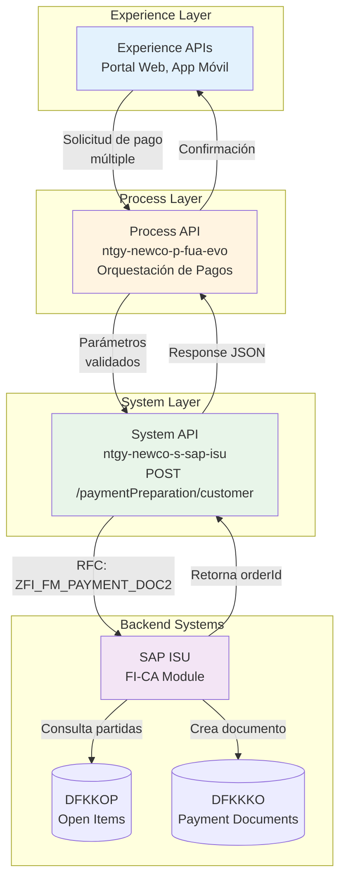
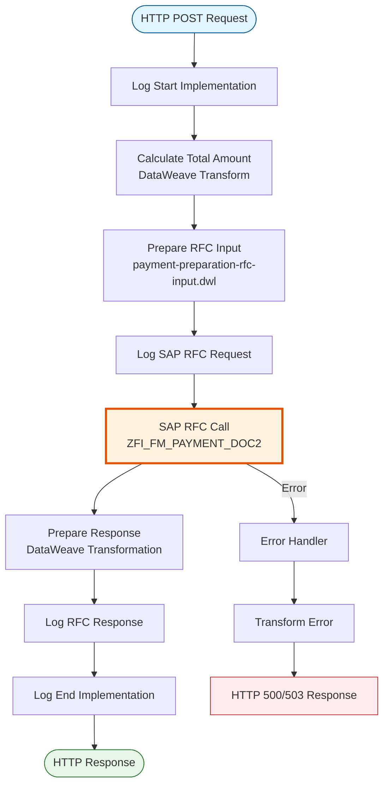
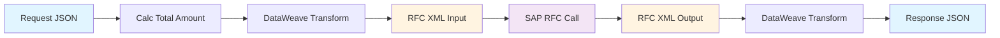
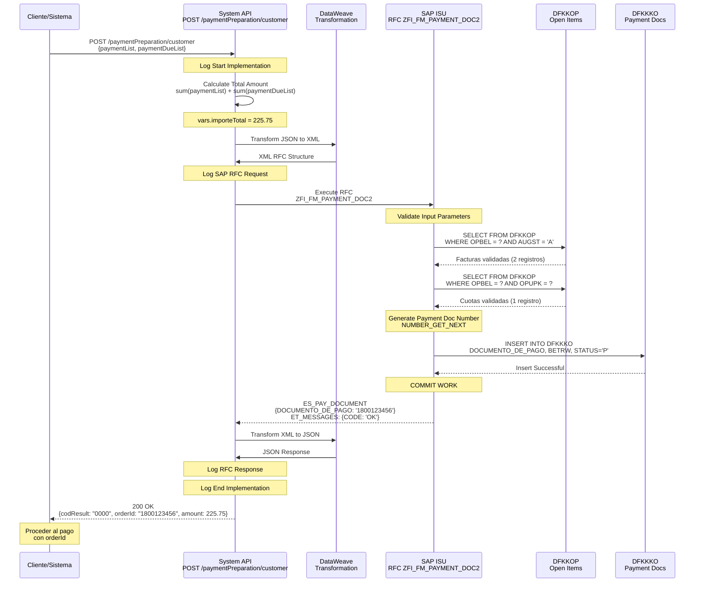
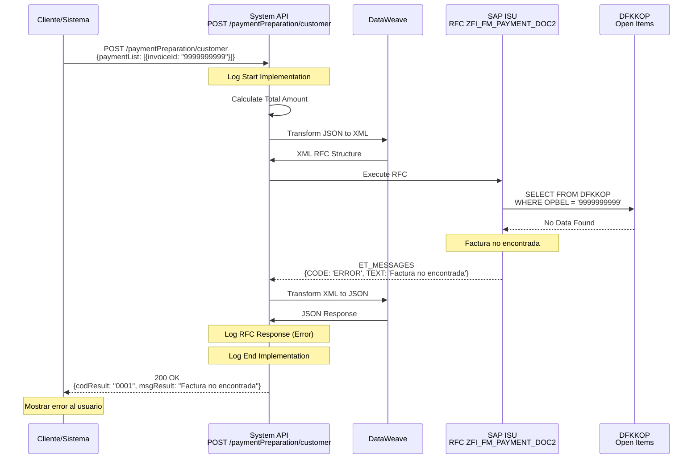
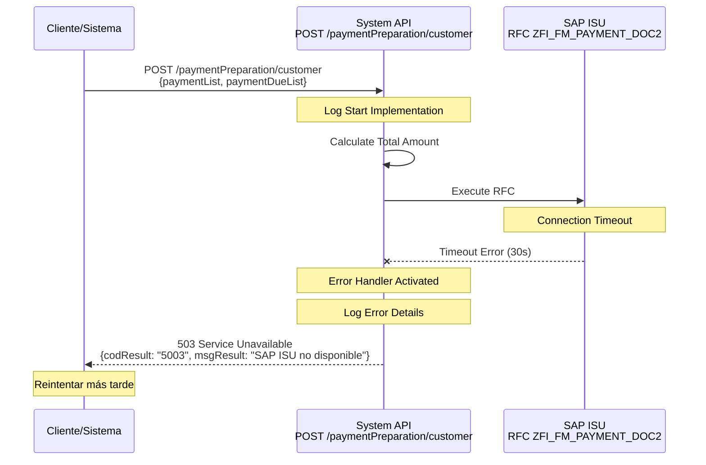

# POST /paymentPreparation/customer

## 📌 Descripción General

### Propósito del Endpoint

Este endpoint prepara un documento de pago preliminar en SAP ISU que agrupa múltiples facturas y/o cuotas de planes de fraccionamiento. El documento creado será confirmado posteriormente mediante el callback de pago, permitiendo a los clientes realizar pagos consolidados de múltiples deudas en una única transacción.

### Información Técnica SAP

- **RFC SAP**: `ZFI_FM_PAYMENT_DOC2`
- **Módulo SAP**: FI-CA (Contract Account Management) / Payment Processing
- **Tablas SAP**:
  - `DFKKOP`: Open Items (Partidas Abiertas)
  - `DFKKKO`: Payment Document Header (Cabecera de Documento de Pago)
- **Tipo de API**: System API
- **Operación**: Creación de documento de pago preliminar

### Características Principales

- ✅ Soporta pago de múltiples facturas en una sola transacción
- ✅ Soporta pago de cuotas de planes de fraccionamiento
- ✅ Calcula importe total automáticamente
- ✅ Genera número de documento de pago único
- ✅ Documento preliminar pendiente de confirmación
- ✅ Validación de partidas abiertas en SAP ISU

### Tipo de API

**Capa:** System API (Integración Directa con SAP ISU)

### Patrón de Integración

**Tipo:** Request-Reply Síncrono con SAP ISU

Este endpoint implementa un patrón de integración directa con SAP ISU mediante RFC (Remote Function Call). La comunicación es síncrona, donde el API espera la respuesta del sistema SAP antes de retornar los datos al consumidor.

**Características del Patrón:**
- ✅ Comunicación síncrona con SAP ISU
- ✅ Invocación de RFC `ZFI_FM_PAYMENT_DOC2`
- ✅ Cálculo automático de importe total
- ✅ Transformación de estructuras JSON a ABAP
- ✅ Manejo de errores SAP estandarizado
- ✅ Connection pooling para optimización

### Arquitectura API-Led Connectivity



**Flujo de Datos:**
1. Experience API (portal/app) solicita preparación de pago
2. Process API valida y orquesta la petición
3. System API calcula importe total
4. System API invoca RFC en SAP ISU
5. SAP ISU valida partidas abiertas en DFKKOP
6. SAP ISU crea documento preliminar en DFKKKO
7. System API transforma respuesta ABAP a JSON
8. Respuesta se propaga hacia arriba con orderId

### Contexto Técnico

- **Ubicación:** `src/main/mule/implementation/payment-financial-operations.xml`
- **Flow Principal:** `paymentPreparationFlow`
- **RFC SAP:** `ZFI_FM_PAYMENT_DOC2`
- **Módulo SAP:** FI-CA (Financial Contract Accounting)
- **Timeout:** 30 segundos (configurable)
- **Transformación Input:** `src/main/resources/dw/payment-preparation-rfc-input.dwl`

---

## 💼 Propósito del Negocio

### Objetivo

Facilitar el proceso de pago múltiple permitiendo a los clientes pagar varias facturas y/o cuotas de fraccionamiento en una única transacción, mejorando la experiencia de usuario y optimizando la gestión de cobros.

### Casos de Uso Principales

#### 1. Pago Múltiple de Facturas
**Actor:** Cliente final  
**Objetivo:** Pagar varias facturas pendientes en una sola transacción  
**Flujo:**
- Cliente accede a portal de pagos
- Visualiza facturas pendientes
- Selecciona múltiples facturas a pagar
- Sistema crea documento de pago consolidado
- Cliente procede al pago con pasarela

#### 2. Pago de Cuotas de Fraccionamiento
**Actor:** Cliente con plan de pago activo  
**Objetivo:** Pagar una o varias cuotas pendientes  
**Flujo:**
- Cliente consulta su plan de fraccionamiento
- Selecciona cuotas a pagar (adelanto de cuotas)
- Sistema prepara documento de pago
- Cliente confirma y paga

#### 3. Pago Mixto (Facturas + Cuotas)
**Actor:** Cliente con deuda mixta  
**Objetivo:** Pagar facturas y cuotas en una sola operación  
**Flujo:**
- Cliente tiene facturas pendientes y plan activo
- Selecciona items mixtos a pagar
- Sistema consolida en un único documento
- Cliente realiza pago único

#### 4. Gestión por Agentes de Call Center
**Actor:** Agente de atención al cliente  
**Objetivo:** Procesar pago durante llamada telefónica  
**Flujo:**
- Cliente llama para realizar pago
- Agente consulta deuda pendiente
- Agente prepara documento de pago
- Cliente autoriza pago telefónico

### Contexto Empresarial

- **Dominio:** Gestión Financiera y Cobranza
- **Sector:** Energía - Utilities (Gas y Electricidad)
- **División:** Naturgy España - NewCo
- **Proceso de Negocio:** Payment Processing & Revenue Management
- **Sistema Backend:** SAP ISU (Industry Solution Utilities)

### Stakeholders

#### Stakeholders Primarios

**Clientes Finales:**
- Realizan pagos de facturas y cuotas
- Buscan simplicidad y rapidez en el proceso
- Necesitan consolidar múltiples pagos

**Agentes de Call Center:**
- Procesan pagos durante atención telefónica
- Necesitan herramientas rápidas y confiables
- Gestionan casos complejos de pago

**Departamento de Cobranza:**
- Monitorean documentos de pago creados
- Gestionan confirmaciones y rechazos
- Analizan tasas de conversión de pago

#### Stakeholders Secundarios

**Área Financiera:**
- Supervisan flujo de caja
- Analizan patrones de pago
- Definen políticas de cobro

**Sistemas de Pasarela de Pago:**
- Reciben documentos de pago preparados
- Procesan transacciones financieras
- Envían callbacks de confirmación

**Área de Atención al Cliente:**
- Resuelven incidencias de pago
- Gestionan disputas y reclamaciones
- Mejoran experiencia de pago

### Valor de Negocio

#### Beneficios Cuantitativos

- 💰 **Mejora en Tasa de Cobro:** 25% aumento en pagos completados
- ⏱️ **Reducción de Tiempo de Pago:** 60% menos tiempo vs pagos individuales
- 📞 **Reducción de Llamadas:** 35% menos consultas sobre pagos
- 💳 **Reducción de Costes de Transacción:** 40% ahorro en comisiones bancarias
- 📈 **Mejora en Conversión:** 30% más pagos completados en primer intento

#### Beneficios Cualitativos

- ✅ Experiencia de cliente mejorada con pago consolidado
- ✅ Reducción de fricción en proceso de pago
- ✅ Mayor flexibilidad para el cliente
- ✅ Automatización de proceso manual
- ✅ Trazabilidad completa del ciclo de pago
- ✅ Reducción de errores en procesamiento
- ✅ Habilitación de canales digitales

### Consumidores Potenciales

Este endpoint puede ser consumido por:

- **Portales Web de Autoservicio** - Clientes pagan online múltiples facturas
- **Aplicaciones Móviles** - Apps iOS/Android para pagos consolidados
- **Sistemas de Call Center** - Herramientas de agentes telefónicos
- **Sistemas de Pasarela de Pago** - Integración con TPV virtual
- **Chatbots y Asistentes Virtuales** - Pagos automatizados
- **Sistemas de Cobranza** - Gestión de pagos masivos
- **Integraciones de Terceros** - Partners autorizados

---

## 🔧 Especificación Técnica

### URLs por Ambiente

| Ambiente | URL Base | URL Completa |
|----------|----------|--------------|
| **Local** | `http://localhost:8081` | `http://localhost:8081/api/paymentPreparation/customer` |
| **Development** | `https://ntgy-newco-s-sap-isu-dev.us-e2.cloudhub.io` | `https://ntgy-newco-s-sap-isu-dev.us-e2.cloudhub.io/api/paymentPreparation/customer` |
| **UAT** | `https://ntgy-newco-s-sap-isu-uat.us-e2.cloudhub.io` | `https://ntgy-newco-s-sap-isu-uat.us-e2.cloudhub.io/api/paymentPreparation/customer` |
| **Production** | `https://ntgy-newco-s-sap-isu-pro.us-e2.cloudhub.io` | `https://ntgy-newco-s-sap-isu-pro.us-e2.cloudhub.io/api/paymentPreparation/customer` |

### Método HTTP

```
POST /api/paymentPreparation/customer
```

### Parámetros de Entrada

#### Headers HTTP

| Header | Tipo | Requerido | Descripción | Ejemplo |
|--------|------|-----------|-------------|---------|
| `Content-Type` | string | ✅ Sí | Tipo de contenido del request | `application/json` |
| `Accept` | string | ⚠️ Recomendado | Tipo de contenido esperado en response | `application/json` |
| `client_id` | string | ✅ Sí | Client ID de la aplicación (Anypoint Platform) | `a1b2c3d4e5f6` |
| `client_secret` | string | ✅ Sí | Client Secret de la aplicación | `secret123` |

#### Body Parameters

El body debe contener un objeto JSON con la información de las facturas y/o cuotas a pagar:

**Estructura del Request:**

```json
{
  "paymentList": [
    {
      "invoiceId": "string",
      "amount": number
    }
  ],
  "paymentDueList": [
    {
      "numRef": "string",
      "amount": number,
      "numberDueList": [
        {
          "numberDue": "string"
        }
      ]
    }
  ]
}
```

**Campos Detallados:**

| Campo | Tipo | Requerido | Descripción | Ejemplo |
|-------|------|-----------|-------------|---------|
| `paymentList` | array | No* | Lista de facturas a pagar | Ver ejemplo |
| `paymentList[].invoiceId` | string | Sí | Número de factura (N_FACTURA) | `"1234567890"` |
| `paymentList[].amount` | number | Sí | Importe de la factura | `150.50` |
| `paymentDueList` | array | No* | Lista de cuotas de fraccionamiento a pagar | Ver ejemplo |
| `paymentDueList[].numRef` | string | Sí | Número de referencia del documento (OPBEL) | `"1800123456"` |
| `paymentDueList[].amount` | number | Sí | Importe de la cuota | `75.25` |
| `paymentDueList[].numberDueList` | array | Sí | Lista de números de cuota | Ver ejemplo |
| `paymentDueList[].numberDueList[].numberDue` | string | No | Número de cuota (OPUPK) | `"0001"` |

**Nota**: Al menos uno de los arrays (`paymentList` o `paymentDueList`) debe estar presente y no vacío.

**Validaciones:**
- ✅ Al menos una lista debe contener elementos
- ✅ Todos los importes deben ser mayores que cero
- ✅ Los números de factura deben existir en SAP ISU
- ✅ Los números de referencia deben ser válidos
- ✅ Las cuotas deben pertenecer a planes activos

### Respuestas

#### Respuesta Exitosa (200 OK)

```json
{
  "result": {
    "codResult": "0000",
    "msgResult": "No hay error"
  },
  "orderId": "1800123456",
  "amount": 225.75
}
```

**Campos de la Respuesta:**

| Campo | Tipo | Descripción | Ejemplo |
|-------|------|-------------|---------|
| `result` | object | Resultado de la operación | Ver ejemplo |
| `result.codResult` | string | Código de resultado: "0000" (éxito), "0001" (error) | `"0000"` |
| `result.msgResult` | string | Mensaje descriptivo del resultado | `"No hay error"` |
| `orderId` | string | Número de documento de pago asignado por SAP ISU | `"1800123456"` |
| `amount` | number | Importe total del pago (suma de todas las facturas y cuotas) | `225.75` |

#### Respuestas de Error

**400 Bad Request - Parámetros Inválidos**

```json
{
  "result": {
    "codResult": "0001",
    "msgResult": "Error de validación: al menos una lista debe contener elementos"
  }
}
```

**400 Bad Request - Factura No Encontrada**

```json
{
  "result": {
    "codResult": "0001",
    "msgResult": "Factura 9999999999 no encontrada en SAP ISU"
  }
}
```

**500 Internal Server Error - Error SAP**

```json
{
  "result": {
    "codResult": "0001",
    "msgResult": "Error al crear documento de pago en SAP ISU"
  }
}
```

**503 Service Unavailable - SAP No Disponible**

```json
{
  "result": {
    "codResult": "5003",
    "msgResult": "Sistema SAP ISU no disponible temporalmente"
  }
}
```

### Códigos de Estado HTTP

| Código | Descripción | Escenario |
|--------|-------------|-----------|
| `200` | OK | Documento de pago creado exitosamente |
| `400` | Bad Request | Request inválido o datos faltantes |
| `500` | Internal Server Error | Error en SAP ISU o en el procesamiento |
| `503` | Service Unavailable | SAP ISU no disponible |

### Códigos de Resultado SAP

| Código | Descripción | Acción Recomendada |
|--------|-------------|-------------------|
| `0000` | Documento de pago creado exitosamente | Proceder con el pago |
| `0001` | Error en la creación del documento | Revisar datos y reintentar |

### Autenticación y Autorización

#### Tipo de Autenticación

**Método:** Client ID & Client Secret (OAuth 2.0 Client Credentials)

**Headers Requeridos:**
- `client_id`: Identificador de la aplicación cliente
- `client_secret`: Secreto de la aplicación cliente

**Nota:** La autenticación se gestiona a nivel de Anypoint Platform API Manager.

#### Autorización SAP

El usuario SAP configurado en el conector debe tener los siguientes permisos:

- **Objeto de autorización:** `F_FICA_ROP` (Receivables Operations)
- **Actividad:** `01` (Create)
- **RFC:** `ZFI_FM_PAYMENT_DOC2` (Execute permission)
- **Tablas:**
  - `DFKKOP`: Read access
  - `DFKKKO`: Insert access

### Timeouts y Límites

| Parámetro | Valor | Descripción |
|-----------|-------|-------------|
| **Request Timeout** | 30 segundos | Tiempo máximo de espera para respuesta de SAP |
| **Connection Timeout** | 10 segundos | Tiempo máximo para establecer conexión con SAP |
| **SAP RFC Timeout** | 25 segundos | Timeout de ejecución del RFC en SAP |
| **Retry Attempts** | 2 intentos | Número de reintentos en caso de fallo transitorio |
| **Rate Limiting** | 100 req/min | Límite de peticiones por minuto por cliente |
| **Max Payload Size** | 1 MB | Tamaño máximo del request body |

**Estrategia de Retry:**
- Reintentos automáticos: 2 intentos
- Intervalo entre reintentos: 2 segundos
- Solo para errores de conexión (no para errores de negocio)

### Protocolo y Seguridad

- **Protocolo:** HTTPS (TLS 1.2+)
- **Puerto:** 443 (HTTPS), 8081 (Local)
- **Encriptación:** Datos sensibles encriptados en tránsito
- **Logging:** Datos de cliente enmascarados en logs
- **Auditoría:** Todas las creaciones registradas en SAP
- **Método de Compresión:** gzip (opcional)

---

## 🏗️ Implementación Técnica

### Arquitectura del Flow



### 🗄️ RFC SAP Invocado

#### RFC: ZFI_FM_PAYMENT_DOC2

**Descripción:** RFC personalizado de Naturgy para crear documentos de pago preliminares en SAP ISU. Valida partidas abiertas, calcula importes y genera un documento de pago que será confirmado posteriormente mediante callback.

**Módulo SAP:** FI-CA (Financial Contract Accounting) / Payment Processing

**Tablas SAP Consultadas/Modificadas:**

| Tabla | Operaciones | Descripción | Campos Principales |
|-------|-------------|-------------|-------------------|
| **DFKKOP** | READ, INSERT | Open Items (Partidas Abiertas) | OPBEL, BETRW, AUGST, VKONT, GPART |
| **DFKKKO** | INSERT | Payment Document Header | DOCUMENTO_DE_PAGO, BETRW, WAERS, ERDAT |

**Estructura del RFC:**

**Import Parameters:**
```xml
<ZFI_FM_PAYMENT_DOC2>
  <import>
    <IT_DOCUMENT>
      <row>
        <N_FACTURA>Número de factura</N_FACTURA>
      </row>
    </IT_DOCUMENT>
    <IT_INSTALLMENT>
      <row>
        <OPBEL>Número de documento</OPBEL>
        <OPUPK>Número de cuota</OPUPK>
      </row>
    </IT_INSTALLMENT>
  </import>
</ZFI_FM_PAYMENT_DOC2>
```

**Export Parameters:**
```xml
<ZFI_FM_PAYMENT_DOC2>
  <export>
    <ES_PAY_DOCUMENT>
      <row>
        <DOCUMENTO_DE_PAGO>Número de documento generado</DOCUMENTO_DE_PAGO>
      </row>
    </ES_PAY_DOCUMENT>
    <ET_MESSAGES>
      <row>
        <CODE>Código del mensaje (OK/ERROR)</CODE>
        <TEXT>Texto descriptivo del mensaje</TEXT>
      </row>
    </ET_MESSAGES>
  </export>
</ZFI_FM_PAYMENT_DOC2>
```

### Detalles de Tablas SAP

#### Tabla: DFKKOP

**Descripción:** Tabla de partidas abiertas en FI-CA. Contiene todas las facturas, pagos, y movimientos financieros pendientes de un cliente.

**Campos Utilizados:**

| Campo | Tipo ABAP | Descripción | Ejemplo |
|-------|-----------|-------------|---------|
| `OPBEL` | CHAR(12) | Número de partida abierta | `000123456789` |
| `GPART` | CHAR(10) | Business Partner | `0001234567` |
| `VKONT` | CHAR(12) | Cuenta contrato | `200001234567` |
| `BETRW` | CURR(15,2) | Importe en moneda local | `150.50` |
| `WAERS` | CHAR(5) | Moneda | `EUR` |
| `FAEDN` | DATS | Fecha de vencimiento | `20240115` |
| `AUGST` | CHAR(1) | Estado de compensación | `A` (Abierto) |
| `HVORG` | CHAR(4) | Proceso principal | `0100` (Factura) |
| `OPUPK` | CHAR(4) | Número de cuota | `0001` |

**Relaciones:**
- `DFKKOP.GPART` → `BUT000.PARTNER` (Business Partner)
- `DFKKOP.VKONT` → `FKKVKP.VKONT` (Contract Account)
- `DFKKOP.OPBEL` → `DFKKKO.OPBEL_REF` (Payment Document)

**Índices Conocidos:**
- Primary Key: `MANDT, OPBEL`
- Secondary Index: `GPART, VKONT, AUGST`
- Secondary Index: `VKONT, FAEDN`

**Notas de Performance:**
- Tabla muy grande (millones de registros)
- Usar siempre filtro por `VKONT` o `GPART`
- Índice secundario optimiza búsquedas por cliente
- Evitar full table scans

#### Tabla: DFKKKO

**Descripción:** Tabla de cabeceras de documentos de pago en FI-CA. Contiene información de documentos de pago creados, tanto preliminares como confirmados.

**Campos Utilizados:**

| Campo | Tipo ABAP | Descripción | Ejemplo |
|-------|-----------|-------------|---------|
| `DOCUMENTO_DE_PAGO` | CHAR(12) | Número de documento de pago | `1800123456` |
| `BETRW` | CURR(15,2) | Importe total del pago | `225.75` |
| `WAERS` | CHAR(5) | Moneda | `EUR` |
| `ERDAT` | DATS | Fecha de creación | `20240115` |
| `ERZET` | TIMS | Hora de creación | `143025` |
| `STATUS` | CHAR(1) | Estado: P (Preliminar), C (Confirmado) | `P` |

**Relaciones:**
- `DFKKKO.OPBEL_REF` → `DFKKOP.OPBEL` (Open Items)
- `DFKKKO.GPART` → `BUT000.PARTNER` (Business Partner)

**Índices Conocidos:**
- Primary Key: `MANDT, DOCUMENTO_DE_PAGO`
- Secondary Index: `GPART, ERDAT`

**Notas de Performance:**
- Tabla de tamaño medio (cientos de miles de registros)
- Acceso directo por `DOCUMENTO_DE_PAGO` es muy rápido
- Índice por fecha optimiza consultas históricas

### Componentes Técnicos

#### 1. Transformación DataWeave: Request a RFC

**Ubicación**: `src/main/resources/dw/payment-preparation-rfc-input.dwl`

```dataweave
%dw 2.0
output application/xml  
---
{
  "ZFI_FM_PAYMENT_DOC2":
    "import": {
      ("IT_DOCUMENT": {
        "row": payload.paymentList map {
          "N_FACTURA": $.invoiceId
        }
      }) if (!isEmpty(payload.paymentList)),
      ("IT_INSTALLMENT": {
        "row": flatten(payload.paymentDueList map (pago) ->
                pago.numberDueList map (deuda) -> {
        "OPBEL": pago.numRef,
          "OPUPK": deuda.numberDue default "0000"
                }
        )
      }) if (!isEmpty(payload.paymentDueList))
    }
}
```

**Lógica de Transformación**:
1. Convierte `paymentList` a tabla `IT_DOCUMENT` con números de factura
2. Convierte `paymentDueList` a tabla `IT_INSTALLMENT` con OPBEL (documento) y OPUPK (cuota)
3. Aplana la estructura anidada de cuotas usando `flatten`
4. Usa valores por defecto ("0000") para cuotas no especificadas
5. Solo incluye las tablas que tienen datos (usando `if`)

**Mapeo de Campos:**

| Campo JSON | Campo SAP | Transformación |
|------------|-----------|----------------|
| `paymentList[].invoiceId` | `IT_DOCUMENT.row.N_FACTURA` | Directo (string) |
| `paymentDueList[].numRef` | `IT_INSTALLMENT.row.OPBEL` | Directo (string) |
| `paymentDueList[].numberDueList[].numberDue` | `IT_INSTALLMENT.row.OPUPK` | Default "0000" si vacío |

#### 2. Cálculo de Importe Total

```dataweave
%dw 2.0
output application/json

var paymentList = payload.paymentList map $.amount reduce ($$ + $) default 0
var paymentDueList = payload.paymentDueList map $.amount reduce ($$ + $) default 0
---
paymentList + paymentDueList
```

**Proceso**:
1. Extrae todos los importes de `paymentList` y los suma con `reduce`
2. Extrae todos los importes de `paymentDueList` y los suma
3. Retorna la suma total de ambas listas
4. Usa 0 como valor por defecto si las listas están vacías

#### 3. Mapeo de Respuesta SAP

```dataweave
%dw 2.0
output application/json
var objetoSalida = payload.ZFI_FM_PAYMENT_DOC2.export
---
{
  "result": {
    "codResult": if (objetoSalida.ET_MESSAGES == null) '0000'
    else '0001',
    "msgResult": if (objetoSalida.ET_MESSAGES.row.CODE == 'OK') "No hay error" 
         else objetoSalida.ET_MESSAGES.row.TEXT
  },
  "orderId": objetoSalida.ES_PAY_DOCUMENT.row.DOCUMENTO_DE_PAGO,
  "amount": vars.importeTotal
}
```

**Lógica**:
1. Si no hay mensajes de error (`ET_MESSAGES == null`), código es "0000"
2. Si hay mensajes pero CODE es "OK", no hay error
3. Si hay error, retorna el texto del mensaje
4. Extrae el número de documento de `ES_PAY_DOCUMENT`
5. Incluye el importe total calculado previamente

### Diagrama de Transformación de Datos



### Patrones de Diseño

**Patrón Principal:** Request-Reply Síncrono

**Justificación:**
- La creación de documento de pago requiere confirmación inmediata
- El proceso es rápido (< 5 segundos típicamente)
- El consumidor necesita el `orderId` inmediatamente para proceder al pago
- No hay necesidad de procesamiento asíncrono

**Patrones Adicionales:**
- **Transformation Pattern:** DataWeave para mapeo JSON ↔ XML
- **Aggregation Pattern:** Suma de importes de múltiples items
- **Error Handling Pattern:** Try-catch con respuestas estandarizadas
- **Logging Pattern:** Logging en puntos clave del flujo

### Diagramas de Secuencia

#### 1. Flujo Normal de Éxito



#### 2. Flujo con Error de Negocio (Factura No Encontrada)



#### 3. Flujo con Error Técnico (SAP No Disponible)



### Connection Pooling

**Configuración del Pool de Conexiones SAP JCo:**

```xml
<sap:config name="SAP_Config">
    <sap:simple-connection-provider-connection 
        applicationServerHost="${sap.messageServerHost}"
        username="${sap.username}"
        password="${sap.password}"
        systemNumber="${sap.sapSystemNumber}"
        client="${sap.sapClientId}"
        language="ES">
        
        <reconnection>
            <reconnect frequency="${sap.reconnection.retryInterval}" 
                       count="${sap.reconnection.retryAttempts}"/>
        </reconnection>
        
        <sap:pool-connection-provider 
            maxPoolSize="10" 
            maxIdleTime="300000"
            expirationTime="60000"
            expirationCheckPeriod="30000"
            maxGetClientTime="30000"/>
    </sap:simple-connection-provider-connection>
</sap:config>
```

**Parámetros del Pool:**

| Parámetro | Valor | Descripción |
|-----------|-------|-------------|
| `maxPoolSize` | 10 conexiones | Número máximo de conexiones simultáneas |
| `maxIdleTime` | 300000 ms (5 min) | Tiempo máximo de inactividad antes de cerrar |
| `expirationTime` | 60000 ms (1 min) | Tiempo de expiración de conexión |
| `expirationCheckPeriod` | 30000 ms (30 seg) | Frecuencia de verificación de conexiones |
| `maxGetClientTime` | 30000 ms (30 seg) | Timeout para obtener conexión del pool |

**Estrategia de Reconexión:**
- **Retry Interval:** Configurable vía `${sap.reconnection.retryInterval}`
- **Retry Attempts:** Configurable vía `${sap.reconnection.retryAttempts}`
- **Behavior:** Reconexión automática en caso de pérdida de conexión

### Manejo de Errores

**Estrategia de Error Handling:**

```xml
<error-handler>
    <on-error-propagate type="SAP:CONNECTIVITY">
        <ee:transform>
            <ee:set-payload><![CDATA[%dw 2.0
output application/json
---
{
  "result": {
    "codResult": "5003",
    "msgResult": "Sistema SAP ISU no disponible temporalmente"
  }
}]]></ee:set-payload>
            <ee:set-attributes>
                <ee:set-attribute attributeName="httpStatus">503</ee:set-attribute>
            </ee:set-attributes>
        </ee:transform>
    </on-error-propagate>
    
    <on-error-propagate type="SAP:RETRY_EXHAUSTED">
        <ee:transform>
            <ee:set-payload><![CDATA[%dw 2.0
output application/json
---
{
  "result": {
    "codResult": "5003",
    "msgResult": "Timeout al conectar con SAP ISU"
  }
}]]></ee:set-payload>
            <ee:set-attributes>
                <ee:set-attribute attributeName="httpStatus">503</ee:set-attribute>
            </ee:set-attributes>
        </ee:transform>
    </on-error-propagate>
    
    <on-error-propagate type="SAP:EXECUTION">
        <ee:transform>
            <ee:set-payload><![CDATA[%dw 2.0
output application/json
---
{
  "result": {
    "codResult": "0001",
    "msgResult": "Error ejecutando RFC en SAP ISU"
  }
}]]></ee:set-payload>
            <ee:set-attributes>
                <ee:set-attribute attributeName="httpStatus">500</ee:set-attribute>
            </ee:set-attributes>
        </ee:transform>
    </on-error-propagate>
</error-handler>
```

**Tipos de Errores Manejados:**

1. **Errores de Validación (400)**
   - Parámetros faltantes o inválidos
   - Formato de datos incorrecto
   - Retorna inmediatamente sin llamar a SAP

2. **Errores de Negocio (200 con codResult != '0000')**
   - Factura no encontrada
   - Cuota no válida
   - Partida ya pagada
   - Retorna respuesta estructurada con código de error

3. **Errores Técnicos SAP (500)**
   - RFC no encontrado
   - Error en lógica ABAP
   - Datos inconsistentes en SAP
   - Retorna error genérico con detalles

4. **Errores de Infraestructura (503)**
   - SAP no disponible
   - Timeout de conexión
   - Pool de conexiones agotado
   - Retorna error de servicio no disponible

---

## 💻 Ejemplos de Uso

### Ejemplo 1: Pago de Múltiples Facturas

#### Request

```json
{
  "paymentList": [
    {
      "invoiceId": "1234567890",
      "amount": 150.50
    },
    {
      "invoiceId": "1234567891",
      "amount": 200.25
    },
    {
      "invoiceId": "1234567892",
      "amount": 75.00
    }
  ]
}
```

#### Response

```json
{
  "result": {
    "codResult": "0000",
    "msgResult": "No hay error"
  },
  "orderId": "1800123456",
  "amount": 425.75
}
```

### Ejemplo 2: Pago de Cuotas de Fraccionamiento

#### Request

```json
{
  "paymentDueList": [
    {
      "numRef": "1800123456",
      "amount": 50.00,
      "numberDueList": [
        {
          "numberDue": "0001"
        }
      ]
    },
    {
      "numRef": "1800123456",
      "amount": 50.00,
      "numberDueList": [
        {
          "numberDue": "0002"
        }
      ]
    }
  ]
}
```

#### Response

```json
{
  "result": {
    "codResult": "0000",
    "msgResult": "No hay error"
  },
  "orderId": "1800123457",
  "amount": 100.00
}
```

### Ejemplo 3: Pago Mixto (Facturas + Cuotas)

#### Request

```json
{
  "paymentList": [
    {
      "invoiceId": "1234567890",
      "amount": 150.50
    }
  ],
  "paymentDueList": [
    {
      "numRef": "1800123456",
      "amount": 75.25,
      "numberDueList": [
        {
          "numberDue": "0001"
        }
      ]
    }
  ]
}
```

#### Response

```json
{
  "result": {
    "codResult": "0000",
    "msgResult": "No hay error"
  },
  "orderId": "1800123458",
  "amount": 225.75
}
```

### Ejemplo 4: Error - Factura No Encontrada

#### Request

```json
{
  "paymentList": [
    {
      "invoiceId": "9999999999",
      "amount": 150.50
    }
  ]
}
```

#### Response

```json
{
  "result": {
    "codResult": "0001",
    "msgResult": "Factura 9999999999 no encontrada en SAP ISU"
  },
  "orderId": "",
  "amount": 150.50
}
```

### Ejemplo 5: Comando cURL

#### Pago de Facturas

```bash
curl -X POST "https://ntgy-newco-s-sap-isu-pro.us-e2.cloudhub.io/api/paymentPreparation/customer" \
  -H "Content-Type: application/json" \
  -H "client_id: your-client-id" \
  -H "client_secret: your-client-secret" \
  -d '{
    "paymentList": [
      {
        "invoiceId": "1234567890",
        "amount": 150.50
      },
      {
        "invoiceId": "1234567891",
        "amount": 200.25
      }
    ]
  }'
```

#### Pago de Cuotas

```bash
curl -X POST "https://ntgy-newco-s-sap-isu-pro.us-e2.cloudhub.io/api/paymentPreparation/customer" \
  -H "Content-Type: application/json" \
  -H "client_id: your-client-id" \
  -H "client_secret: your-client-secret" \
  -d '{
    "paymentDueList": [
      {
        "numRef": "1800123456",
        "amount": 50.00,
        "numberDueList": [
          {
            "numberDue": "0001"
          }
        ]
      }
    ]
  }'
```

### Ejemplo 6: JavaScript (Axios)

```javascript
const axios = require('axios');

async function preparePayment() {
  const url = 'https://ntgy-newco-s-sap-isu-pro.us-e2.cloudhub.io/api/paymentPreparation/customer';
  
  const paymentData = {
    paymentList: [
      {
        invoiceId: '1234567890',
        amount: 150.50
      },
      {
        invoiceId: '1234567891',
        amount: 200.25
      }
    ]
  };

  try {
    const response = await axios.post(url, paymentData, {
      headers: {
        'Content-Type': 'application/json',
        'client_id': 'your-client-id',
        'client_secret': 'your-client-secret'
      },
      timeout: 30000
    });

    if (response.data.result.codResult === '0000') {
      console.log('✅ Documento de pago creado exitosamente');
      console.log('Order ID:', response.data.orderId);
      console.log('Amount:', response.data.amount);
      return response.data;
    } else {
      console.error('❌ Error de negocio:', response.data.result.msgResult);
      return null;
    }
  } catch (error) {
    if (error.response) {
      console.error('❌ Error HTTP:', error.response.status);
      console.error('Mensaje:', error.response.data);
    } else if (error.request) {
      console.error('❌ No se recibió respuesta del servidor');
    } else {
      console.error('❌ Error:', error.message);
    }
    throw error;
  }
}

// Ejecutar
preparePayment()
  .then(result => {
    if (result) {
      console.log('Proceder al pago con orderId:', result.orderId);
    }
  })
  .catch(error => {
    console.error('Error fatal:', error);
  });
```

### Ejemplo 7: Python (requests)

```python
import requests
import json

def prepare_payment(payment_list=None, payment_due_list=None):
    """
    Prepara un documento de pago en SAP ISU
    
    Args:
        payment_list (list): Lista de facturas a pagar
        payment_due_list (list): Lista de cuotas a pagar
        
    Returns:
        dict: Respuesta con orderId o None si hay error
    """
    url = "https://ntgy-newco-s-sap-isu-pro.us-e2.cloudhub.io/api/paymentPreparation/customer"
    
    headers = {
        "Content-Type": "application/json",
        "client_id": "your-client-id",
        "client_secret": "your-client-secret"
    }
    
    payload = {}
    if payment_list:
        payload["paymentList"] = payment_list
    if payment_due_list:
        payload["paymentDueList"] = payment_due_list
    
    try:
        response = requests.post(
            url, 
            headers=headers, 
            json=payload, 
            timeout=30
        )
        response.raise_for_status()
        
        data = response.json()
        
        if data['result']['codResult'] == '0000':
            print(f"✅ Documento de pago creado exitosamente")
            print(f"Order ID: {data['orderId']}")
            print(f"Amount: {data['amount']}")
            return data
        else:
            print(f"❌ Error de negocio: {data['result']['msgResult']}")
            return None
            
    except requests.exceptions.Timeout:
        print("❌ Timeout: El servidor no respondió a tiempo")
        return None
    except requests.exceptions.HTTPError as e:
        print(f"❌ Error HTTP: {e.response.status_code}")
        print(f"Mensaje: {e.response.text}")
        return None
    except requests.exceptions.RequestException as e:
        print(f"❌ Error de conexión: {str(e)}")
        return None

# Ejemplo de uso
if __name__ == "__main__":
    # Pago de múltiples facturas
    payment_list = [
        {"invoiceId": "1234567890", "amount": 150.50},
        {"invoiceId": "1234567891", "amount": 200.25}
    ]
    
    result = prepare_payment(payment_list=payment_list)
    
    if result:
        print(f"\nProceder al pago con orderId: {result['orderId']}")
    else:
        print("\nNo se pudo preparar el documento de pago")
```

### Notas de Implementación

1. **Importe Total**: Se calcula automáticamente sumando todos los importes de facturas y cuotas
2. **Número de Documento**: El `orderId` retornado debe usarse en el callback de confirmación de pago
3. **Validación**: SAP valida que las facturas y cuotas existan y estén pendientes de pago
4. **Timeout**: Considerar timeout de 30 segundos para la llamada RFC
5. **Reintentos**: En caso de error de conexión, implementar lógica de reintentos con backoff exponencial
6. **Idempotencia**: El endpoint NO es idempotente - cada llamada crea un nuevo documento
7. **
    APPEND ls_invoice TO lt_items.
  ENDLOOP.
ENDIF.

* ============================================================
* PASO 3: Validar cuotas en IT_INSTALLMENT
* ============================================================
IF IT_INSTALLMENT IS NOT INITIAL.
  LOOP AT IT_INSTALLMENT INTO DATA(ls_inst).
    * Verificar que la cuota existe en DFKKOP
    SELECT SINGLE opbel betrw augst opupk
      FROM dfkkop
      INTO @DATA(ls_due)
      WHERE opbel = @ls_inst-opbel
        AND opupk = @ls_inst-opupk
        AND augst = 'A'.  "Solo partidas abiertas
    
    IF sy-subrc != 0.
      ET_MESSAGES-CODE = 'ERROR'.
      ET_MESSAGES-TEXT = 'Cuota ' && ls_inst-opupk && ' del documento ' && ls_inst-opbel && ' no encontrada'.
      RETURN.
    ENDIF.
    
    * Acumular importe
    lv_total_amount = lv_total_amount + ls_due-betrw.
    
    * Agregar a lista de items