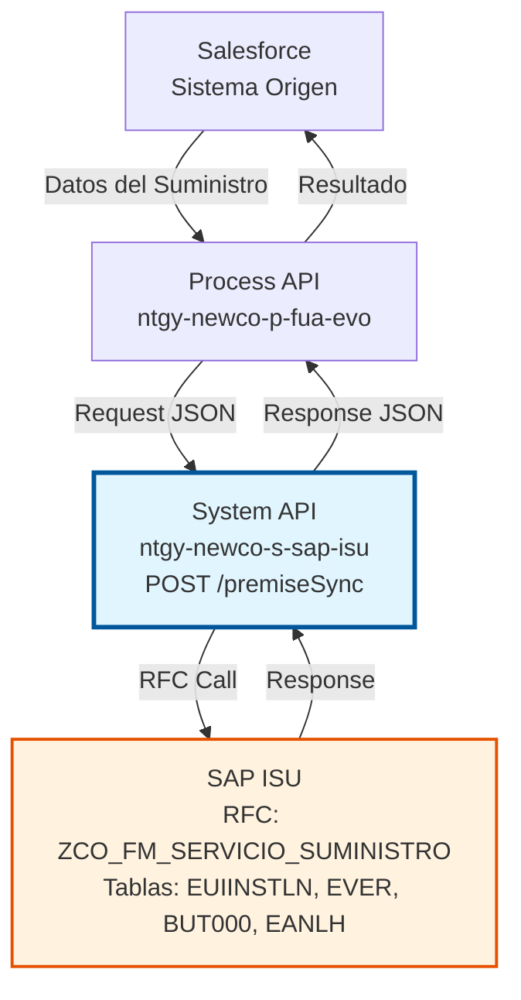
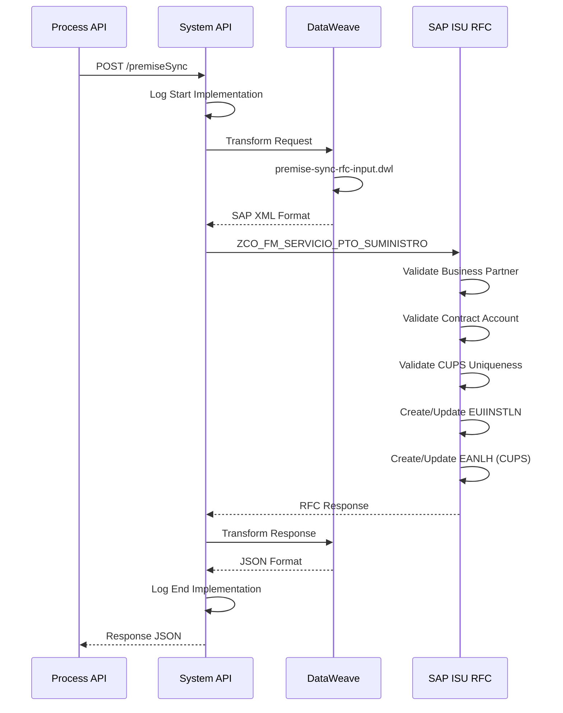
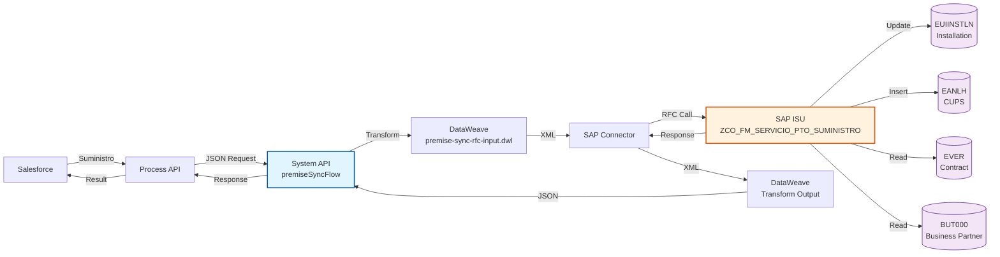
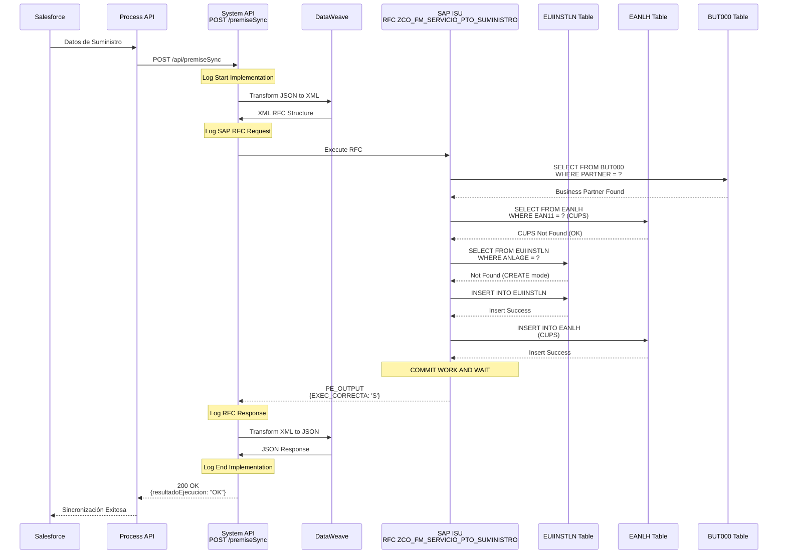
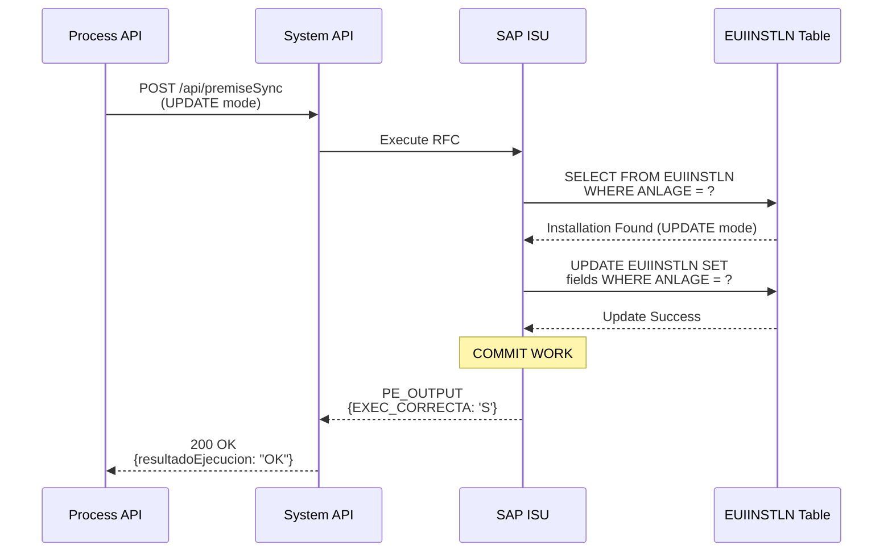
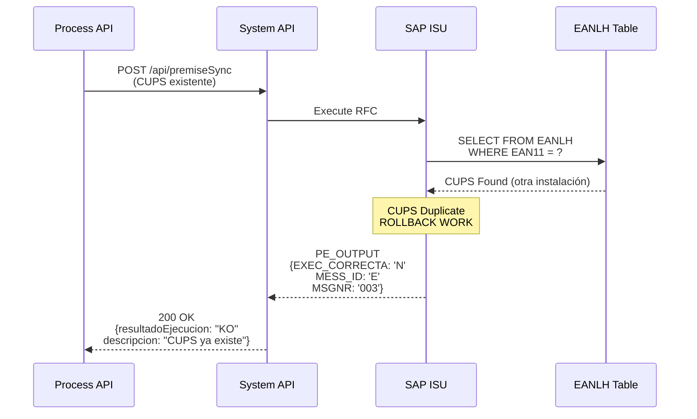
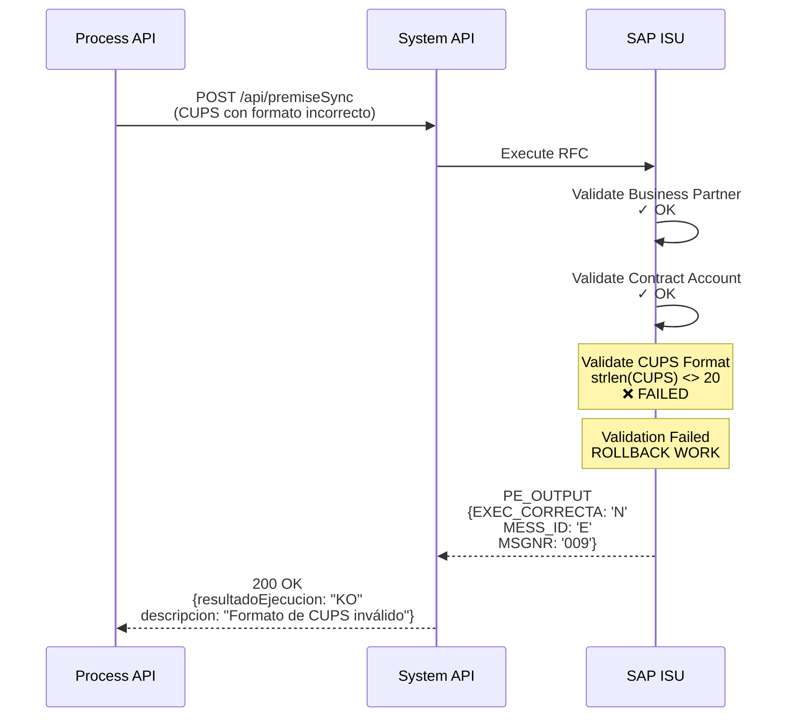

# POST /premiseSync

## 📌 Descripción General

### Propósito del Endpoint

Este endpoint sincroniza información de suministros (premise/installation) desde Salesforce hacia SAP ISU. Los suministros representan los puntos físicos donde se entrega energía (electricidad o gas) a los clientes, identificados por su CUPS (Código Universal del Punto de Suministro).

El endpoint soporta la sincronización de:
- **Datos del suministro**: Número de instalación (ANLAGE), CUPS, división de negocio
- **Información técnica**: Tarifa, potencia contratada, tipo de suministro
- **Asociación con contrato**: Vinculación con Business Partner y cuenta contrato
- **Fechas de vigencia**: Inicio y fin del suministro
- **Estados del suministro**: ACTIVO, INACTIVO, BAJA
- **Dirección del punto de suministro**: Ubicación física completa
- **Gestión de bajas**: Motivos de desconexión y fechas

### Tipo de API

**Capa:** System API (API-Led Connectivity)

**Función:** Integración directa con SAP ISU para sincronización de datos maestros de instalaciones y puntos de suministro.

### Patrón de Integración

**Tipo:** Request-Reply Síncrono con SAP RFC

**Descripción:** El endpoint recibe los datos del suministro desde Salesforce, determina la división de negocio (Electricidad o Gas), valida el CUPS, transforma al formato SAP ISU, invoca el RFC `ZCO_FM_SERVICIO_SUMINISTRO` y retorna el resultado de la sincronización.

### Arquitectura API-Led Connectivity



---

## 💼 Propósito del Negocio

### Casos de Uso Principales

1. **Alta de Nuevo Suministro**
   - Cuando se contrata un nuevo punto de suministro en Salesforce
   - Crea la instalación en SAP ISU con todos sus datos técnicos
   - Asigna número de instalación (ANLAGE)
   - Registra CUPS y asocia al Business Partner y contrato

2. **Actualización de Datos de Suministro Existente**
   - Cuando se modifican datos técnicos del suministro en Salesforce
   - Actualiza tarifa, potencia contratada, dirección
   - Mantiene la consistencia entre ambos sistemas
   - Actualiza fechas de vigencia

3. **Gestión de Bajas de Suministro**
   - Procesa desconexiones de puntos de suministro
   - Registra motivos de baja (cambio de titular, impago, etc.)
   - Actualiza fechas de fin de suministro
   - Mantiene histórico de suministros

4. **Sincronización por División de Negocio**
   - Aplica configuraciones específicas para suministros de Electricidad
   - Aplica configuraciones específicas para suministros de Gas
   - Gestiona tarifas y potencias diferenciadas

5. **Gestión de CUPS**
   - Valida unicidad del CUPS en el sistema
   - Asocia CUPS con instalación en SAP ISU
   - Mantiene trazabilidad de puntos de suministro

### Stakeholders

- **Departamento Comercial**: Alta y gestión de nuevos suministros
- **Atención al Cliente**: Consulta y modificación de datos de suministro
- **Operaciones**: Gestión técnica de instalaciones
- **Facturación**: Base para generación de facturas por suministro
- **Administración SAP ISU**: Mantenimiento de datos maestros de instalaciones

### Valor de Negocio

- **Automatización**: Elimina sincronización manual de suministros
- **Consistencia**: Datos únicos entre Salesforce y SAP ISU
- **Trazabilidad**: Registro completo de cambios en suministros
- **Eficiencia**: Reducción de errores en datos técnicos
- **Compliance**: Gestión correcta de CUPS según normativa

---

## 🔧 Especificación Técnica

### Endpoint

```
POST /api/premiseSync
```

### Headers

| Header | Valor | Requerido | Descripción |
|--------|-------|-----------|-------------|
| `Content-Type` | `application/json` | Sí | Formato del body |
| `Accept` | `application/json` | Sí | Formato de respuesta |

### Request Body

```json
{
  "modoEjecucion": "CREATE",
  "partner": "0001234567",
  "vkont": "200001234567",
  "detalleObjeto": {
    "codigo": "3000123456",
    "ptoSuministro": "ES0021000000000001AA",
    "divisionNegocio": "Electricidad",
    "fechaInicio": "2024-01-15",
    "fechaFin": null,
    "estado": "ACTIVO",
    "tarifa": "2.0TD",
    "potencia": 4.6,
    "direccion": {
      "calle": "Calle Mayor",
      "numero": "123",
      "codigoPostal": "28001",
      "ciudad": "Madrid",
      "provincia": "Madrid"
    }
  }
}
```

#### Parámetros del Request

| Campo | Tipo | Requerido | Descripción | Ejemplo |
|-------|------|-----------|-------------|---------|
| `modoEjecucion` | string | No | Modo de ejecución (CREATE/UPDATE) | "CREATE" |
| `partner` | string | No | Número de Business Partner | "0001234567" |
| `vkont` | string | Sí | Número de cuenta contrato | "200001234567" |
| `detalleObjeto` | object | Sí | Detalle del suministro | - |
| `detalleObjeto.codigo` | string | Sí | Número de instalación (ANLAGE) | "3000123456" |
| `detalleObjeto.ptoSuministro` | string | Sí | CUPS del punto de suministro | "ES0021000000000001AA" |
| `detalleObjeto.divisionNegocio` | string | Sí | División (Electricidad/Gas) | "Electricidad" |
| `detalleObjeto.fechaInicio` | string | Sí | Fecha inicio (YYYY-MM-DD) | "2024-01-15" |
| `detalleObjeto.fechaFin` | string | No | Fecha fin (YYYY-MM-DD) | "2025-12-31" |
| `detalleObjeto.estado` | string | Sí | Estado del suministro | "ACTIVO" |
| `detalleObjeto.motivoBaja` | string | No | Motivo de baja | "CAMBIO_TITULAR" |
| `detalleObjeto.tarifa` | string | No | Tarifa aplicable | "2.0TD" |
| `detalleObjeto.potencia` | number | No | Potencia contratada (kW) | 4.6 |
| `detalleObjeto.direccion` | object | No | Dirección del suministro | - |

### Response

#### Response Exitoso (200 OK)

```json
{
  "suministro": "3000123456",
  "ptoSuministro": "ES0021000000000001AA",
  "partner": "0001234567",
  "numCtaContrato": "200001234567",
  "resultadoEjecucion": "OK",
  "idMensaje": "00",
  "numMensaje": "000",
  "descripcion": "Suministro sincronizado correctamente",
  "areaFuncional": "ISU",
  "categoriaError": null
}
```

#### Response con Error (400 Bad Request)

```json
{
  "suministro": null,
  "ptoSuministro": "ES0021000000000001AA",
  "partner": "0001234567",
  "numCtaContrato": "200001234567",
  "resultadoEjecucion": "KO",
  "idMensaje": "E001",
  "numMensaje": "001",
  "descripcion": "CUPS ya existe en SAP ISU",
  "areaFuncional": "ISU",
  "categoriaError": "E"
}
```

#### Códigos de Estado HTTP

| Código | Descripción | Cuándo se usa |
|--------|-------------|---------------|
| 200 | OK | Sincronización exitosa |
| 400 | Bad Request | Datos inválidos, CUPS duplicado |
| 500 | Internal Server Error | Error en SAP ISU o sistema |

---

## 🏗️ Implementación Técnica

### RFC SAP

**Nombre:** `ZCO_FM_SERVICIO_SUMINISTRO`

**Módulo:** ISU (Industry Solution Utilities)

**Descripción:** Function module personalizado para sincronización de instalaciones y puntos de suministro desde sistemas externos hacia SAP ISU.

### Tablas SAP Involucradas

| Tabla | Operaciones | Descripción | Campos Principales |
|-------|-------------|-------------|-------------------|
| `EUIINSTLN` | READ, INSERT, UPDATE | Installation Master Data - Datos maestros de instalaciones | ANLAGE, VSTELLE, AB, BIS, SPARTE, HAUS |
| `EVER` | READ | Contract Master Data - Datos del contrato asociado | VERTRAG, VKONT, ANLAGE |
| `BUT000` | READ | Business Partner Master Data - Datos del Business Partner | PARTNER, PARTNER_GUID |
| `EANLH` | READ, INSERT | Connection Object - Objeto de conexión (CUPS) | ANLAGE, VSTELLE, EAN11 |

### Flow de MuleSoft

**Nombre del Flow:** `premiseSyncFlow`

**Ubicación:** `src/main/mule/implementation/customer-data-management-operations.xml`



### Transformación DataWeave (Input)

**Archivo:** `premise-sync-rfc-input.dwl`

**Propósito:** Transforma el request JSON al formato XML requerido por el RFC SAP.

**Transformaciones Clave:**
- Mapeo de división de negocio a código SAP (01=Electricidad, 02=Gas)
- Conversión de fechas a formato SAP (YYYYMMDD)
- Construcción de estructura OBJ_CONEXION con dirección completa
- Construcción de estructura PUNTO_SUMIN con datos del suministro
- Preparación de CUPS (EXT_UI)

### Transformación DataWeave (Output)

**Ubicación:** Inline en el flow XML

**Propósito:** Transforma la respuesta del RFC SAP a formato JSON estándar.

**Transformaciones Clave:**
- Extracción de resultado de ejecución (OK/KO)
- Mapeo de mensajes de error SAP
- Construcción de response JSON con datos del suministro creado/actualizado

### Diagrama de Arquitectura



### Diagramas de Secuencia Detallados

#### 1. Flujo Normal de Éxito - Crear Suministro



#### 2. Flujo Normal de Éxito - Actualizar Suministro



#### 3. Flujo con Error - CUPS Duplicado



#### 4. Flujo con Error - Formato CUPS Inválido



### Manejo de Errores

**Estrategia:** Error handling global con transformación de errores SAP a formato estándar.

**Tipos de Errores:**
- **Validación**: Business Partner no existe, cuenta contrato inválida, CUPS duplicado
- **Datos**: División de negocio inválida, fechas inconsistentes, formato CUPS inválido
- **SAP**: RFC no disponible, timeout, errores de conexión
- **Sistema**: Errores de transformación DataWeave

---

## 💻 Ejemplos de Uso

### Ejemplo 1: Crear Suministro de Electricidad

**Request:**

```bash
curl -X POST "https://api.naturgy.com/s-sap-isu/api/premiseSync" \
  -H "Content-Type: application/json" \
  -H "Accept: application/json" \
  -d '{
    "modoEjecucion": "CREATE",
    "partner": "0001234567",
    "vkont": "200001234567",
    "detalleObjeto": {
      "codigo": "3000123456",
      "ptoSuministro": "ES0021000000000001AA",
      "divisionNegocio": "Electricidad",
      "fechaInicio": "2024-01-15",
      "estado": "ACTIVO",
      "tarifa": "2.0TD",
      "potencia": 4.6,
      "direccion": {
        "calle": "Calle Mayor",
        "numero": "123",
        "codigoPostal": "28001",
        "ciudad": "Madrid",
        "provincia": "Madrid"
      }
    }
  }'
```

**Response:**

```json
{
  "suministro": "3000123456",
  "ptoSuministro": "ES0021000000000001AA",
  "partner": "0001234567",
  "numCtaContrato": "200001234567",
  "resultadoEjecucion": "OK",
  "idMensaje": "00",
  "numMensaje": "000",
  "descripcion": "Suministro de Electricidad creado correctamente",
  "areaFuncional": "ISU",
  "categoriaError": null
}
```

### Ejemplo 2: Actualizar Suministro de Gas

**Request:**

```json
{
  "modoEjecucion": "UPDATE",
  "partner": "0001234568",
  "vkont": "200001234568",
  "detalleObjeto": {
    "codigo": "3000123457",
    "ptoSuministro": "ES0021000000000002BB",
    "divisionNegocio": "Gas",
    "fechaInicio": "2024-02-01",
    "fechaFin": "2026-01-31",
    "estado": "ACTIVO",
    "tarifa": "RL.1",
    "potencia": 3.3
  }
}
```

**Response:**

```json
{
  "suministro": "3000123457",
  "ptoSuministro": "ES0021000000000002BB",
  "partner": "0001234568",
  "numCtaContrato": "200001234568",
  "resultadoEjecucion": "OK",
  "idMensaje": "00",
  "numMensaje": "000",
  "descripcion": "Suministro de Gas actualizado correctamente",
  "areaFuncional": "ISU",
  "categoriaError": null
}
```

### Ejemplo 3: Dar de Baja Suministro

**Request:**

```json
{
  "modoEjecucion": "UPDATE",
  "partner": "0001234569",
  "vkont": "200001234569",
  "detalleObjeto": {
    "codigo": "3000123458",
    "ptoSuministro": "ES0021000000000003CC",
    "divisionNegocio": "Electricidad",
    "fechaInicio": "2023-01-01",
    "fechaFin": "2024-06-30",
    "estado": "BAJA",
    "motivoBaja": "CAMBIO_TITULAR"
  }
}
```

**Response:**

```json
{
  "suministro": "3000123458",
  "ptoSuministro": "ES0021000000000003CC",
  "partner": "0001234569",
  "numCtaContrato": "200001234569",
  "resultadoEjecucion": "OK",
  "idMensaje": "00",
  "numMensaje": "000",
  "descripcion": "Suministro dado de baja correctamente",
  "areaFuncional": "ISU",
  "categoriaError": null
}
```

### Ejemplo 4: Error - CUPS Duplicado

**Request:**

```json
{
  "modoEjecucion": "CREATE",
  "partner": "0001234570",
  "vkont": "200001234570",
  "detalleObjeto": {
    "codigo": "3000123459",
    "ptoSuministro": "ES0021000000000001AA",
    "divisionNegocio": "Electricidad",
    "fechaInicio": "2024-01-01",
    "estado": "ACTIVO"
  }
}
```

**Response:**

```json
{
  "suministro": null,
  "ptoSuministro": "ES0021000000000001AA",
  "partner": "0001234570",
  "numCtaContrato": "200001234570",
  "resultadoEjecucion": "KO",
  "idMensaje": "E003",
  "numMensaje": "003",
  "descripcion": "CUPS ES0021000000000001AA ya existe asociado a otra instalación",
  "areaFuncional": "ISU",
  "categoriaError": "E"
}
```
