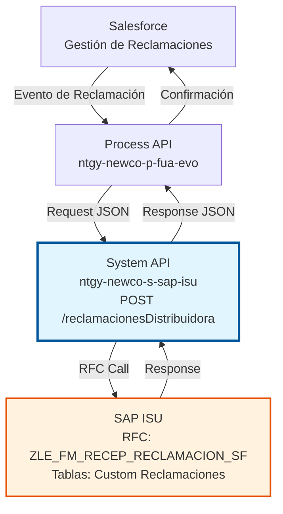
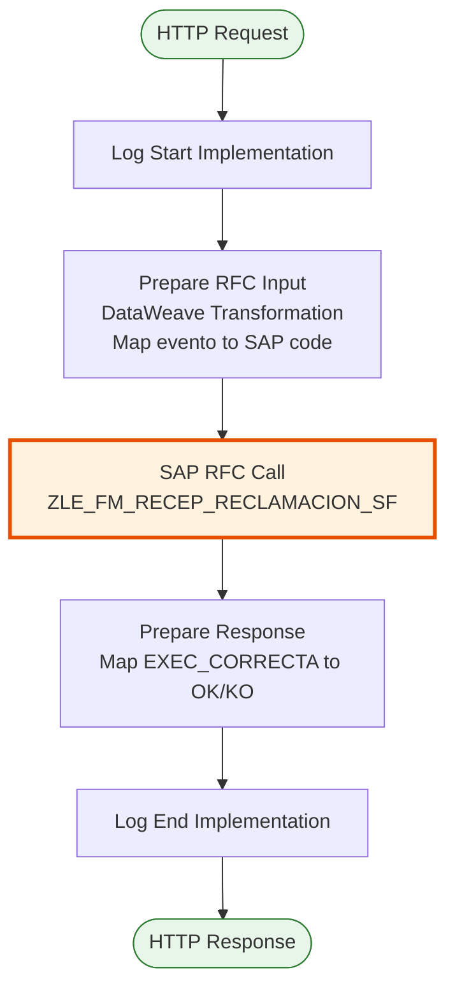
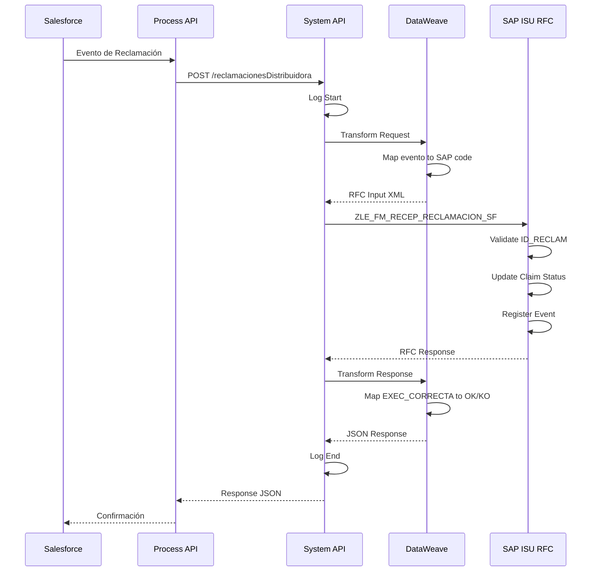
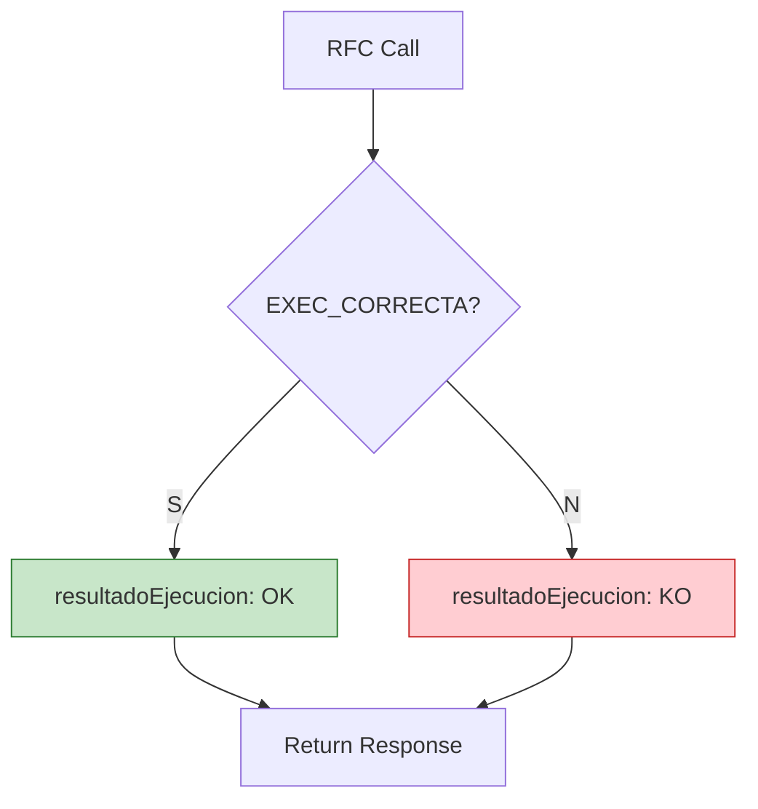

# POST /reclamacionesDistribuidora

## 📌 Descripción General

### Propósito del Endpoint

Este endpoint registra eventos de cambio de estado de reclamaciones de distribuidora desde Salesforce hacia SAP ISU. Permite mantener sincronizado el ciclo de vida completo de las reclamaciones gestionadas con distribuidoras eléctricas o de gas, asegurando trazabilidad y coherencia entre ambos sistemas.

El endpoint soporta:
- **Registro de Eventos**: Captura todos los cambios de estado de reclamaciones
- **Múltiples Tipos de Evento**: Soporta 6 tipos diferentes de eventos del ciclo de vida
- **Sincronización Bidireccional**: Mantiene coherencia entre Salesforce y SAP ISU
- **Trazabilidad Completa**: Registra motivos, códigos de resultado y comentarios
- **Gestión de Rechazos**: Captura razones de rechazo y solicitudes de información

### Tipo de API

**Capa:** System API (API-Led Connectivity)

**Función:** Integración directa con SAP ISU para sincronización de eventos de reclamaciones de distribuidora desde Salesforce.

### Patrón de Integración

**Tipo:** Request-Reply Síncrono con SAP RFC

**Descripción:** Recibe eventos de cambio de estado de reclamaciones desde Salesforce, mapea el tipo de evento a códigos SAP, transforma los datos al formato RFC, invoca el RFC ZLE_FM_RECEP_RECLAMACION_SF para actualizar el estado en SAP ISU y retorna confirmación del registro.

### Arquitectura API-Led Connectivity



---

## 💼 Propósito del Negocio

### Casos de Uso Principales

1. **Registro de Inicio de Reclamación**
   - Cliente reporta incidencia con distribuidora (lectura incorrecta, corte indebido, etc.)
   - Salesforce crea caso de reclamación y notifica a SAP ISU
   - SAP ISU registra el inicio del proceso de reclamación
   - **Beneficio**: Trazabilidad desde el primer momento

2. **Actualización de Estado por Distribuidora**
   - Distribuidora acepta, rechaza o solicita información adicional
   - Salesforce recibe respuesta y actualiza estado
   - SAP ISU sincroniza el nuevo estado de la reclamación
   - **Beneficio**: Visibilidad en tiempo real del estado de reclamaciones

3. **Gestión de Rechazos**
   - Distribuidora rechaza reclamación con motivo específico
   - Sistema registra código y descripción del rechazo
   - SAP ISU actualiza estado y permite análisis de rechazos
   - **Beneficio**: Mejora continua en gestión de reclamaciones

### Contexto Empresarial

- **Dominio:** Gestión de Consumo y Lecturas
- **Sector:** Energía - Utilities
- **División:** Naturgy España - NewCo
- **Proceso de Negocio:** Gestión de Reclamaciones con Distribuidoras
- **Módulo SAP:** EL-MD (Meter Data Management) / Reclamaciones

### Stakeholders

- **Atención al Cliente**: Necesita visibilidad del estado de reclamaciones para informar a clientes
- **Gestión de Distribuidoras**: Requiere trazabilidad de todas las interacciones con distribuidoras
- **Operaciones de Lectura**: Necesita conocer reclamaciones relacionadas con lecturas incorrectas
- **Calidad y Mejora Continua**: Analiza motivos de rechazo para mejorar procesos

### Valor de Negocio

- **Trazabilidad Completa**: Registro histórico de todos los eventos de reclamaciones
- **Mejora en Atención al Cliente**: Información actualizada sobre estado de reclamaciones
- **Reducción de Tiempos**: Sincronización automática elimina procesos manuales
- **Análisis de Calidad**: Datos estructurados para análisis de rechazos y mejoras
- **Cumplimiento Normativo**: Registro de todas las interacciones con distribuidoras

### Consumidores Potenciales

Este endpoint puede ser consumido por:
- Process APIs de gestión de reclamaciones
- Flujos de Salesforce (Platform Events, Flows)
- Sistemas de integración con distribuidoras
- Portales de atención al cliente

---

## 🔧 Especificación Técnica

### URLs por Ambiente

| Ambiente | URL Base | URL Completa |
|----------|----------|--------------|
| **Local** | `http://localhost:8081` | `http://localhost:8081/api/reclamacionesDistribuidora` |
| **Development** | `https://ntgy-newco-s-sap-isu-dev.us-e2.cloudhub.io` | `https://ntgy-newco-s-sap-isu-dev.us-e2.cloudhub.io/api/reclamacionesDistribuidora` |
| **UAT** | `https://ntgy-newco-s-sap-isu-uat.us-e2.cloudhub.io` | `https://ntgy-newco-s-sap-isu-uat.us-e2.cloudhub.io/api/reclamacionesDistribuidora` |
| **Production** | `https://ntgy-newco-s-sap-isu-pro.us-e2.cloudhub.io` | `https://ntgy-newco-s-sap-isu-pro.us-e2.cloudhub.io/api/reclamacionesDistribuidora` |

### Método HTTP

```
POST /api/reclamacionesDistribuidora
```

### Parámetros de Entrada

#### Headers HTTP

| Header | Tipo | Requerido | Descripción | Ejemplo |
|--------|------|-----------|-------------|---------|
| `Content-Type` | string | ✅ Sí | Tipo de contenido del request | `application/json` |
| `Accept` | string | ❌ No | Tipo de contenido esperado en response | `application/json` |

#### Body Parameters

| Campo | Tipo | Requerido | Descripción | Ejemplo |
|-------|------|-----------|-------------|---------|
| `idSap` | string | ✅ Sí | Identificador de la reclamación en SAP ISU | `"1234567890"` |
| `evento` | string | ✅ Sí | Tipo de evento (ver tabla de eventos) | `"AvisoReclamacionSAPIniciado"` |
| `codRes` | string | ❌ No | Código de resultado de la operación | `"0000"` |
| `detRes` | string | ❌ No | Detalle del resultado de la operación | `"Operación exitosa"` |
| `reason` | string | ✅ Sí | Código de motivo de rechazo o cambio | `"01"` |
| `descError` | string | ✅ Sí | Descripción del error o motivo | `"Documentación incompleta"` |
| `comentarios` | string | ❌ No | Comentarios adicionales | `"Cliente solicita revisión"` |
| `scCode` | string | ✅ Sí | Código de solicitud asociado | `"SC-2024-001234"` |

#### Tipos de Evento

| Evento | Código SAP | Descripción |
|--------|------------|-------------|
| `AvisoReclamacionSAPNoGenerado` | 01NG | Reclamación no pudo ser generada en SAP |
| `AvisoReclamacionSAPIniciado` | 01CR | Reclamación iniciada/creada |
| `AvisoReclamacionSAPAceptado` | 01AC | Reclamación aceptada por distribuidora |
| `AvisoReclamacionSAPRechazado` | 01RE | Reclamación rechazada por distribuidora |
| `AvisoReclamacionSAPInfoSolicitada` | 01IA | Información adicional solicitada |
| `AvisoReclamacionSAPActivado` | 01AV | Reclamación activada/reactivada |

### Respuestas

#### Respuesta Exitosa (200 OK)

```json
{
  "resultadoEjecucion": "OK",
  "idMensaje": "000",
  "numMensaje": "001",
  "errorSAP": "ZLE",
  "descripcion": "Evento de reclamación registrado correctamente"
}
```

#### Respuesta de Error de Negocio (200 OK con resultadoEjecucion = "KO")

```json
{
  "resultadoEjecucion": "KO",
  "idMensaje": "E001",
  "numMensaje": "002",
  "errorSAP": "ZLE",
  "descripcion": "Reclamación no encontrada en SAP ISU"
}
```

#### Respuesta de Error Técnico (400/500)

```json
{
  "result": {
    "codResult": "0001",
    "msgResult": "Error interno del servidor"
  }
}
```

### Autenticación y Autorización

- **Tipo:** Client ID & Client Secret (Anypoint Platform)
- **Autorización SAP:** El usuario debe tener permisos para:
  - Ejecutar RFC `ZLE_FM_RECEP_RECLAMACION_SF`
  - Acceso a tablas custom de reclamaciones
  - Permisos de escritura en módulo EL-MD

### Timeouts

| Tipo | Valor | Descripción |
|------|-------|-------------|
| **Request Timeout** | 30 segundos | Tiempo máximo de espera para la respuesta |
| **Connection Timeout** | 10 segundos | Tiempo máximo para establecer conexión con SAP |

---

## 🏗️ Implementación Técnica

### Arquitectura del Flow



### Componentes del Flow

#### 1. Log Start Implementation
```xml
<module-logger:log 
    config-ref="Logger_Mule_Extension_Config" 
    level="DEBUG" 
    message="Start implementation flow for reclamaciones distribuidora" />
```

#### 2. Prepare RFC Input (DataWeave)

**Archivo:** `src/main/resources/dw/reclamaciones-distribuidora-rfc-input.dwl`

```dataweave
%dw 2.0
output application/xml
var event = if ( payload.evento == "AvisoReclamacionSAPNoGenerado" ) "01NG"
		else if ( payload.evento == "AvisoReclamacionSAPIniciado" ) "01CR"
		else if ( payload.evento == "AvisoReclamacionSAPAceptado" ) "01AC"
		else if ( payload.evento == "AvisoReclamacionSAPRechazado" ) "01RE"
		else if ( payload.evento == "AvisoReclamacionSAPInfoSolicitada" ) "01IA"
		else if ( payload.evento == "AvisoReclamacionSAPActivado" ) "01AV"
		else ""
---
{
	ZLE_FM_RECEP_RECLAMACION_SF: {
		"import": {
			"ID_RECLAM": payload.idSap,
			"CODI_RESULT": payload.codRes default null,
			"DETALLE_RESULT": payload.detRes default null,
			"EVENT": event,
			"CODI_RECH": payload.reason,
			"DETALLE_RECH": payload.descError,
			"COMENTARIOS": payload.comentarios default null,
			"CODIGO_SOLI": payload.scCode
		}
	}
}
```

**Mapeo de Campos:**

| Campo JSON | Campo RFC | Descripción |
|------------|-----------|-------------|
| `idSap` | `ID_RECLAM` | ID de reclamación en SAP |
| `codRes` | `CODI_RESULT` | Código de resultado |
| `detRes` | `DETALLE_RESULT` | Detalle del resultado |
| `evento` | `EVENT` | Código de evento (01NG, 01CR, etc.) |
| `reason` | `CODI_RECH` | Código de motivo |
| `descError` | `DETALLE_RECH` | Descripción del motivo |
| `comentarios` | `COMENTARIOS` | Comentarios adicionales |
| `scCode` | `CODIGO_SOLI` | Código de solicitud |

#### 3. SAP RFC Call

```xml
<sap:synchronous-remote-function-call 
    key="ZLE_FM_RECEP_RECLAMACION_SF" 
    config-ref="SAP_Config" />
```

**RFC:** `ZLE_FM_RECEP_RECLAMACION_SF`

**Parámetros de Entrada:**
- `ID_RECLAM`: Identificador de reclamación
- `CODI_RESULT`: Código de resultado
- `DETALLE_RESULT`: Detalle del resultado
- `EVENT`: Código de evento (01NG, 01CR, 01AC, 01RE, 01IA, 01AV)
- `CODI_RECH`: Código de rechazo/motivo
- `DETALLE_RECH`: Descripción del rechazo
- `COMENTARIOS`: Comentarios adicionales
- `CODIGO_SOLI`: Código de solicitud

**Parámetros de Salida:**
- `EXEC_CORRECTA`: Indicador de ejecución correcta (S/N)
- `E_CODIGO`: Código de mensaje
- `MSGNR`: Número de mensaje
- `ARBGB`: Área funcional SAP
- `E_MESSAGE`: Mensaje descriptivo

**Operaciones en SAP ISU:**

El RFC `ZLE_FM_RECEP_RECLAMACION_SF` ejecuta las siguientes operaciones en SAP ISU:

| Operación | Tablas Involucradas | Tipo | Descripción |
|-----------|---------------------|------|-------------|
| **Validación** | Tablas custom de reclamaciones | READ | Verifica que la reclamación con `ID_RECLAM` existe en el sistema |
| **Actualización Estado** | Tablas custom de reclamaciones | UPDATE | Actualiza el estado de la reclamación según el código de evento recibido |
| **Registro Histórico** | Tablas de histórico de eventos | INSERT | Inserta un nuevo registro con el evento, fecha, motivo y comentarios |
| **Log de Auditoría** | Tablas de log/auditoría | INSERT | Registra la operación para trazabilidad y auditoría |

**Proceso Interno del RFC:**
1. Valida que `ID_RECLAM` corresponde a una reclamación existente
2. Verifica que el código de evento (`EVENT`) es válido
3. Actualiza el estado de la reclamación según el evento:
   - `01NG` → Estado: No Generado
   - `01CR` → Estado: Iniciado/Creado
   - `01AC` → Estado: Aceptado
   - `01RE` → Estado: Rechazado
   - `01IA` → Estado: Info Solicitada
   - `01AV` → Estado: Activado
4. Registra el evento en el histórico con timestamp, motivo y comentarios
5. Actualiza campos de auditoría (usuario, fecha modificación)
6. Retorna resultado de la operación (`EXEC_CORRECTA`, códigos y mensajes)

> **Nota:** Las tablas específicas son custom tables desarrolladas para la gestión de reclamaciones con distribuidoras. Para detalles técnicos completos del RFC, consultar la documentación ABAP en el sistema SAP ISU.

#### 4. Prepare Response (DataWeave Inline)

```dataweave
%dw 2.0
output application/json

var out = payload.ZLE_FM_RECEP_RECLAMACION_SF.export
---
{
	resultadoEjecucion: if (out.EXEC_CORRECTA == 'S') "OK" else "KO",
	idMensaje: out.E_CODIGO,
	numMensaje: out.MSGNR,
	errorSAP: out.ARBGB,
	descripcion: out.E_MESSAGE
}
```

### Diagrama de Secuencia Completo



### Manejo de Errores



**Códigos de Error Comunes:**

| Código | Descripción | Acción Recomendada |
|--------|-------------|-------------------|
| `E001` | Reclamación no encontrada | Verificar idSap |
| `E002` | Evento inválido | Verificar tipo de evento |
| `E003` | Código de solicitud inválido | Verificar scCode |
| `E004` | Error de actualización | Reintentar operación |

---

## 💻 Ejemplos de Uso

### Ejemplo 1: Registro de Inicio de Reclamación

#### Request

```bash
curl -X POST "https://ntgy-newco-s-sap-isu-dev.us-e2.cloudhub.io/api/reclamacionesDistribuidora" \
  -H "Content-Type: application/json" \
  -H "client_id: your-client-id" \
  -H "client_secret: your-client-secret" \
  -d '{
    "idSap": "1234567890",
    "evento": "AvisoReclamacionSAPIniciado",
    "codRes": "0000",
    "detRes": "Reclamación creada correctamente",
    "reason": "01",
    "descError": "Lectura incorrecta reportada por cliente",
    "comentarios": "Cliente reporta consumo anormalmente alto",
    "scCode": "SC-2024-001234"
  }'
```

#### Response (200 OK)

```json
{
  "resultadoEjecucion": "OK",
  "idMensaje": "000",
  "numMensaje": "001",
  "errorSAP": "ZLE",
  "descripcion": "Evento de reclamación registrado correctamente"
}
```

### Ejemplo 2: Registro de Reclamación Aceptada

#### Request

```bash
curl -X POST "https://ntgy-newco-s-sap-isu-dev.us-e2.cloudhub.io/api/reclamacionesDistribuidora" \
  -H "Content-Type: application/json" \
  -H "client_id: your-client-id" \
  -H "client_secret: your-client-secret" \
  -d '{
    "idSap": "1234567890",
    "evento": "AvisoReclamacionSAPAceptado",
    "codRes": "0000",
    "detRes": "Distribuidora acepta reclamación",
    "reason": "02",
    "descError": "Lectura corregida por distribuidora",
    "comentarios": "Nueva lectura: 12345 kWh",
    "scCode": "SC-2024-001234"
  }'
```

#### Response (200 OK)

```json
{
  "resultadoEjecucion": "OK",
  "idMensaje": "000",
  "numMensaje": "002",
  "errorSAP": "ZLE",
  "descripcion": "Estado de reclamación actualizado a ACEPTADO"
}
```

### Ejemplo 3: Registro de Reclamación Rechazada

#### Request

```bash
curl -X POST "https://ntgy-newco-s-sap-isu-dev.us-e2.cloudhub.io/api/reclamacionesDistribuidora" \
  -H "Content-Type: application/json" \
  -H "client_id: your-client-id" \
  -H "client_secret: your-client-secret" \
  -d '{
    "idSap": "1234567890",
    "evento": "AvisoReclamacionSAPRechazado",
    "codRes": "0001",
    "detRes": "Reclamación rechazada por distribuidora",
    "reason": "03",
    "descError": "Documentación incompleta - falta fotografía del contador",
    "comentarios": "Distribuidora solicita evidencia fotográfica",
    "scCode": "SC-2024-001234"
  }'
```

#### Response (200 OK)

```json
{
  "resultadoEjecucion": "OK",
  "idMensaje": "000",
  "numMensaje": "003",
  "errorSAP": "ZLE",
  "descripcion": "Estado de reclamación actualizado a RECHAZADO"
}
```

### Ejemplo 4: Error - Reclamación No Encontrada

#### Request

```bash
curl -X POST "https://ntgy-newco-s-sap-isu-dev.us-e2.cloudhub.io/api/reclamacionesDistribuidora" \
  -H "Content-Type: application/json" \
  -H "client_id: your-client-id" \
  -H "client_secret: your-client-secret" \
  -d '{
    "idSap": "9999999999",
    "evento": "AvisoReclamacionSAPIniciado",
    "reason": "01",
    "descError": "Reclamación iniciada",
    "scCode": "SC-2024-999999"
  }'
```

#### Response (200 OK - Error de Negocio)

```json
{
  "resultadoEjecucion": "KO",
  "idMensaje": "E001",
  "numMensaje": "001",
  "errorSAP": "ZLE",
  "descripcion": "Reclamación con ID 9999999999 no encontrada en SAP ISU"
}
```

### Ejemplo 5: Solicitud de Información Adicional

#### Request

```json
{
  "idSap": "1234567890",
  "evento": "AvisoReclamacionSAPInfoSolicitada",
  "codRes": "0002",
  "detRes": "Información adicional requerida",
  "reason": "04",
  "descError": "Distribuidora solicita histórico de consumos",
  "comentarios": "Requiere consumos de últimos 12 meses",
  "scCode": "SC-2024-001234"
}
```

#### Response

```json
{
  "resultadoEjecucion": "OK",
  "idMensaje": "000",
  "numMensaje": "004",
  "errorSAP": "ZLE",
  "descripcion": "Solicitud de información registrada correctamente"
}
```

### Ejemplo 6: Código JavaScript/TypeScript

```typescript
interface ReclamacionEvent {
  idSap: string;
  evento: 'AvisoReclamacionSAPNoGenerado' | 'AvisoReclamacionSAPIniciado' | 
          'AvisoReclamacionSAPAceptado' | 'AvisoReclamacionSAPRechazado' |
          'AvisoReclamacionSAPInfoSolicitada' | 'AvisoReclamacionSAPActivado';
  codRes?: string;
  detRes?: string;
  reason: string;
  descError: string;
  comentarios?: string;
  scCode: string;
}

async function registrarEventoReclamacion(event: ReclamacionEvent): Promise<any> {
  const response = await fetch(
    'https://ntgy-newco-s-sap-isu-dev.us-e2.cloudhub.io/api/reclamacionesDistribuidora',
    {
      method: 'POST',
      headers: {
        'Content-Type': 'application/json',
        'client_id': process.env.CLIENT_ID,
        'client_secret': process.env.CLIENT_SECRET
      },
      body: JSON.stringify(event)
    }
  );
  
  if (!response.ok) {
    throw new Error(`HTTP error! status: ${response.status}`);
  }
  
  return await response.json();
}

//