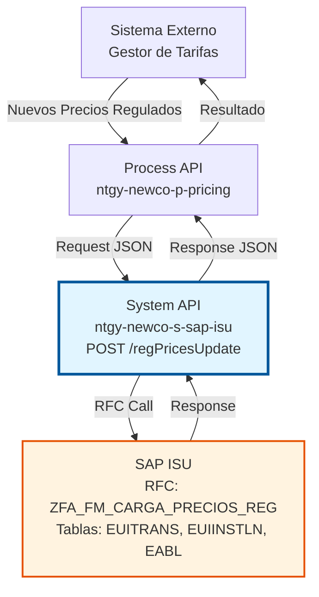
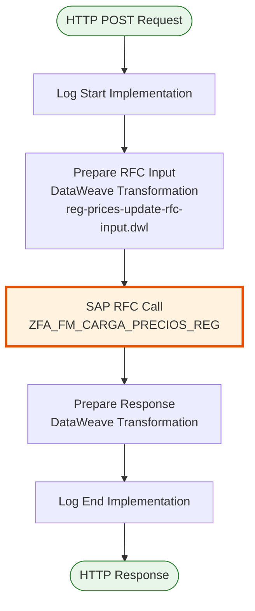
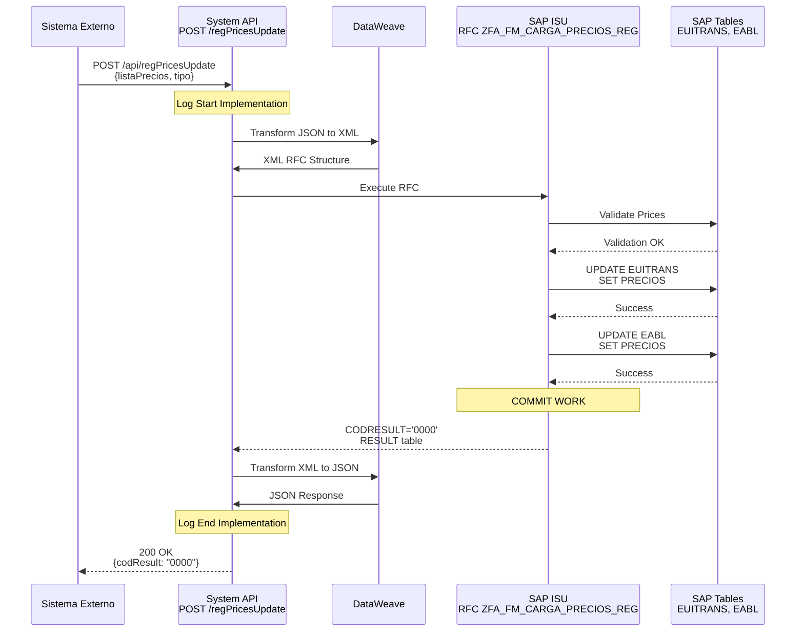

# POST /regPricesUpdate

## 📌 Descripción General

### Propósito del Endpoint

Este endpoint permite la actualización masiva de precios regulados en SAP ISU para contratos de energía (electricidad y gas). Está diseñado para aplicar cambios tarifarios según la normativa del sector energético español, incluyendo actualizaciones de PVPC (Precio Voluntario para el Pequeño Consumidor) para electricidad y TUR (Tarifa de Último Recurso) para gas.

El endpoint soporta:
- **Actualización masiva**: Procesa múltiples precios en una sola operación
- **Tarifas reguladas**: PVPC para electricidad, TUR para gas
- **Períodos tarifarios**: Soporte para discriminación horaria
- **Validación automática**: Verifica vigencia y validez de precios
- **Fecha de vigencia**: Aplica precios según fecha de inicio
- **Trazabilidad**: Registro completo de actualizaciones realizadas

### Tipo de API

**Capa:** System API (API-Led Connectivity)

**Función:** Integración directa con SAP ISU para actualización de precios regulados en contratos de energía.

### Patrón de Integración

**Tipo:** Request-Reply Síncrono con SAP RFC

**Descripción:** El endpoint recibe una lista de precios regulados, valida la información, transforma al formato SAP, invoca el RFC `ZFA_FM_CARGA_PRECIOS_REG` para actualizar los precios en las tablas de facturación, y retorna el resultado de la actualización con detalles por cada precio procesado.

### Arquitectura API-Led Connectivity



---

## 💼 Propósito del Negocio

### Casos de Uso Principales

1. **Actualización de PVPC (Precio Voluntario para el Pequeño Consumidor)**
   - Aplicación de nuevos precios horarios de electricidad según BOE
   - Actualización diaria/mensual de tarifas reguladas eléctricas
   - Soporte para discriminación horaria (2.0TD, 3.0TD)
   - Cumplimiento normativa CNMC

2. **Actualización de TUR (Tarifa de Último Recurso) para Gas**
   - Aplicación de nuevos precios de gas regulado
   - Actualización trimestral según normativa
   - Soporte para diferentes niveles de consumo
   - Cumplimiento normativa sector gasista

3. **Cambios Tarifarios Masivos**
   - Aplicación de cambios regulatorios a múltiples contratos
   - Actualización por cambios en peajes de acceso
   - Modificación de términos fijos de potencia
   - Ajustes por cambios en impuestos energéticos

### Contexto Empresarial

- **Dominio:** Gestión de Precios y Tarifas (Pricing Management)
- **Sector:** Energía - Utilities
- **División:** Naturgy España - NewCo
- **Proceso de Negocio:** Actualización de precios regulados según normativa del sector energético
- **Módulo SAP:** FI-CA (Financial Contract Accounting) / ISU (Industry Solution Utilities)

### Stakeholders

- **Departamento de Pricing:** Define y aplica nuevos precios regulados
- **Departamento Regulatorio:** Asegura cumplimiento normativa CNMC
- **Departamento de Facturación:** Requiere precios actualizados para facturación correcta
- **Departamento Comercial:** Necesita información actualizada de tarifas
- **Atención al Cliente:** Informa a clientes sobre cambios tarifarios

### Valor de Negocio

- **Cumplimiento Normativo:** Asegura aplicación correcta de tarifas reguladas según BOE
- **Automatización:** Elimina actualización manual de precios en SAP ISU
- **Reducción de Errores:** Minimiza errores en facturación por precios incorrectos
- **Eficiencia Operativa:** Actualización masiva de miles de precios en minutos
- **Trazabilidad:** Registro completo de actualizaciones de precios
- **Tiempo Real:** Aplicación inmediata de nuevos precios regulados

### Consumidores Potenciales

Este endpoint puede ser consumido por:
- Process APIs de gestión de precios y tarifas
- Sistemas de gestión tarifaria (Pricing Management Systems)
- Plataformas de integración middleware
- Aplicaciones de gestión regulatoria

---

## 🔧 Especificación Técnica

### URLs por Ambiente

| Ambiente | URL Base | URL Completa |
|----------|----------|--------------|
| **Local** | `http://localhost:8081` | `http://localhost:8081/api/regPricesUpdate` |
| **Development** | `https://ntgy-newco-s-sap-isu-dev.us-e2.cloudhub.io` | `https://ntgy-newco-s-sap-isu-dev.us-e2.cloudhub.io/api/regPricesUpdate` |
| **UAT** | `https://ntgy-newco-s-sap-isu-uat.us-e2.cloudhub.io` | `https://ntgy-newco-s-sap-isu-uat.us-e2.cloudhub.io/api/regPricesUpdate` |
| **Production** | `https://ntgy-newco-s-sap-isu-pro.us-e2.cloudhub.io` | `https://ntgy-newco-s-sap-isu-pro.us-e2.cloudhub.io/api/regPricesUpdate` |

### Método HTTP

```
POST /api/regPricesUpdate
```

### Parámetros de Entrada

#### Headers HTTP

| Header | Tipo | Requerido | Descripción | Ejemplo |
|--------|------|-----------|-------------|---------|
| `Content-Type` | string | ✅ Sí | Tipo de contenido del request | `application/json` |
| `Accept` | string | ❌ No | Tipo de contenido esperado en response | `application/json` |

#### Body Parameters

El body debe contener un objeto JSON con la lista de precios regulados:

**Estructura Principal:**

| Campo | Tipo | Requerido | Descripción |
|-------|------|-----------|-------------|
| `listaPrecios` | array | ✅ Sí | Lista de precios regulados a actualizar |
| `tipo` | string | ✅ Sí | Tipo de precio (REG para regulado) |

**Objeto `listaPrecios` (Array Items):**

| Campo | Tipo | Requerido | Descripción | Ejemplo |
|-------|------|-----------|-------------|---------|
| `codigo` | string | ✅ Sí | Código del precio | `"PVPC_P1_2024"` |
| `fechaIni` | string | ✅ Sí | Fecha de inicio de vigencia (dd.MM.yyyy) | `"01.01.2024"` |
| `fechaFin` | string | ✅ Sí | Fecha de fin de vigencia (dd.MM.yyyy) | `"31.12.2024"` |
| `importe` | number | ✅ Sí | Importe del precio en €/kWh | `0.15` |
| `fechaClave` | string | ❌ No | Fecha clave para el precio (dd.MM.yyyy) | `"01.01.2024"` |

### Respuestas

#### Respuesta Exitosa (200 OK)

```json
{
  "codResult": "0000",
  "msgResult": [
    {
      "id": "1",
      "mensaje": "Precio PVPC_P1_2024 actualizado correctamente"
    },
    {
      "id": "2",
      "mensaje": "Precio TUR_GAS_2024 actualizado correctamente"
    }
  ]
}
```

**Estructura de la Respuesta:**

| Campo | Tipo | Descripción |
|-------|------|-------------|
| `codResult` | string | Código de resultado: "0000" (éxito) o "0001" (error) |
| `msgResult` | array | Lista de mensajes con resultado por precio |
| `msgResult[].id` | string | ID del mensaje o índice del precio |
| `msgResult[].mensaje` | string | Mensaje descriptivo del resultado |

#### Respuesta con Errores Parciales (200 OK con codResult = "0001")

```json
{
  "codResult": "0001",
  "msgResult": [
    {
      "id": "1",
      "mensaje": "Precio PVPC_P1_2024 actualizado correctamente"
    },
    {
      "id": "2",
      "mensaje": "Error: Código de precio TUR_GAS_2024 inválido"
    }
  ]
}
```

#### Respuesta de Error Técnico (400/500)

```json
{
  "result": {
    "codResult": "0001",
    "msgResult": "Error interno del servidor"
  }
}
```

### Códigos de Resultado

| Código | Tipo | Descripción |
|--------|------|-------------|
| `0000` | Éxito | Todos los precios actualizados exitosamente |
| `0001` | Error | Error en uno o más precios (ver mensajes individuales) |

### Autenticación y Autorización

- **Tipo:** Client ID & Client Secret (Anypoint Platform)
- **Autorización SAP:** El usuario SAP debe tener permisos para:
  - Ejecutar RFC `ZFA_FM_CARGA_PRECIOS_REG`
  - Acceso a tablas EUITRANS, EUIINSTLN, EABL
  - Autorización para modificar precios de contratos

### Timeouts

| Tipo | Valor | Descripción |
|------|-------|-------------|
| **Request Timeout** | 60 segundos | Tiempo máximo de espera (operación masiva) |
| **Connection Timeout** | 10 segundos | Tiempo máximo para establecer conexión con SAP |

---

## 🏗️ Implementación Técnica

### Arquitectura del Flow



### 🗄️ RFC SAP Invocado

#### RFC: ZFA_FM_CARGA_PRECIOS_REG

**Descripción:** RFC personalizado de Naturgy para actualización masiva de precios regulados en contratos de energía.

**Módulo SAP:** FI-CA (Financial Contract Accounting) / ISU (Industry Solution Utilities)

**Tablas SAP Consultadas/Modificadas:**

| Tabla | Operaciones | Descripción | Campos Principales |
|-------|-------------|-------------|-------------------|
| **EUITRANS** | READ, UPDATE | Installation Transaction | CODIGO, FECHA_INI, FECHA_FIN, IMPORTE |
| **EUIINSTLN** | READ | Installation Master Data | ANLAGE, VSTELLE, SPARTE |
| **EABL** | READ, UPDATE | Billing Document | VERTRAG, ADATSOLL, PREIS |

### Transformaciones DataWeave

#### Transformación de Input (Request → RFC)

**Archivo:** `src/main/resources/dw/reg-prices-update-rfc-input.dwl`

```dataweave
%dw 2.0
output application/xml
import formatDate from modules::commonUtils
---
{
	"ZFA_FM_CARGA_PRECIOS_REG": {
		"import": {
			"PRECIOS": {
				"row": payload.listaPrecios map {
					"COD_PRECIO": $.codigo,
                    "FEC_INI": formatDate($.fechaIni as Date {format: "dd.MM.yyyy"}) default "",
                    "FEC_FIN": formatDate($.fechaFin as Date {format: "dd.MM.yyyy"}) default "",
                    "IMPORTE": $.importe,
                    "FEC_CLA": formatDate($.fechaClave as Date {format: "dd.MM.yyyy"}) default ""
				}
			},
			"TIPO": payload.tipo
		}
	}
}
```

**Mapeo de Campos:**
- `listaPrecios` → `PRECIOS.row` (array de precios)
- `codigo` → `COD_PRECIO` (código del precio)
- `fechaIni` → `FEC_INI` (fecha inicio con formato)
- `fechaFin` → `FEC_FIN` (fecha fin con formato)
- `importe` → `IMPORTE` (importe del precio)
- `fechaClave` → `FEC_CLA` (fecha clave opcional)
- `tipo` → `TIPO` (tipo de precio: REG)

#### Transformación de Output (RFC → Response)

```dataweave
%dw 2.0
output application/json
---
{
    "codResult": payload.ZFA_FM_CARGA_PRECIOS_REG.export.CODRESULT,
    "msgResult": payload.ZFA_FM_CARGA_PRECIOS_REG.tables.RESULT.*row map
        {
            "id": $.@id,
            "mensaje": $.MENSAJE
        }
}
```

### Patrones de Diseño

**Patrón Principal:** Request-Reply Síncrono con Procesamiento Masivo

**Justificación:**
- La actualización de precios requiere confirmación inmediata
- El proceso es masivo pero debe ser atómico
- El consumidor necesita saber el resultado de cada precio
- Soporta procesamiento de múltiples precios en una sola llamada

### Diagramas de Secuencia

#### Flujo Normal de Éxito



---

## 💻 Ejemplos de Uso

### Ejemplo 1: Actualización de Precios PVPC (Éxito)

#### cURL

```bash
curl -X POST "https://ntgy-newco-s-sap-isu-dev.us-e2.cloudhub.io/api/regPricesUpdate" \
  -H "Content-Type: application/json" \
  -H "client_id: YOUR_CLIENT_ID" \
  -H "client_secret: YOUR_CLIENT_SECRET" \
  -d '{
    "tipo": "REG",
    "listaPrecios": [
      {
        "codigo": "PVPC_P1_2024",
        "fechaIni": "01.01.2024",
        "fechaFin": "31.12.2024",
        "importe": 0.15,
        "fechaClave": "01.01.2024"
      },
      {
        "codigo": "PVPC_P2_2024",
        "fechaIni": "01.01.2024",
        "fechaFin": "31.12.2024",
        "importe": 0.12,
        "fechaClave": "01.01.2024"
      },
      {
        "codigo": "PVPC_P3_2024",
        "fechaIni": "01.01.2024",
        "fechaFin": "31.12.2024",
        "importe": 0.08,
        "fechaClave": "01.01.2024"
      }
    ]
  }'
```

#### Respuesta (200 OK)

```json
{
  "codResult": "0000",
  "msgResult": [
    {
      "id": "1",
      "mensaje": "Precio PVPC_P1_2024 actualizado correctamente"
    },
    {
      "id": "2",
      "mensaje": "Precio PVPC_P2_2024 actualizado correctamente"
    },
    {
      "id": "3",
      "mensaje": "Precio PVPC_P3_2024 actualizado correctamente"
    }
  ]
}
```

---

### Ejemplo 2: Actualización de Precios TUR Gas (Éxito)

#### cURL

```bash
curl -X POST "https://ntgy-newco-s-sap-isu-dev.us-e2.cloudhub.io/api/regPricesUpdate" \
  -H "Content-Type: application/json" \
  -H "client_id: YOUR_CLIENT_ID" \
  -H "client_secret: YOUR_CLIENT_SECRET" \
  -d '{
    "tipo": "REG",
    "listaPrecios": [
      {
        "codigo": "TUR_GAS_Q1_2024",
        "fechaIni": "01.01.2024",
        "fechaFin": "31.03.2024",
        "importe": 0.05,
        "fechaClave": "01.01.2024"
      }
    ]
  }'
```

#### Respuesta (200 OK)

```json
{
  "codResult": "0000",
  "msgResult": [
    {
      "id": "1",
      "mensaje": "Precio TUR_GAS_Q1_2024 actualizado correctamente"
    }
  ]
}
```

---

### Ejemplo 3: Error - Código de Precio Inválido

#### cURL

```bash
curl -X POST "https://ntgy-newco-s-sap-isu-dev.us-e2.cloudhub.io/api/regPricesUpdate" \
  -H "Content-Type: application/json" \
  -H "client_id: YOUR_CLIENT_ID" \
  -H "client_secret: YOUR_CLIENT_SECRET" \
  -d '{
    "tipo": "REG",
    "listaPrecios": [
      {
        "codigo": "INVALID_CODE",
        "fechaIni": "01.01.2024",
        "fechaFin": "31.12.2024",
        "importe": 0.15
      }
    ]
  }'
```

#### Respuesta (200 OK con Error)

```json
{
  "codResult": "0001",
  "msgResult": [
    {
      "id": "1",
      "mensaje": "Error: Código de precio INVALID_CODE no válido en SAP ISU"
    }
  ]
}
```

---

### Ejemplo 4: JavaScript (Fetch API)

```javascript
const updateRegulatedPrices = async () => {
  const url = 'https://ntgy-newco-s-sap-isu-dev.us-e2.cloudhub.io/api/regPricesUpdate';
  
  const pricesData = {
    tipo: 'REG',
    listaPrecios: [
      {
        codigo: 'PVPC_P1_2024',
        fechaIni: '01.01.2024',
        fechaFin: '31.12.2024',
        importe: 0.15,
        fechaClave: '01.01.2024'
      },
      {
        codigo: 'PVPC_P2_2024',
        fechaIni: '01.01.2024',
        fechaFin: '31.12.2024',
        importe: 0.12,
        fechaClave: '01.01.2024'
      }
    ]
  };

  try {
    const response = await fetch(url, {
      method: 'POST',
      headers: {
        'Content-Type': 'application/json',
        'client_id': 'YOUR_CLIENT_ID',
        'client_secret': 'YOUR_CLIENT_SECRET'
      },
      body: JSON.stringify(pricesData)
    });

    const data = await response.json();
    
    if (data.codResult === '0000') {
      console.log('✅ Precios actualizados exitosamente');
      data.msgResult.forEach(msg => {
        console.log(`  - ${msg.mensaje}`);
      });
    } else {
      console.error('❌ Error en actualización de precios');
      data.msgResult.forEach(msg => {
        console.error(`  - ${msg.mensaje}`);
      });
    }
    
    return data;
  } catch (error) {
    console.error('❌ Error técnico:', error);
    throw error;
  }
};

// Ejecutar
updateRegulatedPrices();
```

---

### Ejemplo 5: Python (requests)

```python
import requests
import json

def update_regulated_prices():
    url = 'https://ntgy-newco-s-sap-isu-dev.us-e2.cloudhub.io/api/regPricesUpdate'
    
    headers = {
        'Content-Type': 'application/json',
        'client_id': 'YOUR_CLIENT_ID',
        'client_secret': 'YOUR_CLIENT_SECRET'
    }
    
    data = {
        'tipo': 'REG',
        'listaPrecios': [
            {
                'codigo': 'PVPC_P1_2024',
                'fechaIni': '01.01.2024',
                'fechaFin': '31.12.2024',
                'importe': 0.15,
                'fechaClave': '01.01.2024'
            },
            {
                'codigo': 'PVPC_P2_2024',
                'fechaIni': '01.01.2024',
                'fechaFin': '31.12.2024',
                'importe': 0.12,
                'fechaClave': '01.01.2024'
            }
        ]
    }
    
    try:
        response = requests.post(url, headers=headers, json=data)
        response.raise_for_status()
        
        result = response.json()
        
        if result.get('codResult') == '0000':
            print('✅ Precios actualizados exitosamente')
            for msg in result.get('msgResult', []):
                print(f"