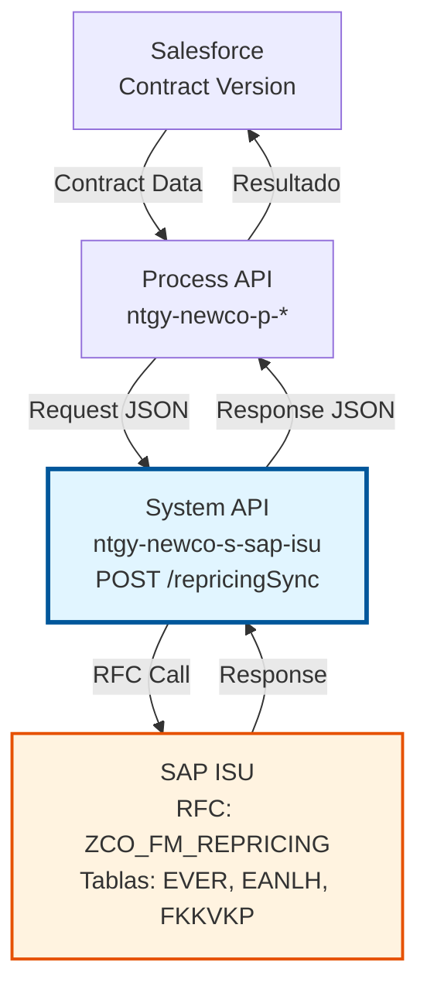
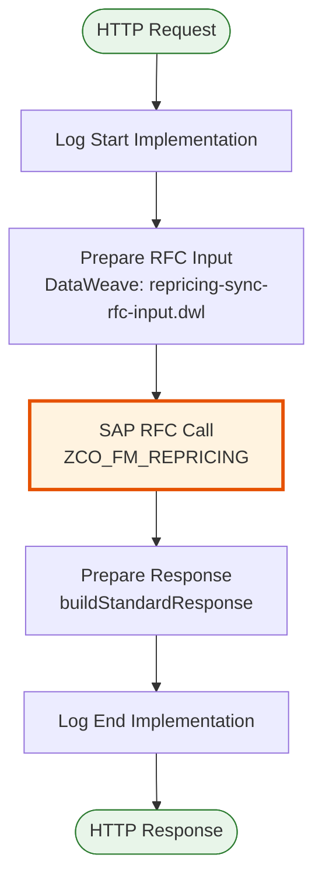
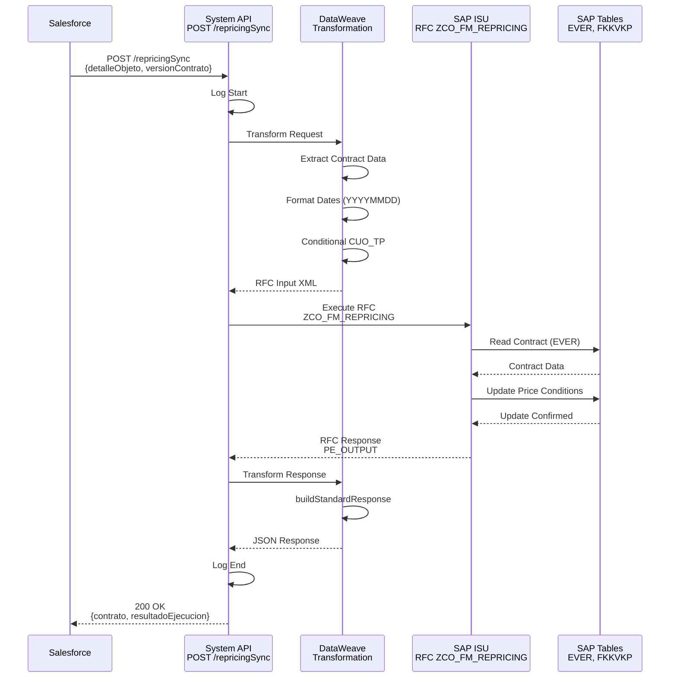

# POST /repricingSync

## 📌 Descripción General

### Propósito del Endpoint

Sincroniza el repricing (recálculo de precios) de un contrato desde Salesforce a SAP ISU, permitiendo actualizar las condiciones de precio cuando hay cambios en directrices tarifarias, fechas de aplicación o tipo de contratación.

El endpoint soporta:
- **Recálculo de Precios**: Actualización de condiciones de precio según nueva directriz
- **Gestión de Fechas**: Control de fecha de aplicación y reserva de precios
- **Tipos de Contratación**: Soporte para diferentes modalidades (ONLINE, PRESENCIAL, etc.)
- **Cuotas de Potencia**: Actualización de término de potencia mensual

### Tipo de API

**Capa:** System API (API-Led Connectivity)

**Función:** Integración directa con SAP ISU para ejecutar repricing de contratos mediante RFC estándar.

### Patrón de Integración

**Tipo:** Request-Reply Síncrono con SAP RFC

**Descripción:** Recibe datos de la versión del contrato desde Salesforce, transforma al formato SAP, invoca el RFC ZCO_FM_REPRICING para ejecutar el recálculo de precios, y retorna el resultado de la operación.

### Arquitectura API-Led Connectivity



---

## 💼 Propósito del Negocio

### Casos de Uso Principales

1. **Cambio de Tarifa**
   - Cliente cambia de tarifa regulada a liberalizada o viceversa
   - Se ejecuta repricing para aplicar nuevas condiciones de precio
   - Actualización automática de facturación futura

2. **Actualización de Directriz de Precios**
   - Cambios en directrices tarifarias por regulación
   - Aplicación de nuevos precios según fecha efectiva
   - Reserva de precios para garantizar tarifas

3. **Modificación de Cuota de Potencia**
   - Cliente modifica potencia contratada
   - Recálculo de término de potencia mensual
   - Actualización de condiciones comerciales

### Contexto Empresarial

- **Dominio:** Gestión de Contratos y Precios
- **Sector:** Energía - Utilities
- **División:** Naturgy España - NewCo
- **Proceso de Negocio:** Repricing de Contratos
- **Módulo SAP:** SD (Sales & Distribution) / ISU

### Stakeholders

- **Departamento Comercial**: Gestión de cambios tarifarios y ofertas
- **Departamento de Facturación**: Aplicación correcta de precios en facturas
- **Atención al Cliente**: Información sobre cambios de precio
- **Sistemas de Salesforce**: Sincronización de datos de contrato

### Valor de Negocio

- **Automatización**: Elimina repricing manual en SAP GUI
- **Precisión**: Garantiza aplicación correcta de precios
- **Trazabilidad**: Registro completo de cambios de precio
- **Eficiencia**: Reduce tiempo de procesamiento de cambios tarifarios

### Consumidores Potenciales

Este endpoint puede ser consumido por:
- Process APIs de gestión de contratos
- Flujos de Salesforce (Platform Events, Flows)
- Sistemas de gestión comercial
- Portales de autoservicio (cambios de tarifa)

---

## 🔧 Especificación Técnica

### URLs por Ambiente

| Ambiente | URL Base | URL Completa |
|----------|----------|--------------|
| **Local** | `http://localhost:8081` | `http://localhost:8081/api/repricingSync` |
| **Development** | `https://ntgy-newco-s-sap-isu-dev.us-e2.cloudhub.io` | `https://ntgy-newco-s-sap-isu-dev.us-e2.cloudhub.io/api/repricingSync` |
| **UAT** | `https://ntgy-newco-s-sap-isu-uat.us-e2.cloudhub.io` | `https://ntgy-newco-s-sap-isu-uat.us-e2.cloudhub.io/api/repricingSync` |
| **Production** | `https://ntgy-newco-s-sap-isu-pro.us-e2.cloudhub.io` | `https://ntgy-newco-s-sap-isu-pro.us-e2.cloudhub.io/api/repricingSync` |

### Método HTTP

```
POST /api/repricingSync
```

### Parámetros de Entrada

#### Headers HTTP

| Header | Tipo | Requerido | Descripción | Ejemplo |
|--------|------|-----------|-------------|---------|
| `Content-Type` | string | ✅ Sí | Tipo de contenido del request | `application/json` |
| `Accept` | string | ❌ No | Tipo de contenido esperado en response | `application/json` |

#### Body Parameters

| Campo | Tipo | Requerido | Descripción | Ejemplo |
|-------|------|-----------|-------------|---------|
| `detalleObjeto` | object | ✅ Sí | Detalle del objeto contrato | Ver estructura completa abajo |
| `detalleObjeto.codigo` | string | ✅ Sí | Número de contrato (VERTRAG) | `"1000123456"` |
| `detalleObjeto.versionContrato` | object | ✅ Sí | Información de versión del contrato | Ver estructura completa abajo |
| `detalleObjeto.versionContrato.idDirectriz` | string | ✅ Sí | ID de directriz de precios | `"DIR001"` |
| `detalleObjeto.versionContrato.fechaInicio` | date | ✅ Sí | Fecha de aplicación del repricing | `"2024-01-01"` |
| `detalleObjeto.versionContrato.fechaReservaPrecios` | date | ✅ Sí | Fecha de reserva de precios | `"2023-12-15"` |
| `detalleObjeto.versionContrato.tipoContratacion` | string | ✅ Sí | Tipo de oferta/contratación | `"ONLINE"` |
| `detalleObjeto.versionContrato.pagoRecurrenteMensual` | number | ❌ No | Cuota de término de potencia mensual | `45.50` |

### Respuestas

#### Respuesta Exitosa (200 OK)

```json
{
  "contrato": "1000123456",
  "resultadoEjecucion": "OK",
  "descripcion": "Repricing ejecutado correctamente"
}
```

#### Respuesta de Error de Negocio (200 OK con resultadoEjecucion = "KO")

```json
{
  "contrato": "1000123456",
  "resultadoEjecucion": "KO",
  "idMensaje": "E",
  "numMensaje": "001",
  "descripcion": "Directriz de precios no válida",
  "areaFuncional": "SD",
  "categoriaError": "VALIDATION"
}
```

#### Respuesta de Error Técnico (400/500)

```json
{
  "result": {
    "codResult": "0001",
    "msgResult": "Error al ejecutar repricing en SAP ISU"
  }
}
```

### Autenticación y Autorización

- **Tipo:** Client ID & Client Secret (Anypoint Platform)
- **Autorización SAP:** El usuario debe tener permisos para:
  - Ejecutar RFC `ZCO_FM_REPRICING`
  - Acceso a tablas EVER, EANLH, FKKVKP
  - Autorización para modificar condiciones de precio

### Timeouts

| Tipo | Valor | Descripción |
|------|-------|-------------|
| **Request Timeout** | 30 segundos | Tiempo máximo de espera para la respuesta |
| **Connection Timeout** | 10 segundos | Tiempo máximo para establecer conexión |

---

## 🏗️ Implementación Técnica

### Arquitectura del Flow



### Componentes del Flow

#### 1. Log Start Implementation
```xml
<module-logger:log 
    level="DEBUG" 
    message="Start implementation flow for repricing sync" />
```

#### 2. Prepare RFC Input (DataWeave)
**Archivo:** `src/main/resources/dw/repricing-sync-rfc-input.dwl`

```dataweave
%dw 2.0
output application/xml skipNullOn = "everywhere"

var detalleObjeto = payload.detalleObjeto
var versionContrato = payload.detalleObjeto.versionContrato

var cuotp = if(versionContrato.pagoRecurrenteMensual != 0.00) 
    versionContrato.pagoRecurrenteMensual
    else null
---
{
    "ZCO_FM_REPRICING": {
        "import": {
            "PI_INPUT": {
                "ID_DIRECTRIZ": versionContrato.idDirectriz,
                "VERTRAG": detalleObjeto.codigo,
                "FEC_APL": versionContrato.fechaInicio as Date as String {format: 'YYYYMMdd'},
                "FEC_RESERVA": versionContrato.fechaReservaPrecios as Date as String {format: 'YYYYMMdd'},
                "TIP_OFERTA": versionContrato.tipoContratacion,
                "CUO_TP": cuotp
            }
        }
    }
}
```

**Mapeo de Campos:**

| Campo JSON | Campo SAP | Descripción | Transformación |
|------------|-----------|-------------|----------------|
| `detalleObjeto.codigo` | `VERTRAG` | Número de contrato | Directo |
| `versionContrato.idDirectriz` | `ID_DIRECTRIZ` | ID de directriz de precios | Directo |
| `versionContrato.fechaInicio` | `FEC_APL` | Fecha de aplicación | Date → YYYYMMDD |
| `versionContrato.fechaReservaPrecios` | `FEC_RESERVA` | Fecha de reserva | Date → YYYYMMDD |
| `versionContrato.tipoContratacion` | `TIP_OFERTA` | Tipo de oferta | Directo |
| `versionContrato.pagoRecurrenteMensual` | `CUO_TP` | Cuota término potencia | Condicional (si != 0) |

#### 3. SAP RFC Call
```xml
<sap:synchronous-remote-function-call 
    key="ZCO_FM_REPRICING" 
    config-ref="SAP_Config" />
```

**RFC:** `ZCO_FM_REPRICING`
- **Módulo:** SD/ISU
- **Función:** Recálculo de precios de contrato
- **Operación:** Actualización de condiciones de precio

#### 4. Prepare Response (DataWeave)
```dataweave
%dw 2.0
output application/json
import buildStandardResponse from modules::commonUtils
var out = payload.ZCO_FM_REPRICING.export.PE_OUTPUT
---
buildStandardResponse(out, {
    contrato: out.VERTRAG
})
```

**Función `buildStandardResponse`:**
- Transforma respuesta SAP estándar a formato JSON
- Incluye campos: `resultadoEjecucion`, `idMensaje`, `numMensaje`, `descripcion`, `areaFuncional`, `categoriaError`
- Añade campos específicos del endpoint (contrato)

#### 5. Log End Implementation
```xml
<module-logger:log 
    level="DEBUG" 
    message="Finished implementation flow for repricing sync" />
```

### Diagrama de Secuencia



### Tablas SAP Involucradas

| Tabla | Descripción | Operación | Propósito |
|-------|-------------|-----------|-----------|
| **EVER** | Contract Master | READ, UPDATE | Datos maestros del contrato, condiciones de precio |
| **EANLH** | Installation | READ | Datos de instalación asociada al contrato |
| **FKKVKP** | Contract Account | READ | Cuenta contrato asociada |

### Transformaciones de Datos

#### Transformación de Fechas
```dataweave
// Entrada: "2024-01-01" (ISO 8601)
// Salida: "20240101" (SAP Format)
versionContrato.fechaInicio as Date as String {format: 'YYYYMMdd'}
```

#### Lógica Condicional para CUO_TP
```dataweave
var cuotp = if(versionContrato.pagoRecurrenteMensual != 0.00) 
    versionContrato.pagoRecurrenteMensual
    else null
```
- Si `pagoRecurrenteMensual` es 0.00 → No se envía al RFC (null)
- Si tiene valor > 0 → Se envía el valor al RFC

---

## 💻 Ejemplos de Uso

### Ejemplo 1: Request Completo

```json
{
  "detalleObjeto": {
    "codigo": "1000123456",
    "versionContrato": {
      "idDirectriz": "DIR001",
      "fechaInicio": "2024-01-01",
      "fechaReservaPrecios": "2023-12-15",
      "tipoContratacion": "ONLINE",
      "pagoRecurrenteMensual": 45.50
    }
  }
}
```

### Ejemplo 2: Response Exitoso

```json
{
  "contrato": "1000123456",
  "resultadoEjecucion": "OK",
  "idMensaje": "S",
  "numMensaje": "000",
  "descripcion": "Repricing ejecutado correctamente para el contrato 1000123456",
  "areaFuncional": "SD",
  "categoriaError": ""
}
```

### Ejemplo 3: Comando cURL

```bash
curl -X POST "https://ntgy-newco-s-sap-isu-dev.us-e2.cloudhub.io/api/repricingSync" \
  -H "Content-Type: application/json" \
  -H "client_id: YOUR_CLIENT_ID" \
  -H "client_secret: YOUR_CLIENT_SECRET" \
  -d '{
    "detalleObjeto": {
      "codigo": "1000123456",
      "versionContrato": {
        "idDirectriz": "DIR001",
        "fechaInicio": "2024-01-01",
        "fechaReservaPrecios": "2023-12-15",
        "tipoContratacion": "ONLINE",
        "pagoRecurrenteMensual": 45.50
      }
    }
  }'
```

### Ejemplo 4: Response de Error

```json
{
  "contrato": "1000123456",
  "resultadoEjecucion": "KO",
  "idMensaje": "E",
  "numMensaje": "001",
  "descripcion": "Directriz de precios DIR999 no existe en el sistema",
  "areaFuncional": "SD",
  "categoriaError": "VALIDATION_ERROR"
}
```

### Ejemplo 5: Request sin Cuota de Potencia

```json
{
  "detalleObjeto": {
    "codigo": "1000123456",
    "versionContrato": {
      "idDirectriz": "DIR002",
      "fechaInicio": "2024-02-01",
      "fechaReservaPrecios": "2024-01-15",
      "tipoContratacion": "PRESENCIAL"
    }
  }
}
```

### Ejemplo 6: Postman Collection

```json
{
  "info": {
    "name": "POST /repricingSync",
    "schema": "https://schema.getpostman.com/json/collection/v2.1.0/collection.json"
  },
  "item": [
    {
      "name": "Repricing Sync - Success",
      "request": {
        "method": "POST",
        "header": [
          {
            "key": "Content-Type",
            "value": "application/json"
          }
        ],
        "body": {
          "mode": "raw",
          "raw": "{\n  \"detalleObjeto\": {\n    \"codigo\": \"1000123456\",\n    \"versionContrato\": {\n      \"idDirectriz\": \"DIR001\",\n      \"fechaInicio\": \"2024-01-01\",\n      \"fechaReservaPrecios\": \"2023-12-15\",\n      \"tipoContratacion\": \"ONLINE\",\n      \"pagoRecurrenteMensual\": 45.50\n    }\n  }\n}"
        },
        "url": {
          "raw": "{{baseUrl}}/api/repricingSync",
          "host": ["{{baseUrl}}"],
          "path": ["api", "repricingSync"]
        }
      }
    }
  ]
}
```

---

## 📊 Códigos de Error Comunes

| Código | Mensaje | Causa | Solución |
|--------|---------|-------|----------|
| `E-001` | Directriz de precios no válida | ID de directriz no existe en SAP | Verificar directriz en tabla de maestros |
| `E-002` | Contrato no encontrado | VERTRAG no existe en EVER | Validar número de contrato |
| `E-003` | Fecha de aplicación inválida | Fecha anterior a fecha actual | Usar fecha futura o actual |
| `E-004` | Fecha de reserva posterior a aplicación | Fechas inconsistentes | FEC_RESERVA debe ser < FEC_APL |
| `E-005` | Tipo de contratación no válido | TIP_OFERTA no reconocido | Usar valores permitidos |
| `E-006` | Cuota de potencia negativa | CUO_TP < 0 | Usar valor positivo o 0 |
