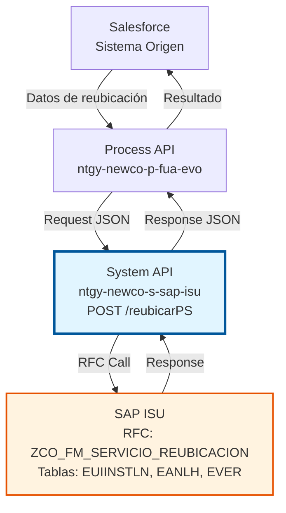
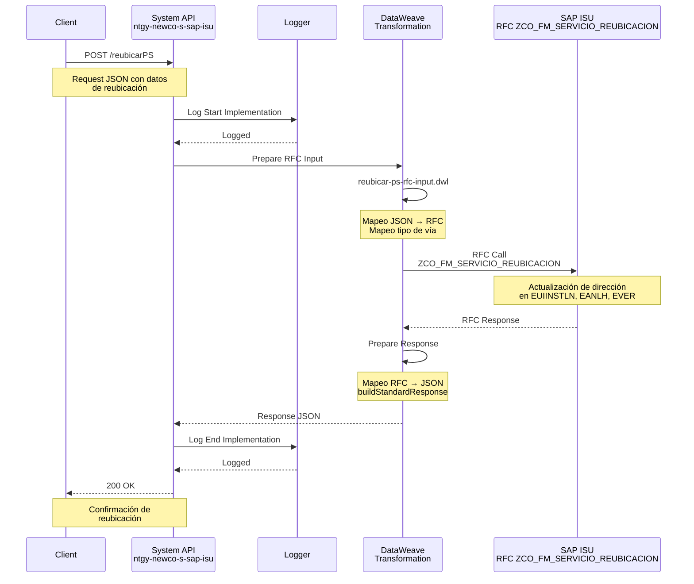
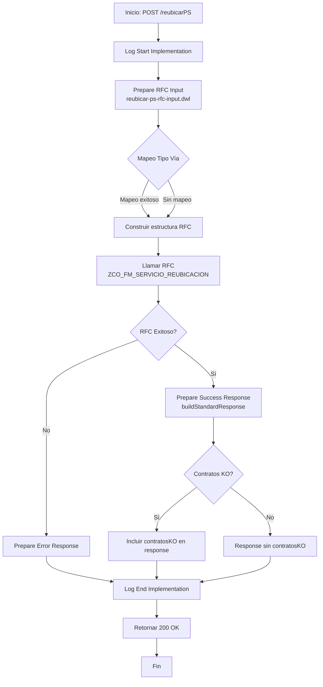
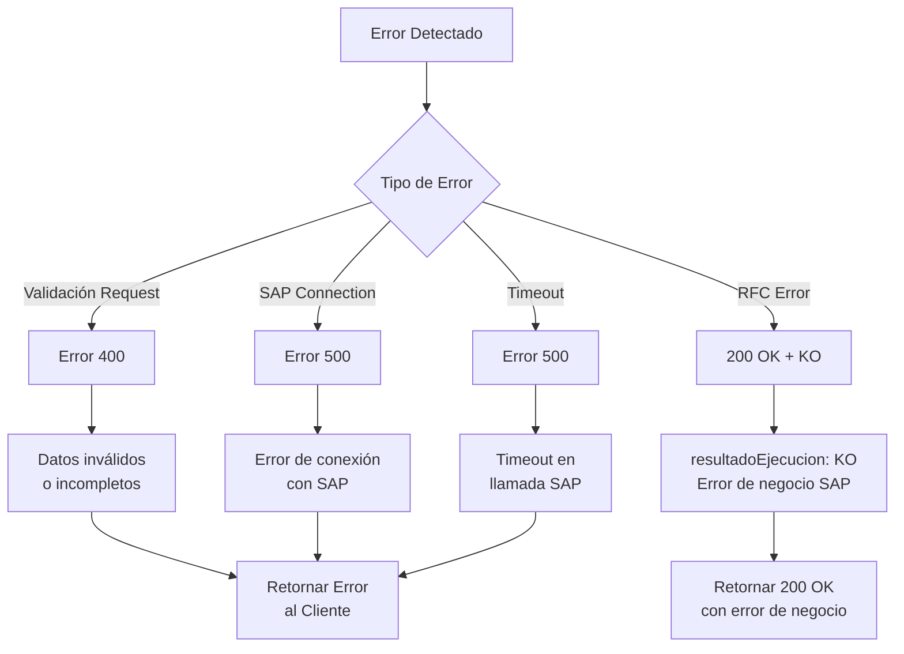
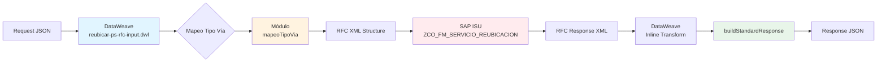

# POST /reubicarPS

## 📌 Descripción General

El endpoint `POST /reubicarPS` permite reubicar un punto de suministro en SAP ISU, actualizando su dirección física mediante el RFC `ZCO_FM_SERVICIO_REUBICACION`. Este endpoint forma parte de la System API `ntgy-newco-s-sap-isu` y proporciona acceso directo a la funcionalidad de reubicación de puntos de suministro en el sistema SAP ISU.

### Información Técnica

- **Método HTTP:** POST
- **Ruta:** `/reubicarPS`
- **Backend:** SAP ISU
- **RFC:** ZCO_FM_SERVICIO_REUBICACION
- **Módulo SAP:** ISU (Industry Solution Utilities)
- **Operación:** Actualización de dirección de punto de suministro
- **Tipo de API:** System API

### Contexto del RFC

El RFC `ZCO_FM_SERVICIO_REUBICACION` es una función personalizada (Z) del módulo ISU de SAP que permite actualizar la dirección física de un punto de suministro existente. La reubicación implica cambiar la ubicación geográfica del punto de suministro manteniendo su identificador único y actualizando todos los contratos asociados.

### Arquitectura API-Led Connectivity



## 💼 Propósito del Negocio

### Objetivo Principal

Facilitar la actualización de la dirección física de un punto de suministro cuando este cambia de ubicación, asegurando que los datos maestros en SAP ISU reflejen la ubicación real del punto de suministro y que todos los contratos asociados se actualicen correctamente.

### Casos de Uso Principales

1. **Cambio de Domicilio del Cliente**
   - Cuando un cliente se muda a una nueva dirección
   - Actualización de la ubicación del punto de suministro
   - Mantenimiento de la continuidad del servicio
   - Actualización automática de contratos asociados

2. **Corrección de Datos Maestros**
   - Corrección de errores en la dirección registrada
   - Actualización de información incompleta o incorrecta
   - Normalización de direcciones según estándares
   - Actualización de códigos INE y postales

3. **Reorganización de Instalaciones**
   - Reubicación física de medidores
   - Cambios en la infraestructura de suministro
   - Optimización de rutas de lectura
   - Actualización de datos técnicos de instalación

### Contexto Empresarial

- **Dominio:** Gestión de Datos Maestros de Clientes
- **Sector:** Energía - Utilities
- **División:** Naturgy España - NewCo
- **Proceso de Negocio:** Mantenimiento de Puntos de Suministro
- **Módulo SAP:** ISU (Industry Solution Utilities)

### Stakeholders

- **Departamento de Atención al Cliente**: Gestión de solicitudes de cambio de dirección
- **Operaciones de Campo**: Actualización de ubicaciones para rutas de lectura
- **Facturación**: Asegurar facturación a dirección correcta
- **Sistemas de Información**: Mantenimiento de datos maestros

### Valor de Negocio

- **Precisión de Datos:** Mantiene la información de ubicación actualizada en tiempo real
- **Facturación Correcta:** Asegura que la facturación se realice a la dirección correcta
- **Gestión Operativa:** Facilita la planificación de rutas de lectura y mantenimiento
- **Cumplimiento Normativo:** Mantiene registros precisos según requisitos regulatorios
- **Experiencia del Cliente:** Reduce errores en comunicaciones y entregas

### Consumidores Potenciales

Este endpoint puede ser consumido por:
- Process API `ntgy-newco-p-fua-evo` (Flujo Único de Alta)
- Flujos de Salesforce (Platform Events, Flows)
- Sistemas de gestión de clientes
- Portales de autogestión de clientes

## 🔧 Especificación Técnica

### URLs por Ambiente

| Ambiente | URL Base | URL Completa |
|----------|----------|--------------|
| **Local** | `http://localhost:8081` | `http://localhost:8081/api/reubicarPS` |
| **Development** | `https://ntgy-newco-s-sap-isu-dev.us-e2.cloudhub.io` | `https://ntgy-newco-s-sap-isu-dev.us-e2.cloudhub.io/api/reubicarPS` |
| **UAT** | `https://ntgy-newco-s-sap-isu-uat.us-e2.cloudhub.io` | `https://ntgy-newco-s-sap-isu-uat.us-e2.cloudhub.io/api/reubicarPS` |
| **Production** | `https://ntgy-newco-s-sap-isu-pro.us-e2.cloudhub.io` | `https://ntgy-newco-s-sap-isu-pro.us-e2.cloudhub.io/api/reubicarPS` |

### Método HTTP

```
POST /api/reubicarPS
```

### Parámetros de Entrada

#### Headers HTTP

| Header | Tipo | Requerido | Descripción | Ejemplo |
|--------|------|-----------|-------------|---------|
| `Content-Type` | string | ✅ Sí | Tipo de contenido del request | `application/json` |
| `Accept` | string | ❌ No | Tipo de contenido esperado en response | `application/json` |
| `client_id` | string | ✅ Sí | Client ID de Anypoint Platform | `a1b2c3d4e5f6` |
| `client_secret` | string | ✅ Sí | Client Secret de Anypoint Platform | `A1B2C3D4E5F6` |

#### Body Parameters

**Estructura del Request:**

```json
{
  "modo": "string",
  "placeId": "string",
  "masterId": "string",
  "idVia": "string",
  "tipoVia": "string",
  "calle": "string",
  "numero": "string",
  "portal": "string",
  "codigoPostal": "string",
  "codigoIne": "string",
  "localidad": "string",
  "provincia": "string",
  "escalera": "string",
  "piso": "string",
  "puerta": "string",
  "contratos": [
    {
      "codigo": "string",
      "divisionNegocio": "string",
      "CUPS": "string"
    }
  ]
}
```

**Descripción de Campos:**

| Campo | Tipo | Requerido | Descripción | Ejemplo |
|-------|------|-----------|-------------|---------|
| `modo` | string | ✅ Sí | Modo de ejecución de la reubicación | "X" |
| `placeId` | string | ✅ Sí | Identificador de la finca (12 dígitos) | "000000001234" |
| `masterId` | string | ✅ Sí | Identificador del punto de suministro (12 dígitos) | "000000123456" |
| `idVia` | string | ❌ No | Identificador de la vía | "12345" |
| `tipoVia` | string | ❌ No | Tipo de vía (CL, AV, PZ, etc.) | "CL" |
| `calle` | string | ✅ Sí | Nombre de la calle | "CALLE MAYOR" |
| `numero` | string | ✅ Sí | Número de la dirección | "123" |
| `portal` | string | ❌ No | Portal | "A" |
| `codigoPostal` | string | ✅ Sí | Código postal (5 dígitos) | "28001" |
| `codigoIne` | string | ❌ No | Código INE del municipio | "28079" |
| `localidad` | string | ✅ Sí | Localidad | "MADRID" |
| `provincia` | string | ✅ Sí | Provincia | "MADRID" |
| `escalera` | string | ❌ No | Escalera | "1" |
| `piso` | string | ❌ No | Piso | "3" |
| `puerta` | string | ❌ No | Puerta | "A" |
| `contratos` | array | ✅ Sí | Lista de contratos asociados | - |
| `contratos[].codigo` | string | ✅ Sí | Código del contrato (10 dígitos) | "4800123456" |
| `contratos[].divisionNegocio` | string | ✅ Sí | División de negocio | "Electricidad" |
| `contratos[].CUPS` | string | ✅ Sí | Código Universal del Punto de Suministro | "ES0021000000000001JN0F" |

**Validaciones:**

- `modo`: Debe ser un valor válido según configuración SAP
- `placeId`: Debe ser un identificador válido de finca en SAP ISU (12 dígitos con padding de ceros)
- `masterId`: Debe ser un identificador válido de punto de suministro en SAP ISU (12 dígitos)
- `codigoPostal`: Debe ser un código postal válido español (5 dígitos)
- `tipoVia`: Si se proporciona, debe ser un tipo válido (CL, AV, PZ, etc.)
- `contratos`: Debe contener al menos un contrato
- `contratos[].divisionNegocio`: Debe ser "Electricidad", "Gas" o "Servicios"
- `contratos[].CUPS`: Debe ser un CUPS válido según formato español

### Respuestas

#### Respuesta Exitosa (200 OK)

```json
{
  "resultadoEjecucion": "OK",
  "idMensaje": "S",
  "descripcion": "Reubicación de punto de suministro realizada correctamente",
  "placeId": "000000001234",
  "masterId": "000000123456",
  "contratosKO": []
}
```

**Descripción de Campos del Response:**

| Campo | Tipo | Descripción | Ejemplo |
|-------|------|-------------|---------|
| `resultadoEjecucion` | string | Resultado de la ejecución (OK/KO) | "OK" |
| `idMensaje` | string | Identificador del tipo de mensaje | "S" |
| `descripcion` | string | Descripción del resultado | "Reubicación realizada correctamente" |
| `placeId` | string | ID de la finca reubicada | "000000001234" |
| `masterId` | string | ID del punto de suministro reubicado | "000000123456" |
| `contratosKO` | array | Lista de contratos que no pudieron actualizarse | [] |

#### Respuesta de Error de Negocio (200 OK con resultadoEjecucion = "KO")

```json
{
  "resultadoEjecucion": "KO",
  "idMensaje": "E",
  "descripcion": "Punto de suministro no encontrado en SAP ISU"
}
```

#### Respuesta de Error Técnico (400/500)

```json
{
  "result": {
    "codResult": "0001",
    "msgResult": "Error interno del servidor"
  }
}
```

### Códigos de Respuesta

| Código | Descripción | Escenario |
|--------|-------------|-----------|
| 200 | OK | Reubicación procesada (verificar resultadoEjecucion) |
| 400 | Bad Request | Datos de entrada inválidos o incompletos |
| 500 | Internal Server Error | Error en la comunicación con SAP o error interno |

### Autenticación y Autorización

- **Tipo:** Client ID & Client Secret (Anypoint Platform)
- **Autorización SAP:** El usuario debe tener permisos para:
  - Ejecutar RFC `ZCO_FM_SERVICIO_REUBICACION`
  - Acceso a tablas EUIINSTLN, EANLH, EVER
  - Modificar datos maestros de puntos de suministro

### Timeouts

| Tipo | Valor | Descripción |
|------|-------|-------------|
| **Request Timeout** | 30 segundos | Tiempo máximo de espera para la respuesta |
| **Connection Timeout** | 10 segundos | Tiempo máximo para establecer conexión |

## 🏗️ Implementación Técnica

### Arquitectura del Flujo



### Flujo de Procesamiento



### Componentes Técnicos

#### 1. Sub-Flow Principal

**Archivo:** `src/main/mule/implementation/customer-data-management-operations.xml`
**Líneas:** 281-306

```xml
<sub-flow name="reubicarPSFlow" doc:id="851f49b9-5c87-4248-a51b-d5608fa24bbe">
    <module-logger:log doc:name="Log Start Implementation" 
                       doc:id="fa1e54fc-94a1-4247-841d-3faf80929a4d" 
                       config-ref="Logger_Mule_Extension_Config" 
                       level="DEBUG" 
                       flowName="#[vars.flowName]" 
                       message="Start implementation flow for reubicar PS" 
                       content="#[vars.loggerContext]" />
    
    <ee:transform doc:name="Prepare RFC Input" 
                  doc:id="84cc84d7-9f48-41d5-9bfe-8715613f0f52">
        <ee:message>
            <ee:set-payload resource="dw/reubicar-ps-rfc-input.dwl" />
        </ee:message>
    </ee:transform>
    
    <sap:synchronous-remote-function-call 
         key="ZCO_FM_SERVICIO_REUBICACION" 
         doc:name="Synchronous Remote Function Call" 
         doc:id="39b7376d-9459-40d1-b5c2-39618194b093" 
         config-ref="SAP_Config" />
    
    <ee:transform doc:name="Prepare Response" 
                  doc:id="79ab73b1-b7bf-4d25-84fe-63cb387110be">
        <ee:message>
            <ee:set-payload><![CDATA[%dw 2.0
output application/json
import buildStandardResponse from modules::commonUtils
var out = payload.ZCO_FM_SERVICIO_REUBICACION.export.PE_OUTPUT
var contKO = payload.ZCO_FM_SERVICIO_REUBICACION.export.PE_CONTRATOS_NO_SAP
---

buildStandardResponse(out, {
    placeId: out.ID_FINCA,
    masterId: out.ID_PS,
    contratosKO: contKO.*row default []
})]]></ee:set-payload>
        </ee:message>
    </ee:transform>
    
    <module-logger:log doc:name="Log End Implementation" 
                       doc:id="196935cd-8411-408f-a291-73e0fb863719" 
                       config-ref="Logger_Mule_Extension_Config" 
                       level="DEBUG" 
                       flowName="#[vars.flowName]" 
                       message="Finished implementation flow for reubicar PS" 
                       content="#[vars.loggerContext]" />
</sub-flow>
```

#### 2. Transformación de Request

**Archivo:** `src/main/resources/dw/reubicar-ps-rfc-input.dwl`

```dataweave
%dw 2.0
output application/xml
import * from modules::mapeoTipoVia
var tipoVia = mapeoTipoVia(payload.tipoVia).tipoVia default payload.tipoVia
---
{
    "ZCO_FM_SERVICIO_REUBICACION": {
        "import": {
            "PI_INPUT": {
                "CABECERA": {
                    "EXEC_REUBI": payload.modo,
                    "ID_FINCA": payload.placeId,
                    "ID_PS": payload.masterId
                },
                "DIRECC": {
                    "ID_VIA": payload.idVia,
                    "TIPO_VIA": tipoVia,
                    "STREET": payload.calle,
                    "HOUSE_NUM1": payload.numero,
                    "HOUSE_NUM2": payload.portal,
                    "POST_CODE1": payload.codigoPostal,
                    "CITY_CODE": payload.codigoIne,
                    "CITY2": payload.localidad,
                    "REGION": payload.provincia,
                    "STR_SUPPL3": payload.escalera,
                    "FLOOR": payload.piso,
                    "ROOMNUMBER": payload.puerta,
                },
                "CONTRATOS":{
                    "row": payload.contratos map (cont) -> {
                        "VERTRAG": cont.codigo,
                        "SPARTE": if ( cont.divisionNegocio == "Electricidad" ) "01"
                                  else if ( cont.divisionNegocio == "Gas" ) "02"
                                  else "03",
                        "EXT_UI": cont.CUPS,
                    }
                }
            }
        }
    }
}
```

**Características de la Transformación:**

1. **Mapeo de Tipo de Vía:** Utiliza el módulo `mapeoTipoVia` para normalizar tipos de vía
2. **División de Negocio:** Mapea texto a código SAP (01=Electricidad, 02=Gas, 03=Servicios)
3. **Estructura Jerárquica:** Organiza datos en CABECERA, DIRECC y CONTRATOS
4. **Manejo de Opcionales:** Campos opcionales se incluyen aunque estén vacíos

#### 3. Transformación de Response

La transformación de response utiliza la función `buildStandardResponse` del módulo `commonUtils`:

```dataweave
%dw 2.0
output application/json
import buildStandardResponse from modules::commonUtils
var out = payload.ZCO_FM_SERVICIO_REUBICACION.export.PE_OUTPUT
var contKO = payload.ZCO_FM_SERVICIO_REUBICACION.export.PE_CONTRATOS_NO_SAP
---

buildStandardResponse(out, {
    placeId: out.ID_FINCA,
    masterId: out.ID_PS,
    contratosKO: contKO.*row default []
})
```

**Características:**

1. **buildStandardResponse:** Función reutilizable que construye respuesta estándar
2. **Extracción de Datos:** Obtiene PE_OUTPUT y PE_CONTRATOS_NO_SAP del RFC
3. **Contratos KO:** Lista contratos que no pudieron actualizarse (array vacío si todos OK)
4. **Formato Consistente:** Mantiene estructura estándar de respuesta de la API

### Manejo de Errores



#### Tipos de Errores

1. **Errores de Validación (400)**
   - Punto de suministro no proporcionado
   - Campos requeridos faltantes
   - Formato de datos inválido
   - División de negocio no válida

2. **Errores de SAP (500)**
   - Error de conexión con SAP
   - RFC no disponible
   - Timeout en la llamada
   - Error de configuración

3. **Errores de Negocio (200 con resultadoEjecucion = "KO")**
   - Punto de suministro no existe en SAP ISU
   - Finca no encontrada
   - Contratos no activos
   - Dirección inválida según validaciones SAP
   - Algunos contratos no pudieron actualizarse (ver contratosKO)

### Diagrama de Transformación de Datos



## 💻 Ejemplos de Uso

### Ejemplo 1: Request Completo

```bash
curl -X POST "https://ntgy-newco-s-sap-isu-dev.us-e2.cloudhub.io/api/reubicarPS" \
  -H "Content-Type: application/json" \
  -H "client_id: a1b2c3d4e5f6" \
  -H "client_secret: A1B2C3D4E5F6" \
  -d '{
  "modo": "X",
  "placeId": "000000001234",
  "masterId": "000000123456",
  "idVia": "12345",
  "tipoVia": "CL",
  "calle": "CALLE MAYOR",
  "numero": "123",
  "portal": "A",
  "codigoPostal": "28001",
  "codigoIne": "28079",
  "localidad": "MADRID",
  "provincia": "MADRID",
  "escalera": "1",
  "piso": "3",
  "puerta": "A",
  "contratos": [
    {
      "codigo": "4800123456",
      "divisionNegocio": "Electricidad",
      "CUPS": "ES0021000000000001JN0F"
    }
  ]
}'
```

### Ejemplo 2: Response Exitoso

```json
{
  "resultadoEjecucion": "OK",
  "idMensaje": "S",
  "descripcion": "Reubicación de punto de suministro realizada correctamente",
  "placeId": "000000001234",
  "masterId": "000000123456",
  "contratosKO": []
}
```

### Ejemplo 3: Response con Contratos KO

```json
{
  "resultadoEjecucion": "OK",
  "idMensaje": "W",
  "descripcion": "Reubicación parcial - algunos contratos no pudieron actualizarse",
  "placeId": "000000001234",
  "masterId": "000000123456",
  "contratosKO": [
    {
      "VERTRAG": "4800123457",
      "SPARTE": "02",
      "ERROR": "Contrato no activo"
    }
  ]
}
```

### Ejemplo 4: Response de Error de Negocio

```json
{
  "resultadoEjecucion": "KO",
  "idMensaje": "E",
  "descripcion": "Punto de suministro no encontrado en SAP ISU"
}
```

### Ejemplo 5: Request Mínimo (Solo Campos Requeridos)

```json
{
  "modo": "X",
  "placeId": "000000001234",
  "masterId": "000000123456",
  "calle": "CALLE MAYOR",
  "numero": "123",
  "codigoPostal": "28001",
  "localidad": "MADRID",
  "provincia": "MADRID",
  "contratos": [
    {
      "codigo": "4800123456",
      "divisionNegocio": "Electricidad",
      "CUPS": "ES0021000000000001JN0F"
    }
  ]
}
```

### Ejemplo 6: Request con Múltiples Contratos

```json
{
  "modo": "X",
  "placeId": "000000001234",
  "masterId": "000000123456",
  "calle": "AVENIDA PRINCIPAL",
  "numero": "456",
  "codigoPostal": "08001",
  "localidad": "BARCELONA",
  "provincia": "BARCELONA",
  "contratos": [
    {
      "codigo": "4800123456",
      "divisionNegocio": "Electricidad",
      "CUPS": "ES0021000000000001JN0F"
    },
    {
      "codigo": "4800123457",
      "divisionNegocio": "Gas",
      "CUPS": "ES0034000000000001AA0F"
    }
  ]
}
```

## 📊 Información Adicional

### Módulo de Mapeo de Tipo de Vía

El endpoint utiliza el módulo `mapeoTipoVia` para normalizar los tipos de vía según estándares españoles:

**Ejemplos de Mapeo:**
- "CALLE" → "CL"
- "AVENIDA" → "AV"
- "PLAZA" → "PZ"
- "PASEO" → "PS"
- "CARRETERA" → "CR"

### Códigos de División de Negocio

| Texto | Código SAP | Descripción |
|-------|------------|-------------|
| "Electricidad" | "01" | Suministro eléctrico |
| "Gas" | "02" | Suministro de gas |
| "Servicios" | "03" | Otros servicios |

### Consideraciones de Rendimiento

- **Tiempo de Respuesta Típico:** 2-5 segundos
- **Timeout Configurado:** 30 segundos
- **Procesamiento Asíncrono:** No (operación síncrona)
- **Idempotencia:** No (cada llamada crea una nueva operación de reubicación)

### Logs y Trazabilidad

El endpoint genera logs en los siguientes puntos:
1. **Inicio del flow:** "Start implementation flow for reubicar PS"
2. **Fin del flow:** "Finished implementation flow for reubicar PS"
3. **Nivel de log:** DEBUG
4. **Categoría:** com.naturgy.mule.logger

### Mejores Prácticas

1. **Validar Datos Antes de Enviar:** Verificar formato de CUPS, códigos postales, etc.
2. **Manejar Contratos KO:** Revisar el array `contratosKO` en la respuesta
3. **Retry Logic:** Implementar reintentos para errores 500
4. **Logging:** Registrar todas las llamadas para auditoría
5. **Timeout Handling:** Configurar timeouts apropiados en el cliente
