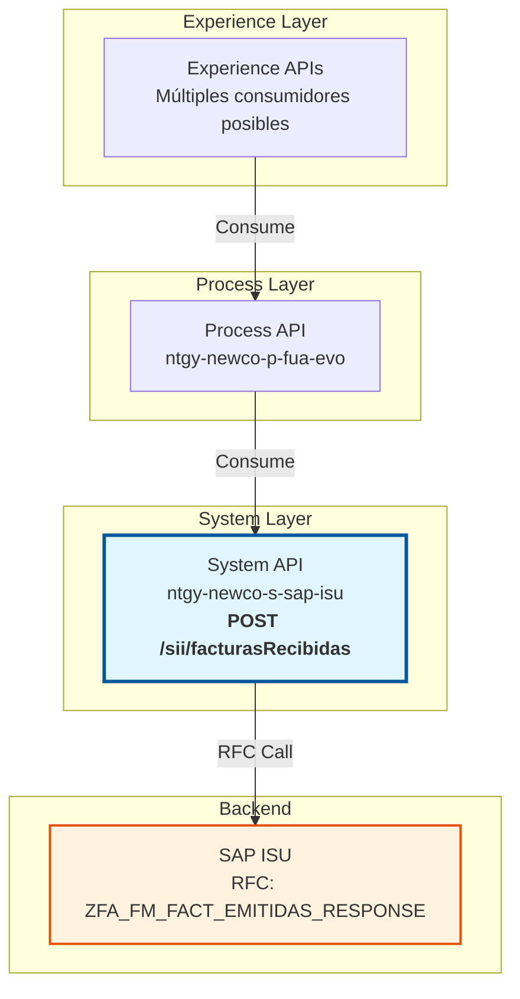
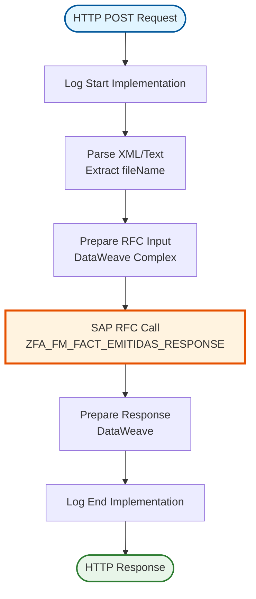
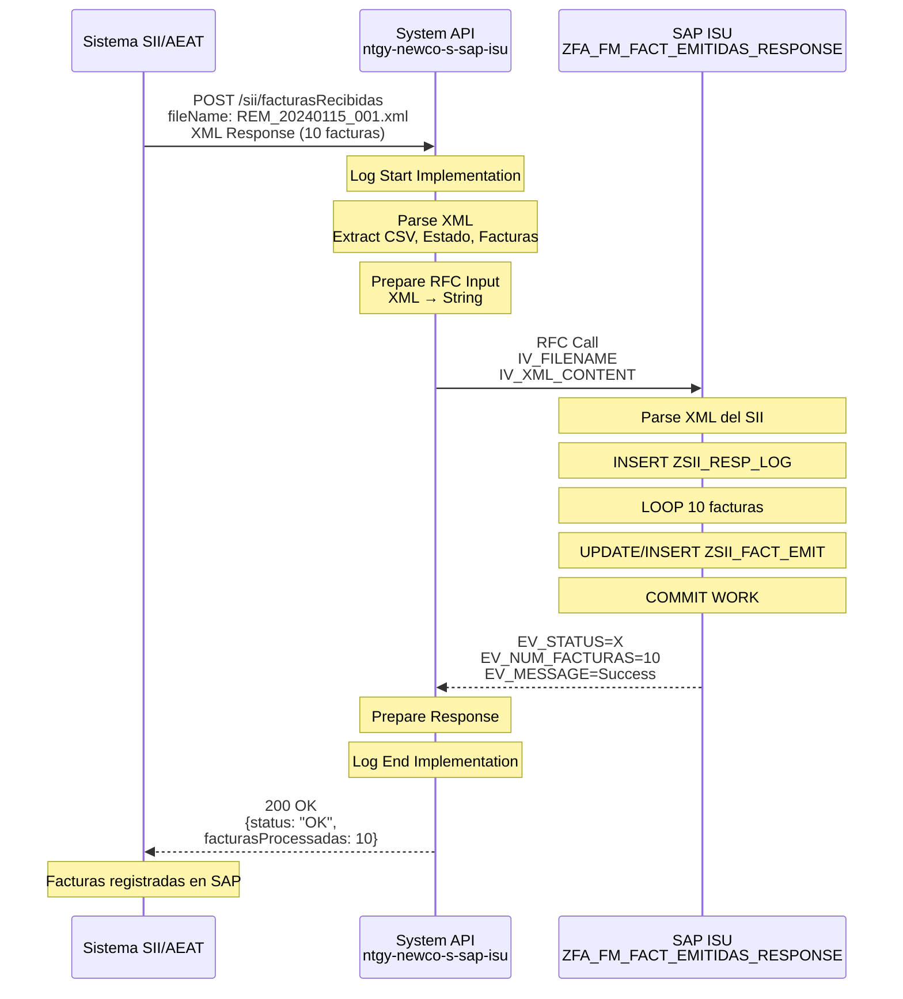
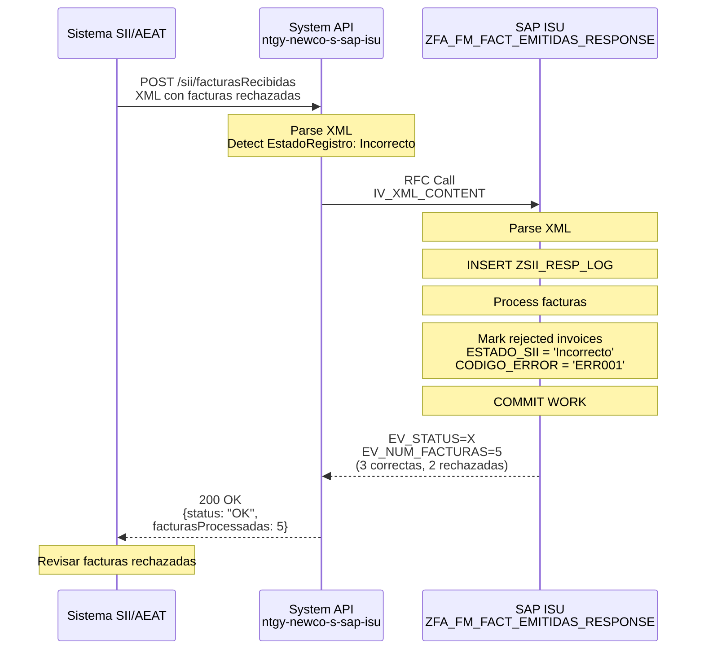
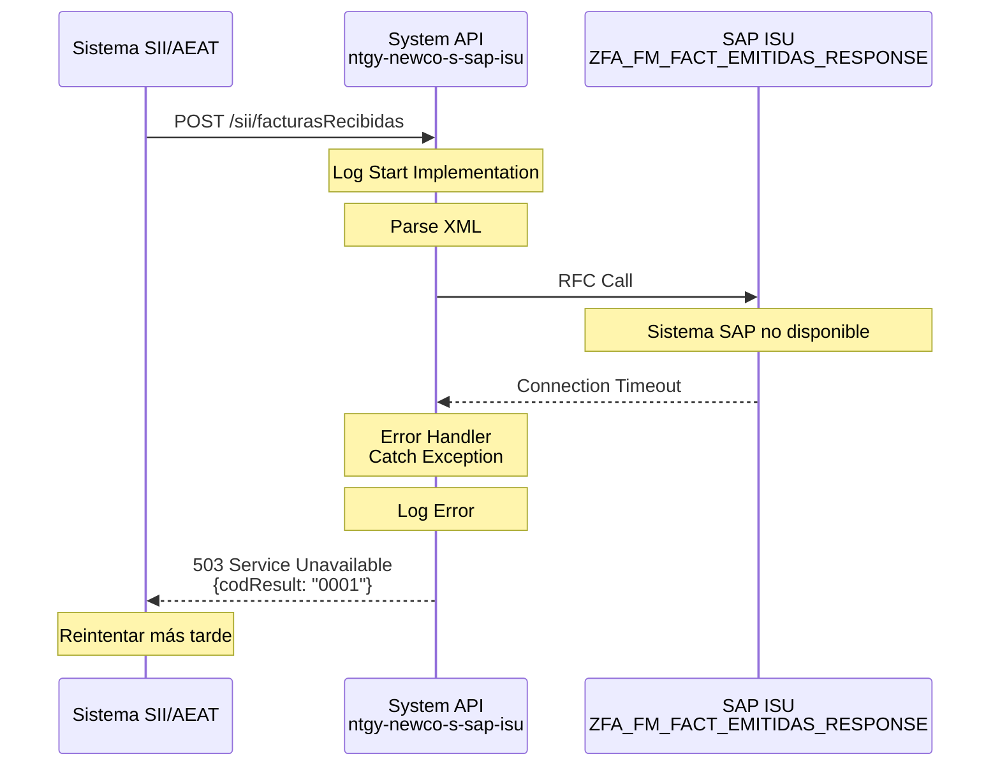

# POST /sii/facturasRecibidas

## 📌 Descripción General

### Propósito del Endpoint

Este endpoint procesa las respuestas de facturas emitidas recibidas desde el Sistema de Información Inmediata (SII) de la Agencia Tributaria (AEAT) y las registra en SAP ISU. Permite mantener sincronizada la información fiscal entre el SII y SAP.

### Tipo de API

**Capa:** System API (Integración directa con SAP ISU)

### Patrón de Integración

**Tipo:** Request-Reply Síncrono con SAP ISU

Este endpoint ejecuta directamente el RFC `ZFA_FM_FACT_EMITIDAS_RESPONSE` en SAP ISU para procesar las respuestas del SII.

### Arquitectura API-Led Connectivity



---

## 💼 Propósito del Negocio

### Casos de Uso Principales

1. **Cumplimiento Fiscal**: Registrar respuestas del SII en SAP para cumplimiento normativo
2. **Sincronización SII-SAP**: Mantener coherencia entre sistemas fiscales
3. **Trazabilidad Fiscal**: Documentar estado de facturas en SII (Correcto, Incorrecto, AceptadoConErrores)
4. **Gestión de Errores**: Identificar y gestionar facturas rechazadas por SII
5. **Auditoría Fiscal**: Mantener registro completo de interacciones con AEAT

### Contexto Empresarial

- **Dominio:** Facturación y Cumplimiento Fiscal
- **Sector:** Energía - Utilities
- **División:** Naturgy NewCo
- **Proceso:** Integración con SII (AEAT)

### Stakeholders

- **Departamento Fiscal**: Gestiona cumplimiento con AEAT
- **Departamento de Facturación**: Verifica estado de facturas
- **Auditoría**: Supervisa cumplimiento fiscal
- **IT**: Mantiene integración con SII
- **Cumplimiento Normativo**: Asegura adherencia a normativa fiscal

### Valor de Negocio

- **Cumplimiento Normativo**: Asegura cumplimiento con SII/AEAT
- **Trazabilidad Fiscal**: Registro completo de interacciones con AEAT
- **Detección de Errores**: Identifica facturas rechazadas rápidamente
- **Automatización**: Reduce trabajo manual en gestión fiscal
- **Reducción de Riesgos**: Minimiza riesgos de incumplimiento fiscal

### Consumidores Potenciales

Este endpoint puede ser consumido por:
- Sistemas de integración con SII/AEAT
- Plataformas de facturación electrónica
- Sistemas de gestión fiscal
- Aplicaciones de back-office fiscal

---

## 🔧 Especificación Técnica

### URLs por Ambiente

| Ambiente | URL Base | URL Completa |
|----------|----------|--------------|
| Local | `http://localhost:8081` | `http://localhost:8081/api/sii/facturasRecibidas` |
| Desarrollo | `https://dev-ntgy-newco-s-sap-isu.cloudhub.io` | `https://dev-ntgy-newco-s-sap-isu.cloudhub.io/api/sii/facturasRecibidas` |
| UAT | `https://uat-ntgy-newco-s-sap-isu.cloudhub.io` | `https://uat-ntgy-newco-s-sap-isu.cloudhub.io/api/sii/facturasRecibidas` |
| Producción | `https://prod-ntgy-newco-s-sap-isu.cloudhub.io` | `https://prod-ntgy-newco-s-sap-isu.cloudhub.io/api/sii/facturasRecibidas` |

### Método HTTP

```
POST /sii/facturasRecibidas
```

### Parámetros de Entrada

#### Headers HTTP

| Header | Tipo | Requerido | Descripción | Ejemplo |
|--------|------|-----------|-------------|---------|
| `fileName` | string | Sí | Nombre del archivo XML recibido desde SII | `"REM_20240115_001.xml"` |
| `Content-Type` | string | Sí | Tipo de contenido | `application/xml` o `text/plain` |

#### Body

**Formato:** XML o texto plano

**Descripción:** Contenido de la respuesta del SII con información de facturas emitidas.

**Estructura XML del SII:**

```xml
<?xml version="1.0" encoding="UTF-8"?>
<RespuestaLRFacturasEmitidas>
  <CSV>ABC123456789</CSV>
  <DatosPresentacion>
    <NIFPresentador>A12345678</NIFPresentador>
    <TimestampPresentacion>2024-01-15T10:30:00</TimestampPresentacion>
  </DatosPresentacion>
  <Cabecera>
    <IDVersionSii>1.1</IDVersionSii>
    <Titular>
      <NombreRazon>EMPRESA SA</NombreRazon>
      <NIF>A12345678</NIF>
    </Titular>
    <TipoComunicacion>A0</TipoComunicacion>
  </Cabecera>
  <EstadoEnvio>Correcto</EstadoEnvio>
  <RespuestaLinea>
    <IDFactura>
      <IDEmisorFactura>
        <NIF>A12345678</NIF>
      </IDEmisorFactura>
      <NumSerieFacturaEmisor>FAC-2024-001</NumSerieFacturaEmisor>
      <FechaExpedicionFacturaEmisor>15-01-2024</FechaExpedicionFacturaEmisor>
    </IDFactura>
    <EstadoRegistro>Correcto</EstadoRegistro>
  </RespuestaLinea>
</RespuestaLRFacturasEmitidas>
```

### Respuestas

#### Respuesta Exitosa (200 OK)

```json
{
  "status": "OK",
  "message": "Respuesta SII procesada correctamente",
  "facturasProcessadas": 10
}
```

**Campos de la Respuesta:**

| Campo | Tipo | Descripción |
|-------|------|-------------|
| `status` | string | Estado de la operación (`OK` = éxito) |
| `message` | string | Mensaje descriptivo del resultado |
| `facturasProcessadas` | integer | Número de facturas procesadas |

#### Respuestas de Error

**400 Bad Request** - XML inválido:

```json
{
  "result": {
    "codResult": "0001",
    "msgResult": "XML inválido o fileName no proporcionado"
  }
}
```

**500 Internal Server Error** - Error en SAP ISU:

```json
{
  "result": {
    "codResult": "0001",
    "msgResult": "Error al procesar respuesta SII en SAP"
  }
}
```

**503 Service Unavailable** - SAP ISU no disponible:

```json
{
  "result": {
    "codResult": "0001",
    "msgResult": "Sistema SAP ISU no disponible"
  }
}
```

### Autenticación

- **Tipo:** Client ID & Client Secret (Anypoint Platform)
- **Ubicación:** Headers HTTP
- **Flujo:** OAuth 2.0 Client Credentials

### Timeouts

| Tipo | Valor | Descripción |
|------|-------|-------------|
| Request Timeout | 60s | Tiempo máximo (procesamiento XML complejo) |
| Connection Timeout | 10s | Tiempo máximo para establecer conexión |

### Protocolo

- **Protocolo:** HTTPS
- **TLS Version:** 1.2+
- **Método:** POST

---

## 🏗️ Implementación Técnica

### Arquitectura del Flow



### 🗄️ Base de Datos SAP ISU

#### RFC SAP Invocado

**RFC:** `ZFA_FM_FACT_EMITIDAS_RESPONSE`

**Descripción:** RFC personalizado de SAP ISU para procesar respuestas del SII sobre facturas emitidas. Actualiza el estado de facturas en tablas personalizadas SII y registra logs de respuestas.

**Módulo SAP:** FI-CA (Financial Contract Accounting) - Billing & Invoicing / SII Integration

**Tablas SAP Consultadas/Modificadas:**

| Tabla | Descripción | Operación |
|-------|-------------|-----------|
| `ZSII_FACT_EMIT` | Facturas Emitidas SII | INSERT, UPDATE |
| `ZSII_RESP_LOG` | Log de Respuestas SII | INSERT |

#### Detalles de Tablas SAP

##### Tabla: `ZSII_FACT_EMIT` (Facturas Emitidas SII)

**Descripción:** Tabla personalizada que contiene información de facturas emitidas registradas en el SII.

**Campos Utilizados:**

| Campo | Tipo ABAP | Descripción | Ejemplo |
|-------|-----------|-------------|---------|
| `MANDT` | CLNT(3) | Cliente (mandante) | `100` |
| `NUM_FACTURA` | CHAR(20) | Número de factura | `FAC-2024-001` |
| `FECHA_EXPEDICION` | DATS | Fecha de expedición | `20240115` |
| `NIF_EMISOR` | CHAR(15) | NIF del emisor | `A12345678` |
| `ESTADO_SII` | CHAR(20) | Estado en SII | `Correcto` |
| `CSV_SII` | CHAR(40) | CSV de respuesta SII | `ABC123456789` |
| `TIMESTAMP_SII` | TIMESTAMPL | Timestamp de respuesta | `20240115103000` |
| `CODIGO_ERROR` | CHAR(10) | Código de error (si aplica) | `ERR001` |

**Relaciones:**
- `ZSII_FACT_EMIT.NUM_FACTURA` → `ERCH.BELNR` (Documento de factura)
- `ZSII_FACT_EMIT.CSV_SII` → `ZSII_RESP_LOG.CSV_SII`

##### Tabla: `ZSII_RESP_LOG` (Log de Respuestas SII)

**Descripción:** Tabla personalizada que contiene logs de todas las respuestas recibidas del SII.

**Campos Utilizados:**

| Campo | Tipo ABAP | Descripción | Ejemplo |
|-------|-----------|-------------|---------|
| `MANDT` | CLNT(3) | Cliente (mandante) | `100` |
| `CSV_SII` | CHAR(40) | CSV de respuesta SII | `ABC123456789` |
| `FILENAME` | CHAR(100) | Nombre del archivo | `REM_20240115_001.xml` |
| `ESTADO_ENVIO` | CHAR(20) | Estado del envío | `Correcto` |
| `TIMESTAMP_PROC` | TIMESTAMPL | Timestamp de procesamiento | `20240115103000` |
| `XML_CONTENT` | STRING | Contenido XML completo | `<RespuestaLR...>` |
| `NUM_FACTURAS` | INT4 | Número de facturas procesadas | `10` |

**Relaciones:**
- `ZSII_RESP_LOG.CSV_SII` → `ZSII_FACT_EMIT.CSV_SII`

**Notas de Performance:**
- El RFC procesa XML complejo con múltiples facturas
- Tiempo de respuesta típico: 5-10 segundos (depende del tamaño del XML)
- Operación de escritura (INSERT/UPDATE)
- Commit automático al finalizar

### Transformaciones DataWeave

#### Transformación de Entrada (XML SII → SAP RFC)

**Archivo:** `src/main/resources/dw/post-response-sii-rfc-input.dwl`

**Características:**
- Convierte XML del SII a formato SAP RFC
- Extrae información de cabecera y líneas de respuesta
- Procesa estados de registro (Correcto, Incorrecto, AceptadoConErrores)
- Maneja errores y registros duplicados
- Incluye lógica condicional basada en fileName (REM_, STS_)

**Mapeo de Campos:**

| Campo XML SII | Campo SAP RFC | Transformación |
|---------------|---------------|----------------|
| `fileName` (header) | `IV_FILENAME` | Directo |
| XML completo (body) | `IV_XML_CONTENT` | Directo (string) |

### Patrones de Diseño

**Patrón:** Request-Reply Síncrono con Procesamiento Complejo

**Justificación:**
- Procesamiento de XML complejo del SII
- Necesidad de confirmación inmediata del procesamiento
- Múltiples facturas en un solo XML
- Registro de logs para auditoría

**Componentes:**
1. **Logger**: Logging de inicio y fin de operación
2. **XML Parser**: Parseo de XML del SII
3. **DataWeave Transformer**: Preparación de datos para RFC
4. **SAP Connector**: Ejecución del RFC
5. **DataWeave Transformer**: Transformación de respuesta

### Diagramas de Secuencia

#### 1. Flujo Normal de Éxito



#### 2. Flujo con Facturas Rechazadas



#### 3. Flujo con Error Técnico



### Connection Pooling

**Configuración del SAP JCo Connector:**

```xml
<sap:config name="SAP_Config">
    <sap:jco-connection-provider>
        <sap:pool-configuration 
            maxPoolSize="10"
            minPoolSize="2"
            maxIdleTime="300000"
            maxWaitTime="10000"/>
    </sap:jco-connection-provider>
</sap:config>
```

### Manejo de Errores

**Estrategia:**

1. **Validación de XML**: Verificar estructura XML antes de procesar
2. **Try-Catch en Flow**: Capturar excepciones de parseo y SAP Connector
3. **Error Handler Global**: Transformar errores a formato estándar
4. **Logging Detallado**: Registrar XML completo para troubleshooting

**Códigos de Error Manejados:**

| Código SAP | Código API | Descripción |
|------------|------------|-------------|
| `X` | `OK` | Respuesta SII procesada exitosamente |
| `''` | `ERROR` | Error de negocio (XML inválido, etc.) |
| Connection Error | `0001` | Error de conexión con SAP |
| Timeout | `0001` | Timeout en la operación |

---

## 💻 Ejemplos de Uso

### Ejemplo 1: Envío de Respuesta SII Exitosa

#### cURL

```bash
curl -X POST "https://prod-ntgy-newco-s-sap-isu.cloudhub.io/api/sii/facturasRecibidas" \
  -H "Content-Type: application/xml" \
  -H "fileName: REM_20240115_001.xml" \
  -H "client_id: your-client-id" \
  -H "client_secret: your-client-secret" \
  -d '<?xml version="1.0" encoding="UTF-8"?>
<RespuestaLRFacturasEmitidas>
  <CSV>ABC123456789</CSV>
  <EstadoEnvio>Correcto</EstadoEnvio>
  <RespuestaLinea>
    <IDFactura>
      <NumSerieFacturaEmisor>FAC-2024-001</NumSerieFacturaEmisor>
      <FechaExpedicionFacturaEmisor>15-01-2024</FechaExpedicionFacturaEmisor>
    </IDFactura>
    <EstadoRegistro>Correcto</EstadoRegistro>
  </RespuestaLinea>
</RespuestaLRFacturasEmitidas>'
```

#### Respuesta

```json
{
  "status": "OK",
  "message": "Respuesta SII procesada correctamente",
  "facturasProcessadas": 1
}
```

### Ejemplo 2: JavaScript (Fetch API)

```javascript
const processSIIResponse = async (fileName, xmlContent) => {
  try {
    const response = await fetch('https://prod-ntgy-newco-s-sap-isu.cloudhub.io/api/sii/facturasRecibidas', {
      method: 'POST',
      headers: {
        'Content-Type': 'application/xml',
        'fileName': fileName,
        'client_id': 'your-client-id',
        'client_secret': 'your-client-secret'
      },
      body: xmlContent
    });

    const data = await response.json();
    
    if (data.status === 'OK') {
      console.log(`✓ Respuesta SII procesada: ${data.facturasProcessadas} facturas`);
      return true;
    } else {
      console.error('✗ Error al procesar respuesta SII:', data.message);
      return false;
    }
  } catch (error) {
    console.error('Error de conexión:', error);
    throw error;
  }
};

// Uso
const xmlResponse = `<?xml version="1.0"?>
<RespuestaLRFacturasEmitidas>
  <CSV>ABC123</CSV>
  <EstadoEnvio>Correcto</EstadoEnvio>
</RespuestaLRFacturasEmitidas>`;

await processSIIResponse('REM_20240115_001.xml', xmlResponse);
```

### Ejemplo 3: Python (requests)

```python
import requests

def process_sii_response(file_name, xml_content):
    """
    Procesa respuesta del SII en SAP ISU
    
    Args:
        file_name (str): Nombre del archivo XML
        xml_content (str): Contenido XML del SII
    
    Returns:
        dict: Respuesta del API
    """
    url = 'https://prod-ntgy-newco-s-sap-isu.cloudhub.io/api/sii/facturasRecibidas'
    
    headers = {
        'Content-Type': 'application/xml',
        'fileName': file_name,
        'client_id': 'your-client-id',
        'client_secret': 'your-client-secret'
    }
    
    try:
        response = requests.post(url, headers=headers, data=xml_content, timeout=60)
        response.raise_for_status()
        
        data = response.json()
        
        if data['status'] == 'OK':
            print(f"✓ Procesadas {data['facturasProcessadas']} facturas")
        else:
            print(f"✗ Error: {data['message']}")
        
        return data
        
    except requests.exceptions.Timeout:
        print("✗ Error: Timeout en la petición")
        raise
    except requests.exceptions.RequestException as e:
        print(f"✗ Error de conexión: {e}")
        raise

# Uso
xml_response = '''<?xml version="1.0" encoding="UTF-8"?>
<RespuestaLRFacturasEmitidas>
  <CSV>ABC123456789</CSV>
  <EstadoEnvio>Correcto</EstadoEnvio>
  <RespuestaLinea>
    <IDFactura>
      <NumSerieFacturaEmisor>FAC-2024-001</NumSerieFacturaEmisor>
    </IDFactura>
    <EstadoRegistro>Correcto</EstadoRegistro>
  </RespuestaLinea>
</RespuestaLRFacturasEmitidas>'''

result = process_sii_response('REM_20240115_001.xml', xml_response)
print(result)
```

---

## 📝 Notas Adicionales

### Consideraciones Especiales

1. **Procesamiento de XML Complejo**: El endpoint maneja XML del SII que puede contener múltiples facturas
2. **Estados del SII**: Procesa estados Correcto, Incorrecto, AceptadoConErrores
3. **Lógica Condicional**: Comportamiento diferente según fileName (REM_, STS_)
4. **Timeout Extendido**: 60 segundos debido a procesamiento complejo
5. **Auditoría Completa