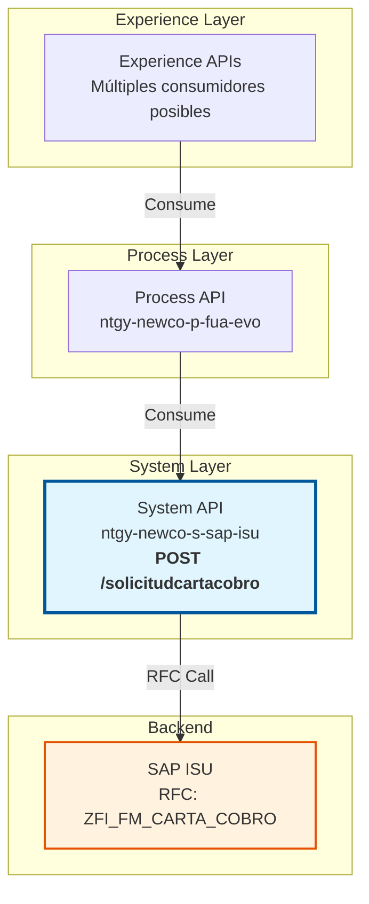
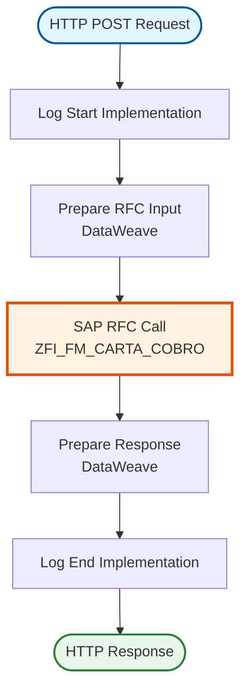
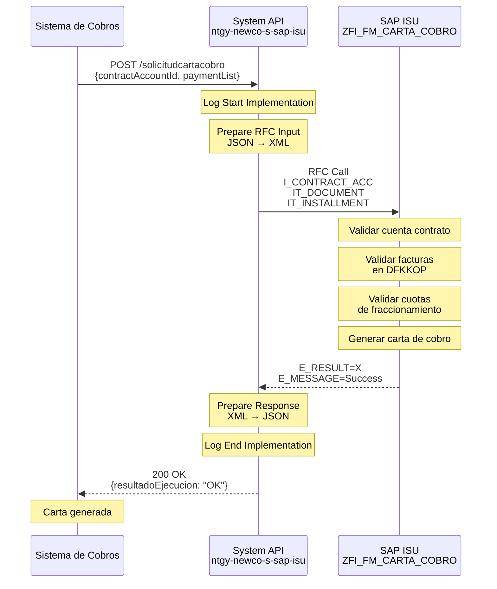
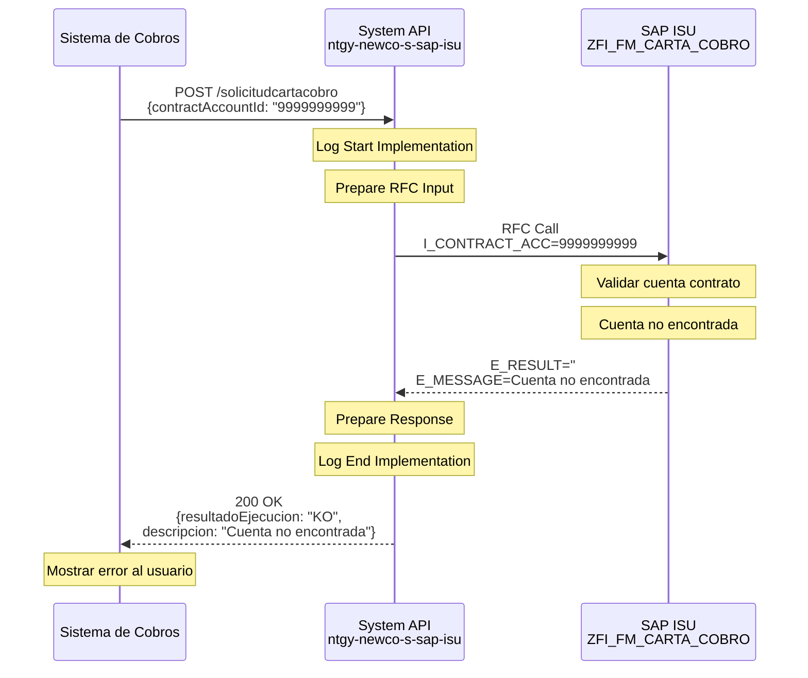
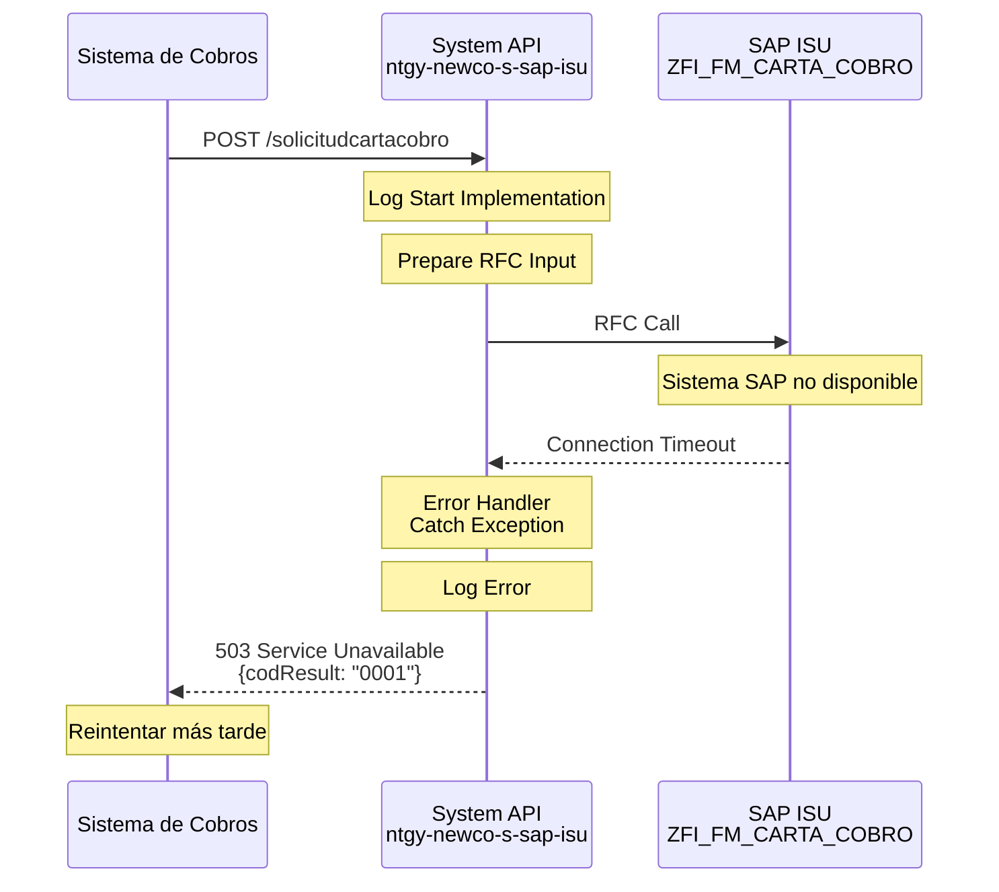

# POST /solicitudcartacobro

## 📌 Descripción General

### Propósito del Endpoint

Este endpoint solicita la generación de una carta de cobro para clientes con deuda impagada en SAP ISU. Permite incluir facturas específicas y cuotas de fraccionamiento en la carta de cobro generada.

### Tipo de API

**Capa:** System API (Integración directa con SAP ISU)

### Patrón de Integración

**Tipo:** Request-Reply Síncrono con SAP ISU

Este endpoint ejecuta directamente el RFC `ZFI_FM_CARTA_COBRO` en SAP ISU para generar la carta de cobro.

### Arquitectura API-Led Connectivity



---

## 💼 Propósito del Negocio

### Casos de Uso Principales

1. **Gestión de Deuda**: Generar cartas de cobro para clientes morosos
2. **Recordatorio de Pago**: Notificar deudas pendientes
3. **Proceso Legal**: Documentar intentos de cobro previos a acciones legales
4. **Fraccionamientos**: Incluir cuotas de planes de pago en cartas

### Contexto Empresarial

- **Dominio:** Gestión de Deuda y Cobros
- **Sector:** Energía - Utilities
- **División:** Naturgy NewCo
- **Proceso:** Gestión de Cobros

### Stakeholders

- **Departamento de Cobros**: Gestiona el proceso de recuperación de deuda
- **Atención al Cliente**: Informa sobre cartas enviadas
- **Departamento Legal**: Utiliza cartas como evidencia
- **Auditoría**: Supervisa el proceso de cobro

### Valor de Negocio

- **Recuperación de Deuda**: Facilita el cobro de importes pendientes
- **Trazabilidad**: Documenta intentos de cobro
- **Cumplimiento Legal**: Cumple requisitos previos a acciones legales
- **Automatización**: Reduce trabajo manual en gestión de cobros

### Consumidores Potenciales

Este endpoint puede ser consumido por:
- Sistemas de gestión de cobros
- Portales de back-office
- Aplicaciones de atención al cliente
- Sistemas de gestión de reclamaciones

---

## 🔧 Especificación Técnica

### URLs por Ambiente

| Ambiente | URL Base | URL Completa |
|----------|----------|--------------|
| Local | `http://localhost:8081` | `http://localhost:8081/api/solicitudcartacobro` |
| Desarrollo | `https://dev-ntgy-newco-s-sap-isu.cloudhub.io` | `https://dev-ntgy-newco-s-sap-isu.cloudhub.io/api/solicitudcartacobro` |
| UAT | `https://uat-ntgy-newco-s-sap-isu.cloudhub.io` | `https://uat-ntgy-newco-s-sap-isu.cloudhub.io/api/solicitudcartacobro` |
| Producción | `https://prod-ntgy-newco-s-sap-isu.cloudhub.io` | `https://prod-ntgy-newco-s-sap-isu.cloudhub.io/api/solicitudcartacobro` |

### Método HTTP

```
POST /solicitudcartacobro
```

### Parámetros de Entrada

#### Headers HTTP

| Header | Tipo | Requerido | Descripción | Ejemplo |
|--------|------|-----------|-------------|---------|
| `Content-Type` | string | Sí | Tipo de contenido | `application/json` |
| `Accept` | string | No | Tipo de respuesta esperada | `application/json` |

#### Body Parameters

| Campo | Tipo | Requerido | Descripción | Ejemplo |
|-------|------|-----------|-------------|---------|
| `contractAccountId` | string | Sí | Identificador de la cuenta contrato | `"200001234567"` |
| `paymentList` | array | No | Lista de facturas a incluir | Ver estructura |
| `paymentList[].invoiceId` | string | Sí | Número de factura | `"1234567890"` |
| `paymentDueList` | array | No | Lista de cuotas de fraccionamiento | Ver estructura |
| `paymentDueList[].numRef` | string | Sí | Número de referencia (OPBEL) | `"100012345678"` |
| `paymentDueList[].numberDueList` | array | Sí | Lista de números de cuota | Ver estructura |
| `paymentDueList[].numberDueList[].numberDue` | string | Sí | Número de cuota (OPUPK) | `"0001"` |

**Estructura del Request:**

```json
{
  "contractAccountId": "200001234567",
  "paymentList": [
    {
      "invoiceId": "1234567890"
    },
    {
      "invoiceId": "1234567891"
    }
  ],
  "paymentDueList": [
    {
      "numRef": "100012345678",
      "numberDueList": [
        {
          "numberDue": "0001"
        },
        {
          "numberDue": "0002"
        }
      ]
    }
  ]
}
```

### Respuestas

#### Respuesta Exitosa (200 OK)

```json
{
  "resultadoEjecucion": "OK",
  "descripcion": "Carta de cobro generada correctamente"
}
```

**Campos de la Respuesta:**

| Campo | Tipo | Descripción | Valores Posibles |
|-------|------|-------------|------------------|
| `resultadoEjecucion` | string | Estado de la operación | `"OK"` (éxito), `"KO"` (error) |
| `descripcion` | string | Mensaje descriptivo del resultado | Texto descriptivo |

#### Respuestas de Error

**400 Bad Request** - Parámetros inválidos:

```json
{
  "result": {
    "codResult": "0001",
    "msgResult": "Cuenta contrato no encontrada"
  }
}
```

**500 Internal Server Error** - Error en SAP ISU:

```json
{
  "result": {
    "codResult": "0001",
    "msgResult": "Error al generar carta de cobro en SAP"
  }
}
```

**503 Service Unavailable** - SAP ISU no disponible:

```json
{
  "result": {
    "codResult": "0001",
    "msgResult": "Sistema SAP ISU no disponible"
  }
}
```

### Autenticación

- **Tipo:** Client ID & Client Secret (Anypoint Platform)
- **Ubicación:** Headers HTTP
- **Flujo:** OAuth 2.0 Client Credentials

### Timeouts

| Tipo | Valor | Descripción |
|------|-------|-------------|
| Request Timeout | 30s | Tiempo máximo de espera para la respuesta |
| Connection Timeout | 10s | Tiempo máximo para establecer conexión |

### Protocolo

- **Protocolo:** HTTPS
- **TLS Version:** 1.2+
- **Método:** POST

---

## 🏗️ Implementación Técnica

### Arquitectura del Flow



### 🗄️ Base de Datos SAP ISU

#### RFC SAP Invocado

**RFC:** `ZFI_FM_CARTA_COBRO`

**Descripción:** RFC personalizado de SAP ISU para generar cartas de cobro para clientes con deuda impagada. Permite incluir facturas específicas y cuotas de fraccionamiento.

**Módulo SAP:** FI-CA (Financial Contract Accounting) - Dunning & Collection

**Tablas SAP Consultadas:**

| Tabla | Descripción | Operación |
|-------|-------------|-----------|
| `DFKKOP` | Open Items | SELECT |
| `FKKVKP` | Contract Account | SELECT |

#### Detalles de Tablas SAP

##### Tabla: `DFKKOP` (Open Items)

**Descripción:** Contiene las partidas abiertas (deudas pendientes) de los clientes en SAP ISU.

**Campos Utilizados:**

| Campo | Tipo ABAP | Descripción | Ejemplo |
|-------|-----------|-------------|---------|
| `OPBEL` | CHAR(12) | Número de partida abierta | `100012345678` |
| `VKONT` | CHAR(12) | Cuenta contrato | `200001234567` |
| `OPUPW` | CURR(15,2) | Importe en moneda local | `125.50` |
| `FAEDN` | DATS | Fecha de vencimiento | `20240215` |
| `AUGST` | CHAR(1) | Estado de compensación | `A` |
| `OPUPK` | NUMC(4) | Número de cuota | `0001` |

**Relaciones:**
- `DFKKOP.VKONT` → `FKKVKP.VKONT` (Cuenta contrato)
- `DFKKOP.OPBEL` → `ERCH.OPBEL` (Documento de factura)

##### Tabla: `FKKVKP` (Contract Account)

**Descripción:** Contiene información de cuentas contrato en SAP ISU.

**Campos Utilizados:**

| Campo | Tipo ABAP | Descripción | Ejemplo |
|-------|-----------|-------------|---------|
| `VKONT` | CHAR(12) | Número de cuenta contrato | `200001234567` |
| `GPART` | CHAR(10) | Business Partner | `0001234567` |
| `VKTYP` | CHAR(2) | Tipo de cuenta contrato | `01` |
| `ERDAT` | DATS | Fecha de creación | `20200115` |

**Relaciones:**
- `FKKVKP.VKONT` → `DFKKOP.VKONT` (Partidas abiertas)
- `FKKVKP.GPART` → `BUT000.PARTNER` (Business Partner)

**Notas de Performance:**
- El RFC utiliza índices primarios en DFKKOP y FKKVKP
- Tiempo de respuesta típico: 2-4 segundos
- Operación de solo lectura (SELECT)

### Transformaciones DataWeave

#### Transformación de Entrada (Request → SAP RFC)

**Archivo:** `src/main/resources/dw/unpaid-letter-rfc-input.dwl`

```dataweave
%dw 2.0
output application/xml
---
{
    "ZFI_FM_CARTA_COBRO": {
        "import": {
            ("IT_DOCUMENT": {
                "row": payload.paymentList map {
                    "N_FACTURA": $.invoiceId
                }
            }) if (!isEmpty(payload.paymentList)),
            ("IT_INSTALLMENT": {
                "row": flatten(payload.paymentDueList map (pago) ->
                    pago.numberDueList map (deuda) -> {
                        "OPBEL": pago.numRef,
                        "OPUPK": deuda.numberDue default "0000"
                    })
            }) if (!isEmpty(payload.paymentDueList)),
            "I_CONTRACT_ACC": payload.contractAccountId
        }
    }
}
```

**Mapeo de Campos:**

| Campo JSON (Input) | Campo SAP RFC | Transformación |
|-------------------|---------------|----------------|
| `contractAccountId` | `I_CONTRACT_ACC` | Directo |
| `paymentList[].invoiceId` | `IT_DOCUMENT.row.N_FACTURA` | Map array |
| `paymentDueList[].numRef` | `IT_INSTALLMENT.row.OPBEL` | Flatten + map |
| `paymentDueList[].numberDueList[].numberDue` | `IT_INSTALLMENT.row.OPUPK` | Flatten + map |

#### Transformación de Salida (SAP RFC → Response)

**Ubicación:** Inline en el flow XML

```dataweave
%dw 2.0
output application/json
---
{
    "resultadoEjecucion": if(payload.ZFI_FM_CARTA_COBRO.export.E_RESULT == "X") "OK" else "KO",
    "descripcion": payload.ZFI_FM_CARTA_COBRO.export.E_MESSAGE
}
```

**Mapeo de Campos:**

| Campo SAP RFC | Campo JSON (Output) | Transformación |
|---------------|-------------------|----------------|
| `E_RESULT` | `resultadoEjecucion` | Condicional: "X" → "OK", "" → "KO" |
| `E_MESSAGE` | `descripcion` | Directo |

### Patrones de Diseño

**Patrón:** Request-Reply Síncrono

**Justificación:**
- Operación que requiere confirmación inmediata
- La carta de cobro debe generarse antes de continuar
- No hay beneficio en procesamiento asíncrono

**Componentes:**
1. **Logger**: Logging de inicio y fin de operación
2. **DataWeave Transformer**: Transformación de JSON a XML SAP
3. **SAP Connector**: Ejecución del RFC
4. **DataWeave Transformer**: Transformación de respuesta SAP a JSON

### Diagramas de Secuencia

#### 1. Flujo Normal de Éxito



#### 2. Flujo con Error de Negocio



#### 3. Flujo con Error Técnico



### Connection Pooling

**Configuración del SAP JCo Connector:**

```xml
<sap:config name="SAP_Config">
    <sap:jco-connection-provider>
        <sap:pool-configuration 
            maxPoolSize="10"
            minPoolSize="2"
            maxIdleTime="300000"
            maxWaitTime="10000"/>
    </sap:jco-connection-provider>
</sap:config>
```

**Optimizaciones:**
- Pool de conexiones reutilizables
- Timeout de 10 segundos para obtener conexión
- Máximo 10 conexiones concurrentes

### Manejo de Errores

**Estrategia:**

1. **Validación de Entrada**: Verificar campos requeridos antes de llamar a SAP
2. **Try-Catch en Flow**: Capturar excepciones de SAP Connector
3. **Error Handler Global**: Transformar errores a formato estándar
4. **Logging**: Registrar todos los errores para troubleshooting

**Códigos de Error Manejados:**

| Código SAP | Código API | Descripción |
|------------|------------|-------------|
| `X` | `OK` | Carta generada exitosamente |
| `''` | `KO` | Error de negocio (cuenta no encontrada, etc.) |
| Connection Error | `0001` | Error de conexión con SAP |
| Timeout | `0001` | Timeout en la operación |

---

## 💻 Ejemplos de Uso

### Ejemplo 1: Carta con Facturas

#### cURL

```bash
curl -X POST "https://prod-ntgy-newco-s-sap-isu.cloudhub.io/api/solicitudcartacobro" \
  -H "Content-Type: application/json" \
  -H "client_id: your-client-id" \
  -H "client_secret: your-client-secret" \
  -d '{
    "contractAccountId": "200001234567",
    "paymentList": [
      {"invoiceId": "1234567890"},
      {"invoiceId": "1234567891"}
    ]
  }'
```

#### Respuesta

```json
{
  "resultadoEjecucion": "OK",
  "descripcion": "Carta de cobro generada correctamente"
}
```

### Ejemplo 2: Carta con Fraccionamiento

#### cURL

```bash
curl -X POST "https://prod-ntgy-newco-s-sap-isu.cloudhub.io/api/solicitudcartacobro" \
  -H "Content-Type: application/json" \
  -H "client_id: your-client-id" \
  -H "client_secret: your-client-secret" \
  -d '{
    "contractAccountId": "200001234567",
    "paymentDueList": [
      {
        "numRef": "100012345678",
        "numberDueList": [
          {"numberDue": "0001"},
          {"numberDue": "0002"}
        ]
      }
    ]
  }'
```

#### Respuesta

```json
{
  "resultadoEjecucion": "OK",
  "descripcion": "Carta de cobro generada correctamente"
}
```

### Ejemplo 3: Carta Completa (Facturas + Fraccionamiento)

#### cURL

```bash
curl -X POST "https://prod-ntgy-newco-s-sap-isu.cloudhub.io/api/solicitudcartacobro" \
  -H "Content-Type: application/json" \
  -H "client_id: your-client-id" \
  -H "client_secret: your-client-secret" \
  -d '{
    "contractAccountId": "200001234567",
    "paymentList": [
      {"invoiceId": "1234567890"}
    ],
    "paymentDueList": [
      {
        "numRef": "100012345678",
        "numberDueList": [
          {"numberDue": "0001"}
        ]
      }
    ]
  }'
```

#### Respuesta

```json
{
  "resultadoEjecucion": "OK",
  "descripcion": "Carta de cobro generada correctamente"
}
```

### Ejemplo 4: JavaScript (Fetch API)

```javascript
const generateCollectionLetter = async (contractAccountId, invoices, installments) => {
  try {
    const response = await fetch('https://prod-ntgy-newco-s-sap-isu.cloudhub.io/api/solicitudcartacobro', {
      method: 'POST',
      headers: {
        'Content-Type': 'application/json',
        'client_id': 'your-client-id',
        'client_secret': 'your-client-secret'
      },
      body: JSON.stringify({
        contractAccountId: contractAccountId,
        paymentList: invoices.map(id => ({ invoiceId: id })),
        paymentDueList: installments
      })
    });

    const data = await response.json();
    
    if (data.resultadoEjecucion === 'OK') {
      console.log('✓ Carta de cobro generada:', data.descripcion);
      return true;
    } else {
      console.error('✗ Error al generar carta:', data.descripcion);
      return false;
    }
  } catch (error) {
    console.error('Error de conexión:', error);
    throw error;
  }
};

// Uso
const success = await generateCollectionLetter(
  '200001234567',
  ['1234567890', '1234567891'],
  [{
    numRef: '100012345678',
    numberDueList: [
      { numberDue: '0001' },
      { numberDue: '0002' }
    ]
  }]
);
```

### Ejemplo 5: Python (requests)

```python
import requests
import json

def generate_collection_letter(contract_account_id, invoices=None, installments=None):
    """
    Genera una carta de cobro en SAP ISU
    
    Args:
        contract_account_id (str): Cuenta contrato
        invoices (list, optional): Lista de IDs de facturas
        installments (list, optional): Lista de cuotas de fraccionamiento
    
    Returns:
        dict: Respuesta del API
    """
    url = 'https://prod-ntgy-newco-s-sap-isu.cloudhub.io/api/solicitudcartacobro'
    
    headers = {
        'Content-Type': 'application/json',
        'client_id': 'your-client-id',
        'client_secret': 'your-client-secret'
    }
    
    payload = {
        'contractAccountId': contract_account_id
    }
    
    if invoices:
        payload['paymentList'] = [{'invoiceId': inv_id} for inv_id in invoices]
    
    if installments:
        payload['paymentDueList'] = installments
    
    try:
        response = requests.post(url, headers=headers, json=payload, timeout=30)
        response.raise_for_status()
        
        data = response.json()
        
        if data['resultadoEjecucion'] == 'OK':
            print(f"✓ Carta generada: {data['descripcion']}")
        else:
            print(f"✗ Error: {data['descripcion']}")
        
        return data
        
    except requests.exceptions.Timeout:
        print("✗ Error: Timeout en la petición")
        raise
    except requests.exceptions.RequestException as e:
        print(f"✗ Error de conexión: {e}")
        raise

# Uso
result = generate_collection_letter(
    '200001234567',
    invoices=['1234567890', '1234567891'],
    installments=[{
        'numRef': '100012345678',
        'numberDueList': [
            {'numberDue': '0001'},
            {'numberDue': '0002'}
        ]
    }]
)
print(json.dumps(result, indent=2))
```

### Ejemplo 6: Postman Collection

```json
{
  "info": {
    "name": "POST /solicitudcartacobro",
    "description": "Generación de carta de cobro",
    "schema": "https://schema.getpostman.com/json/collection/v2.1.0/collection.json"
  },
  "item": [
    {
      "name": "Carta con Facturas",
      "request": {
        "method": "POST",
        "header": [
          {
            "key": "Content-Type",
            "value": "application/json"
          },
          {
            "key": "client_id",
            "value": "{{client_id}}"
          },
          {
            "key": "client_secret",
            "value": "{{client_secret}}"
          }
        ],
        "body": {
          "mode": "raw",
          "raw": "{\n  \"contractAccountId\": \"200001234567\",\n  \"paymentList\": [\n    {\"invoiceId\": \"1234567890\"},\n