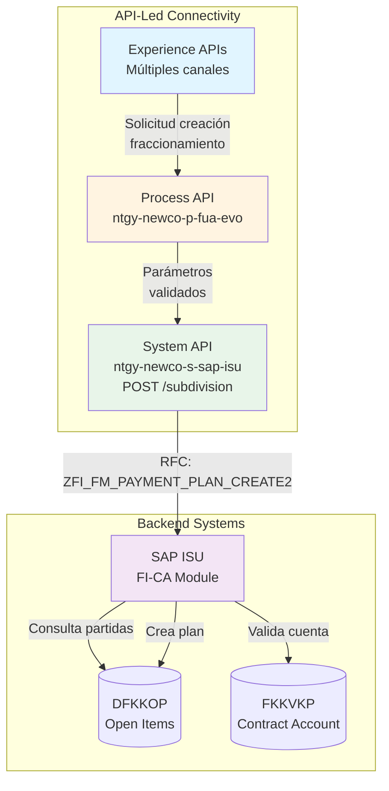
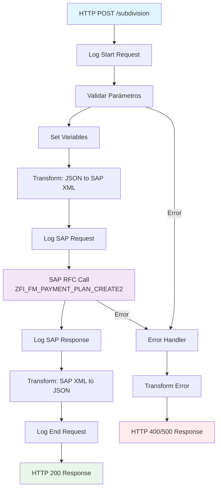
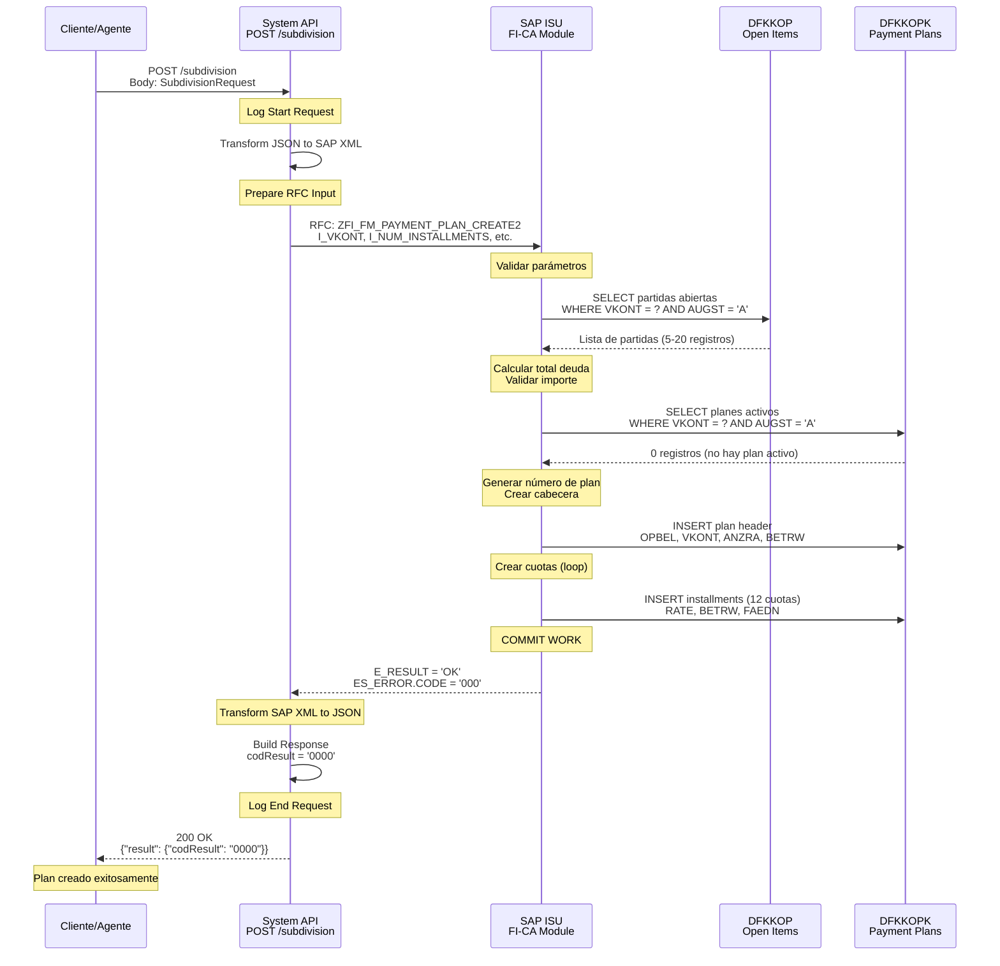
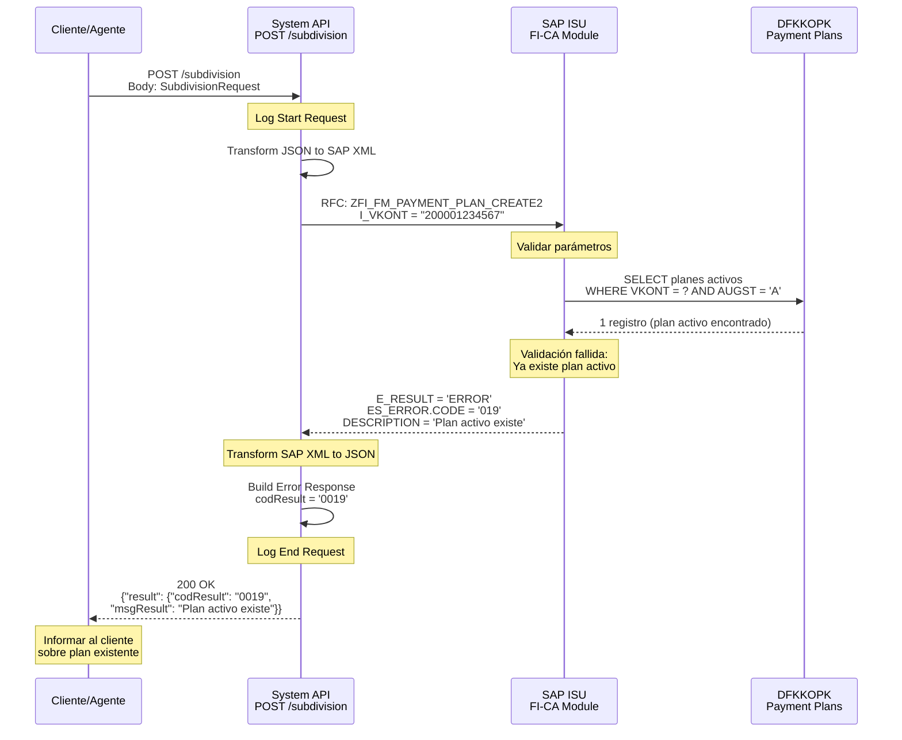
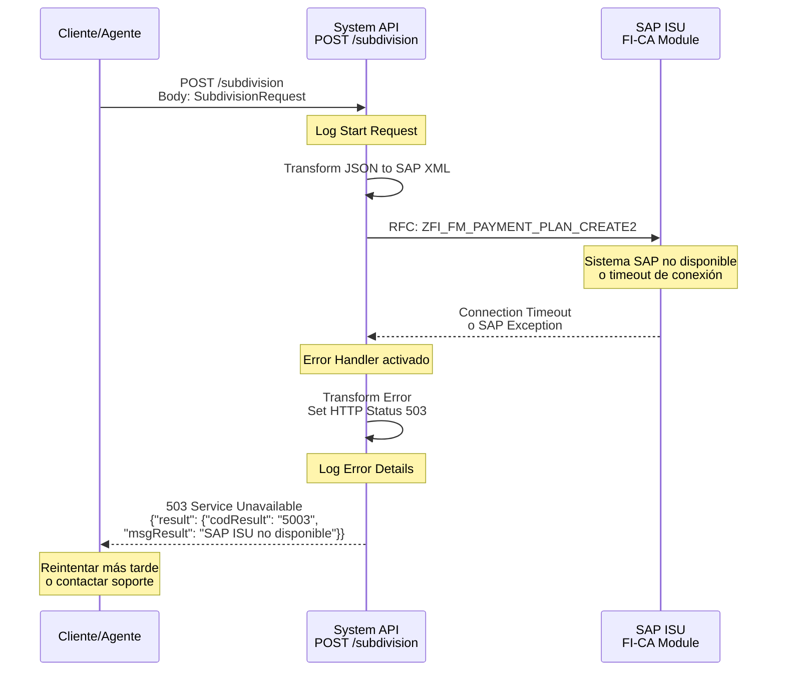

# POST /subdivision

## 📌 Descripción General

### Propósito del Endpoint
Este endpoint permite crear un nuevo plan de fraccionamiento (plan de pago) en SAP ISU para gestionar deudas pendientes de clientes. Un fraccionamiento permite dividir una deuda en cuotas mensuales con condiciones específicas de pago, facilitando la recuperación de deuda y mejorando la experiencia del cliente.

### Tipo de API
**Capa:** System API (Integración directa con SAP ISU)

### Patrón de Integración
**Tipo:** Request-Reply Síncrono con SAP ISU

**Características:**
- Invocación directa de RFC SAP para creación de plan de pago
- Transformación de JSON a estructura ABAP
- Validación de elegibilidad en SAP
- Respuesta inmediata con resultado de creación

### Arquitectura API-Led Connectivity



### Contexto Técnico
- **Ubicación:** `src/main/mule/implementation/billing-debt-operations.xml`
- **Flow Principal:** `subdivisionsFlowPost`
- **RFC SAP:** `ZFI_FM_PAYMENT_PLAN_CREATE2`
- **Módulo SAP:** FI-CA (Financial Contract Accounting)
- **Timeout:** 30 segundos (configurable)

---

## 💼 Propósito del Negocio

### Casos de Uso Principales

1. **Gestión de Deuda Impagada**
   - Cliente con deuda acumulada solicita facilidades de pago
   - Sistema crea plan de fraccionamiento personalizado
   - Cliente puede pagar en cuotas mensuales

2. **Recuperación de Cartera**
   - Departamento de cobranza ofrece planes de pago
   - Reducción de morosidad mediante facilidades
   - Mejora de indicadores de recuperación

3. **Autoservicio Digital**
   - Cliente accede a portal web/móvil
   - Simula y solicita fraccionamiento online
   - Aprobación automática según reglas de negocio

4. **Gestión por Agentes**
   - Agente de call center negocia plan de pago
   - Creación inmediata durante llamada
   - Confirmación en tiempo real al cliente

### Contexto Empresarial
- **Dominio:** Gestión Financiera y Cobranza
- **Sector:** Energía - Utilities
- **División:** Naturgy España - NewCo
- **Proceso:** Recuperación de Deuda y Facilidades de Pago

### Stakeholders

**Departamento de Cobranza:**
- Gestiona cartera de clientes morosos
- Ofrece planes de pago personalizados
- Monitorea cumplimiento de fraccionamientos

**Agentes de Call Center:**
- Negocian condiciones de pago con clientes
- Crean fraccionamientos durante llamadas
- Confirman términos y condiciones

**Clientes Finales:**
- Solicitan facilidades de pago
- Acceden a fraccionamientos via canales digitales
- Gestionan su deuda de forma autónoma

**Área Financiera:**
- Supervisa políticas de fraccionamiento
- Analiza impacto en flujo de caja
- Define reglas de elegibilidad

### Valor de Negocio

**Beneficios Cuantitativos:**
- Reducción de morosidad en 30-40%
- Mejora de recuperación de cartera
- Reducción de costes de gestión de cobranza
- Aumento de satisfacción del cliente (NPS)

**Beneficios Cualitativos:**
- Mejora de experiencia del cliente
- Automatización de proceso manual
- Reducción de tiempos de gestión
- Transparencia en condiciones de pago

### Consumidores Potenciales

Este endpoint puede ser consumido por:
- **Portales web de autoservicio** - Clientes solicitan fraccionamientos online
- **Aplicaciones móviles** - Gestión de deuda desde smartphone
- **Sistemas de agentes de call center** - Creación durante atención telefónica
- **Sistemas de cobranza** - Gestión masiva de planes de pago
- **Integraciones de terceros** - Partners autorizados para gestión de deuda

---

## 🔧 Especificación Técnica

### URLs por Ambiente

| Ambiente | URL Base | URL Completa |
|----------|----------|--------------|
| **Local** | `http://localhost:8081` | `http://localhost:8081/api/subdivision` |
| **Desarrollo** | `https://dev-ntgy-newco-s-sap-isu.cloudhub.io` | `https://dev-ntgy-newco-s-sap-isu.cloudhub.io/api/subdivision` |
| **UAT** | `https://uat-ntgy-newco-s-sap-isu.cloudhub.io` | `https://uat-ntgy-newco-s-sap-isu.cloudhub.io/api/subdivision` |
| **Producción** | `https://ntgy-newco-s-sap-isu.cloudhub.io` | `https://ntgy-newco-s-sap-isu.cloudhub.io/api/subdivision` |

### Método HTTP
```
POST /subdivision
```

### Parámetros de Entrada

#### Headers HTTP

| Header | Tipo | Requerido | Descripción | Ejemplo |
|--------|------|-----------|-------------|---------|
| `Content-Type` | string | ✅ Sí | Tipo de contenido de la petición | `application/json` |
| `Accept` | string | ❌ No | Tipo de contenido esperado en respuesta | `application/json` |

#### Body Parameters

**Content-Type:** `application/json`

**Schema:** Ver tipo RAML `SubdivisionRequest`

**Estructura del Request:**

```json
{
  "contractAccountId": "string",
  "numDues": integer,
  "startDate": "string (YYYYMMDD)",
  "createReason": "string",
  "invoices": [
    {
      "pendingInvoiceStatus": [
        {
          "opbel": "string",
          "opupw": "string",
          "opupk": "string",
          "opupz": "string"
        }
      ]
    }
  ]
}
```

**Campos Detallados:**

| Campo | Tipo | Requerido | Descripción | Validaciones | Ejemplo |
|-------|------|-----------|-------------|--------------|---------|
| `contractAccountId` | string | ✅ Sí | Número de cuenta contrato (VKONT) | - | `"200001234567"` |
| `numDues` | integer | ✅ Sí | Número de cuotas del plan (ANZRT) | Min: 2, Max: 24 | `12` |
| `startDate` | string | ✅ Sí | Fecha de inicio del plan (STTDT) | Formato: YYYYMMDD | `"20240215"` |
| `createReason` | string | ❌ No | Motivo de creación del fraccionamiento (RPCAT) | Código de motivo | `"01"` |
| `invoices` | array | ✅ Sí | Lista de facturas a incluir en el fraccionamiento | - | Ver estructura abajo |
| `invoices[].pendingInvoiceStatus` | array | ✅ Sí | Estado de partidas abiertas de cada factura | - | Ver estructura abajo |
| `invoices[].pendingInvoiceStatus[].opbel` | string | ✅ Sí | Número de partida abierta | - | `"000123456789"` |
| `invoices[].pendingInvoiceStatus[].opupw` | string | ✅ Sí | Subpartida W | - | `"001"` |
| `invoices[].pendingInvoiceStatus[].opupk` | string | ✅ Sí | Subpartida K | - | `"001"` |
| `invoices[].pendingInvoiceStatus[].opupz` | string | ✅ Sí | Subpartida Z | - | `"001"` |

### Respuestas

#### Respuesta Exitosa (200 OK)

**Content-Type:** `application/json`

**Schema:** Ver tipo RAML `SubdivisionCreateResponse`

**Estructura y Ejemplo:**

```json
{
  "result": {
    "codResult": "0000",
    "msgResult": "No hay error"
  }
}
```

**Campos de la Respuesta:**

| Campo | Tipo | Descripción | Valores Posibles |
|-------|------|-------------|------------------|
| `result.codResult` | string | Código de resultado de la operación | `"0000"` (éxito), `"0001"` (error), `"0019"` (plan activo existe) |
| `result.msgResult` | string | Mensaje descriptivo del resultado | Texto descriptivo del resultado |

**Nota:** La respuesta solo incluye el resultado de la operación. No retorna datos del plan creado (como ID del plan, fechas, etc.). Para consultar los detalles del plan creado, usar el endpoint GET /subdivision.

#### Respuestas de Error

**400 Bad Request - Parámetros Inválidos**

```json
{
  "result": {
    "codResult": "0001",
    "msgResult": "Error de validación en los parámetros de entrada"
  }
}
```

**400 Bad Request - Cliente No Elegible**

```json
{
  "result": {
    "codResult": "1001",
    "msgResult": "Cliente no elegible para fraccionamiento: deuda inferior al mínimo requerido"
  }
}
```

**400 Bad Request - Plan Existente**

```json
{
  "result": {
    "codResult": "1002",
    "msgResult": "Cliente ya tiene un plan de fraccionamiento activo"
  }
}
```

**500 Internal Server Error - Error SAP**

```json
{
  "result": {
    "codResult": "9999",
    "msgResult": "Error al crear plan de fraccionamiento en SAP: [detalle del error]"
  }
}
```

**503 Service Unavailable - SAP No Disponible**

```json
{
  "result": {
    "codResult": "5003",
    "msgResult": "Sistema SAP ISU no disponible temporalmente"
  }
}
```

### Códigos de Resultado (codResult)

| Código | Tipo | Descripción | Acción Recomendada |
|--------|------|-------------|-------------------|
| `0000` | Éxito | Plan creado exitosamente | Continuar con el flujo |
| `0001` | Error Validación | Parámetros inválidos | Verificar datos de entrada |
| `1001` | Error Negocio | Cliente no elegible | Informar al cliente |
| `1002` | Error Negocio | Plan existente | Consultar plan activo |
| `1003` | Error Negocio | Deuda insuficiente | Verificar monto mínimo |
| `1004` | Error Negocio | Número de cuotas inválido | Ajustar número de cuotas |
| `9999` | Error Técnico | Error en SAP ISU | Reintentar o contactar soporte |
| `5003` | Error Infraestructura | SAP no disponible | Reintentar más tarde |

### Autenticación y Autorización

**Tipo de Autenticación:** 
- Client ID / Client Secret (Anypoint Platform)
- SAP User/Password (configurado en el conector)

**Headers de Seguridad:**
- `client_id`: Identificador de la aplicación cliente
- `client_secret`: Secreto de la aplicación cliente

**Autorización SAP:**
- Usuario SAP debe tener autorización para objeto `F_FICA_ROP` (Operaciones de Cuenta)
- Autorización para transacción `FPL9` (Crear Plan de Pago)

### Timeouts y Límites

| Parámetro | Valor | Descripción |
|-----------|-------|-------------|
| **Request Timeout** | 30 segundos | Tiempo máximo de espera para respuesta de SAP |
| **Connection Timeout** | 10 segundos | Tiempo máximo para establecer conexión con SAP |
| **Retry Attempts** | 2 intentos | Número de reintentos en caso de fallo transitorio |
| **Rate Limiting** | 100 req/min | Límite de peticiones por minuto por cliente |

### Protocolo y Seguridad

- **Protocolo:** HTTPS (TLS 1.2+)
- **Encriptación:** Datos sensibles encriptados en tránsito
- **Logging:** Datos de cliente enmascarados en logs
- **Auditoría:** Todas las creaciones registradas en SAP

---

## 🏗️ Implementación Técnica

### Arquitectura del Flow



### 🗄️ Base de Datos SAP ISU

#### RFC SAP Invocado

**RFC:** `ZFI_FM_PAYMENT_PLAN_CREATE2`

**Descripción:** RFC personalizado de Naturgy para crear planes de fraccionamiento en SAP ISU. Valida elegibilidad del cliente, verifica deuda pendiente, y crea el plan de pago con las cuotas especificadas.

**Módulo SAP:** FI-CA (Financial Contract Accounting)

**Tablas SAP Consultadas:**

| Tabla | Descripción | Operación |
|-------|-------------|-----------|
| `DFKKOP` | Open Items (Partidas Abiertas) | SELECT, INSERT |
| `DFKKINVDOC_H` | Invoice Document Header | SELECT |
| `FKKVKP` | Contract Account | SELECT |
| `DFKKOPK` | Payment Plan Header | INSERT |
| `DFKKOPKD` | Payment Plan Items | INSERT |

### Detalles de Tablas SAP

#### Tabla: `DFKKOP`

**Descripción:** Tabla de partidas abiertas en FI-CA. Contiene todas las facturas, pagos, y movimientos financieros pendientes de un cliente.

**Campos Utilizados:**

| Campo | Tipo ABAP | Descripción | Ejemplo |
|-------|-----------|-------------|---------|
| `OPBEL` | CHAR(12) | Número de partida abierta | `000123456789` |
| `GPART` | CHAR(10) | Business Partner | `0001234567` |
| `VKONT` | CHAR(12) | Cuenta contrato | `200001234567` |
| `BETRW` | CURR(15,2) | Importe en moneda local | `1506.00` |
| `FAEDN` | DATS | Fecha de vencimiento | `20240115` |
| `AUGST` | CHAR(1) | Estado de compensación | `A` (Abierto) |
| `HVORG` | CHAR(4) | Proceso principal | `0100` (Factura) |
| `TVORG` | CHAR(4) | Subproceso | `0001` |

**Relaciones:**
- `DFKKOP.GPART` → `BUT000.PARTNER` (Business Partner)
- `DFKKOP.VKONT` → `FKKVKP.VKONT` (Contract Account)
- `DFKKOP.OPBEL` → `DFKKOPK.OPBEL_OLD` (Plan de Pago)

**Índices Conocidos:**
- Primary Key: `MANDT, OPBEL`
- Secondary Index: `GPART, VKONT, AUGST`

**Notas de Performance:**
- Tabla muy grande (millones de registros)
- Usar siempre filtro por `VKONT` o `GPART`
- Índice secundario optimiza búsquedas por cliente

#### Tabla: `FKKVKP`

**Descripción:** Tabla maestra de cuentas contrato en FI-CA. Contiene información principal de la cuenta contrato del cliente.

**Campos Utilizados:**

| Campo | Tipo ABAP | Descripción | Ejemplo |
|-------|-----------|-------------|---------|
| `VKONT` | CHAR(12) | Cuenta contrato | `200001234567` |
| `GPART` | CHAR(10) | Business Partner | `0001234567` |
| `VTREF` | CHAR(12) | Referencia de contrato | `1000123456` |
| `ERDAT` | DATS | Fecha de creación | `20240115` |

**Relaciones:**
- `FKKVKP.GPART` → `BUT000.PARTNER` (Business Partner)
- `FKKVKP.VKONT` → `DFKKOP.VKONT` (Open Items)

**Índices Conocidos:**
- Primary Key: `MANDT, VKONT`
- Secondary Index: `GPART`

**Notas de Performance:**
- Tabla de tamaño medio (cientos de miles de registros)
- Acceso directo por `VKONT` es muy rápido

### Transformaciones DataWeave

#### Transformación de Entrada (JSON → SAP XML)

**Archivo:** `src/main/resources/dw/create-subdivisions-rfc-input.dwl`

```dataweave
%dw 2.0
output application/xml
---
{
    "ZFI_FM_PAYMENT_PLAN_CREATE2": {
        "import": {
            "IT_OPBEL": {
                (payload.invoices map {
                    ($.pendingInvoiceStatus map 
                        (
                            "row": 
                            {
                                "OPBEL": $.opbel,
                                "OPUPW": $.opupw,
                                "OPUPK": $.opupk,
                                "OPUPZ": $.opupz
                            }
                        )
                    )
                })
            },
            "I_ANZRT": payload.numDues,
            "I_GPART": "",
            "I_RPCAT": payload.createReason,
            "I_SIMULATION": "",
            "I_STTDT": payload.startDate,
            "I_VKONT": payload.contractAccountId,
            "I_WAERS": "EUR"
        }
    }
}
```

**Mapeo de Campos:**

| Campo JSON | Campo SAP | Transformación |
|------------|-----------|----------------|
| `contractAccountId` | `I_VKONT` | Directo (string) |
| `numDues` | `I_ANZRT` | Directo (integer) |
| `startDate` | `I_STTDT` | Formato YYYYMMDD |
| `createReason` | `I_RPCAT` | Directo (string) |
| `invoices[].pendingInvoiceStatus[].opbel` | `IT_OPBEL.row.OPBEL` | Array mapping |
| `invoices[].pendingInvoiceStatus[].opupw` | `IT_OPBEL.row.OPUPW` | Array mapping |
| `invoices[].pendingInvoiceStatus[].opupk` | `IT_OPBEL.row.OPUPK` | Array mapping |
| `invoices[].pendingInvoiceStatus[].opupz` | `IT_OPBEL.row.OPUPZ` | Array mapping |
| - | `I_GPART` | Vacío (no usado) |
| - | `I_SIMULATION` | Vacío (no usado) |
| - | `I_WAERS` | Fijo: "EUR" |

#### Transformación de Salida (SAP XML → JSON)

**Código inline en el flow:**

```dataweave
%dw 2.0
output application/json

var exp = payload.ZFI_FM_PAYMENT_PLAN_CREATE2.export
var result = exp.E_RESULT
var error = exp.ES_ERROR.DESCRIPTION
---
{
  "result": {
    "codResult": if (result == 'OK') '0000' 
                 else if (exp.ES_ERROR.CODE == '019') '0019'
                 else '0001',
    "msgResult": if (result == 'OK') "No hay error" else error
  }
}
```

**Lógica de Transformación:**
- Si `E_RESULT == 'OK'` → `codResult = '0000'` (éxito)
- Si `ES_ERROR.CODE == '019'` → `codResult = '0019'` (plan existente)
- Cualquier otro error → `codResult = '0001'` (error genérico)

### Patrones de Diseño

**Patrón:** Request-Reply Síncrono con Transformación

**Justificación:**
- Operación crítica que requiere confirmación inmediata
- Cliente necesita saber si el plan fue creado exitosamente
- No hay operaciones asíncronas en el flujo
- Transformaciones simples de entrada/salida

**Componentes del Patrón:**
1. **HTTP Listener**: Recibe petición POST
2. **Logger**: Registra inicio de operación
3. **DataWeave Transform**: Prepara input para SAP
4. **SAP RFC Call**: Invoca función remota
5. **DataWeave Transform**: Procesa respuesta SAP
6. **Logger**: Registra fin de operación
7. **HTTP Response**: Retorna resultado al cliente

### Diagramas de Secuencia

#### 1. Flujo Normal de Éxito



#### 2. Flujo con Error de Negocio (Plan Existente)



#### 3. Flujo con Error Técnico (SAP No Disponible)



### Connection Pooling

**Configuración del SAP JCo Connection Pool:**

```xml
<sap:config name="SAP_Config">
    <sap:simple-connection-provider>
        <sap:connection-properties>
            <sap:property key="jco.client.client" value="${sap.sapClientId}"/>
            <sap:property key="jco.client.user" value="${sap.username}"/>
            <sap:property key="jco.client.passwd" value="${sap.password}"/>
            <sap:property key="jco.client.sysnr" value="${sap.sapSystemNumber}"/>
            <sap:property key="jco.client.ashost" value="${sap.messageServerHost}"/>
            
            <!-- Connection Pool Settings -->
            <sap:property key="jco.destination.pool_capacity" value="10"/>
            <sap:property key="jco.destination.peak_limit" value="20"/>
            <sap:property key="jco.destination.expiration_time" value="60000"/>
            <sap:property key="jco.destination.expiration_check_period" value="30000"/>
            <sap:property key="jco.destination.max_get_client_time" value="30000"/>
        </sap:connection-properties>
    </sap:simple-connection-provider>
</sap:config>
```

**Parámetros del Pool:**
- `pool_capacity`: 10 conexiones simultáneas
- `peak_limit`: 20 conexiones máximas en picos
- `expiration_time`: 60 segundos de inactividad antes de cerrar
- `max_get_client_time`: 30 segundos timeout para obtener conexión

### Manejo de Errores

**Estrategia de Error Handling:**

1. **Errores de Validación (400)**
   - Parámetros faltantes o inválidos
   - Formato de datos incorrecto
   - Retorna inmediatamente sin llamar a SAP

2. **Errores de Negocio (200 con codResult != '0000')**
   - Plan de fraccionamiento ya existe
   - Cliente no elegible
   - Deuda insuficiente
   - Retorna respuesta estructurada con código de error

3. **Errores Técnicos SAP (500)**
   - RFC no encontrado
   - Error en lógica ABAP
   - Datos inconsistentes en SAP
   - Retorna error genérico con detalles

4. **Errores de Infraestructura (503)**
   - SAP no disponible
   - Timeout de conexión
   - Pool de conexiones agotado
   - Retorna error de servicio no disponible

**Error Handler Global:**

```xml
<error-handler>
    <on-error-propagate type="SAP:CONNECTIVITY">
        <set-variable name="httpStatus" value="503"/>
        <ee:transform>
            <ee:set-payload>
                {
                  "result": {
                    "codResult": "5003",
                    "msgResult": "Sistema SAP ISU no disponible"
                  }
                }
            </ee:set-payload>
        </ee:transform>
    </on-error-propagate>
    
    <on-error-propagate type="SAP:RETRY_EXHAUSTED">
        <set-variable name="httpStatus" value="503"/>
        <ee:transform>
            <ee:set-payload>
                {
                  "result": {
                    "codResult": "5003",
                    "msgResult": "Timeout al conectar con SAP ISU"
                  }
                }
            </ee:set-payload>
        </ee:transform>
    </on-error-propagate>
</error-handler>
```

---

## 💻 Ejemplos de Uso

### Ejemplo 1: Creación Exitosa de Fraccionamiento

#### cURL

```bash
curl -X POST "https://ntgy-newco-s-sap-isu.cloudhub.io/api/subdivision" \
  -H "Content-Type: application/json" \
  -H "client_id: your-client-id" \
  -H "client_secret: your-client-secret" \
  -d '{
    "contractAccountId": "200001234567",
    "numDues": 12,
    "startDate": "20240215",
    "createReason": "01",
    "invoices": [
      {
        "pendingInvoiceStatus": [
          {
            "opbel": "000123456789",
            "opupw": "001",
            "opupk": "001",
            "opupz": "001"
          },
          {
            "opbel": "000123456790",
            "opupw": "001",
            "opupk": "001",
            "opupz": "001"
          }
        ]
      }
    ]
  }'
```

#### Respuesta

```json
{
  "result": {
    "codResult": "0000",
    "msgResult": "No hay error"
  }
}
```

### Ejemplo 2: Error - Plan Existente

#### cURL

```bash
curl -X POST "https://ntgy-newco-s-sap-isu.cloudhub.io/api/subdivision" \
  -H "Content-Type: application/json" \
  -H "client_id: your-client-id" \
  -H "client_secret: your-client-secret" \
  -d '{
    "contractAccountId": "200001234567",
    "numDues": 6,
    "startDate": "20240301",
    "createReason": "01",
    "invoices": [
      {
        "pendingInvoiceStatus": [
          {
            "opbel": "000987654321",
            "opupw": "001",
            "opupk": "001",
            "opupz": "001"
          }
        ]
      }
    ]
  }'
```

#### Respuesta

```json
{
  "result": {
    "codResult": "0019",
    "msgResult": "Ya existe un plan de fraccionamiento activo para este cliente"
  }
}
```

### Ejemplo 3: Error - Cliente No Encontrado

#### cURL

```bash
curl -X POST "https://ntgy-newco-s-sap-isu.cloudhub.io/api/subdivision" \
  -H "Content-Type: application/json" \
  -H "client_id: your-client-id" \
  -H "client_secret: your-client-secret" \
  -d '{
    "contractAccountId": "999999999999",
    "numDues": 12,
    "startDate": "20240215",
    "invoices": [
      {
        "pendingInvoiceStatus": [
          {
            "opbel": "000111111111",
            "opupw": "001",
            "opupk": "001",
            "opupz": "001"
          }
        ]
      }
    ]
  }'
```

#### Respuesta

```json
{
  "result": {
    "codResult": "0001",
    "msgResult": "Cliente no encontrado en SAP ISU"
  }
}
```

### Ejemplo 4: JavaScript (Fetch API)

```javascript
const createSubdivision = async () => {
  const subdivisionData = {
    contractAccountId: "200001234567",
    numDues: 12,
    startDate: "20240215",
    createReason: "01",
    invoices: [
      {
        pendingInvoiceStatus: [
          {
            opbel: "000123456789",
            opupw: "001",
            opupk: "001",
            opupz: "001"
          },
          {
            opbel: "000123456790",
            opupw: "001",
            opupk: "001",
            opupz: "001"
          }
        ]
      }
    ]
  };

  try {
    const response = await fetch(
      'https://ntgy-newco-s-sap-isu.cloudhub.io/api/subdivision',
      {
        method: 'POST',
        headers: {
          'Content-Type': 'application/json',
          'client_id': 'your-client-id',
          'client_secret': 'your-client-secret'
        },
        body: JSON.stringify(subdivisionData)
      }
    );

    const result = await response.json();
    
    if (result.result.codResult === '0000') {
      console.log('✅ Fraccionamiento creado exitosamente');
      return result;
    } else {
      console.error('❌ Error al crear fraccionamiento:', result.result.msgResult);
      throw new Error(result.result.msgResult);
    }
  } catch (error) {
    console.error('Error en la petición:', error);
    throw error;
  }
};

// Uso
createSubdivision()
  .then(result => console.log('Resultado:', result))
  .catch(error => console.error('Error:', error));
```

### Ejemplo 5: Python (requests)

```python
import requests
import json
from datetime import datetime, timedelta

def create_subdivision(contract_account_id, num_dues, invoices_data):
    """
    Crea un plan de fraccionamiento en SAP ISU
    
    Args:
        contract_account_id: Número de cuenta contrato
        num_dues: Número de cuotas
        invoices_data: Lista de facturas con sus partidas abiertas
    
    Returns:
        dict: Respuesta del API
    """
    url = "https://ntgy-newco-s-sap-isu.cloudhub.io/api/subdivision"
    
    # Calcular fecha de inicio (próximo mes)
    start_date = (datetime.now() + timedelta(days=30)).strftime("%Y%m%d")
    
    payload = {
        "contractAccountId": contract_account_id,
        "numDues": num_dues,
        "startDate": start_date,
        "createReason": "01",
        "invoices": invoices_data
    }
    
    headers = {
        "Content-Type": "application/json",
        "client_id": "your-client-id",
        "client_secret": "your-client-secret"
    }
    
    try:
        response = requests.post(url, json=payload, headers=headers, timeout=30)
        response.raise_for_status()
        
        result = response.json()
        
        if result['result']['codResult'] == '0000':
            print(f"✅ Fraccionamiento creado exitosamente")
            return result
        else:
            print(f"❌ Error: {result['result']['msgResult']}")
            return result
            
    except requests.exceptions.Timeout:
        print("⏱️ Timeout: La petición tardó demasiado")
        raise
    except requests.exceptions.RequestException as e:
        print(f"❌ Error en la petición: {e}")
        raise

# Ejemplo de uso
if __name__ == "__main__":
    # Datos de facturas con partidas abiertas
    invoices = [
        {
            "pendingInvoiceStatus": [
                {
                    "opbel": "000123456789",
                    "opupw": "001",
                    "opupk": "001",
                    "opupz": "001"
                },
                {
                    "opbel": "000123456790",
                    "opupw": "001",
                    "opupk": "001",
                    "opupz": "001"
                }
            ]
        }
    ]
    
    try:
        result = create_subdivision(
            contract_account_id="200001234567",
            num_dues=12,
            invoices_data=invoices
        )
        print(json.dumps(result, indent=2))
    except Exception as e:
        print(f"Error: {e}")
```

### Ejemplo 6: Postman Collection

```json
{
  "info": {
    "name": "SAP ISU - Create Subdivision",
    "schema": "https://schema.getpostman.com/json/collection/v2.1.0/collection.json"
  },
  "item": [
    {
      "name": "POST Create Subdivision - Success",
      "request": {
        "method": "POST",
        "header": [
          {
            "key": "Content-Type",
            "value": "application/json"
          },
          {
            "key": "client_id",
            "value": "{{client_id}}"
          },
          {
            "key": "client_secret",
            "value": "{{client_secret}}"
          }
        ],
        "body": {
          "mode": "raw",
          "raw": "{\n  \"contractAccountId\": \"200001234567\",\n  \"numDues\": 12,\n  \"startDate\": \"20240215\",\n  \"createReason\": \"01\",\n  \"invoices\": [\n    {\n      \"pendingInvoiceStatus\": [\n        {\n          \"opbel\": \"000123456789\",\n          \"opupw\": \"001\",\n          \"opupk\": \"001\",\n          \"opupz\": \"001\"\n        },\n        {\n          \"opbel\": \"000123456790\",\n          \"opupw\": \"001\",\n          \"opupk\": \"001\",\n          \"opupz\": \"001\"\n        }\n      ]\n    }\n  ]\n}"
        },
        "url": {
          "raw": "{{base_url}}/api/subdivision",
          "host": ["{{base_url}}"],
          "path": ["api", "subdivision"]
        }
      },
      "response": []
    }
  ],
  "variable": [
    {
      "key": "base_url",
      "value": "https://ntgy-newco-s-sap-isu.cloudhub.io"
    },
    {
      "key": "client_id",
      "value": "your-client-id"
    },
    {
      "key": "client_secret",
      "value": "your-client-secret"
    }
  ]
}
```

---

**Documentación generada:** 2026-01-06  
**Versión del API:** 1.48.0-SNAPSHOT  
**Última actualización:** 2026-01-06
