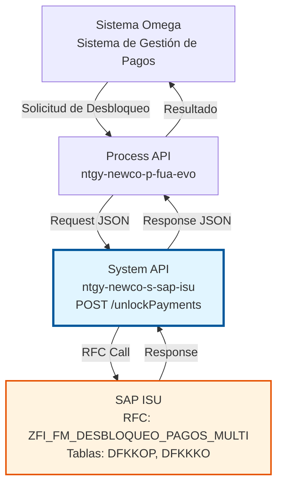
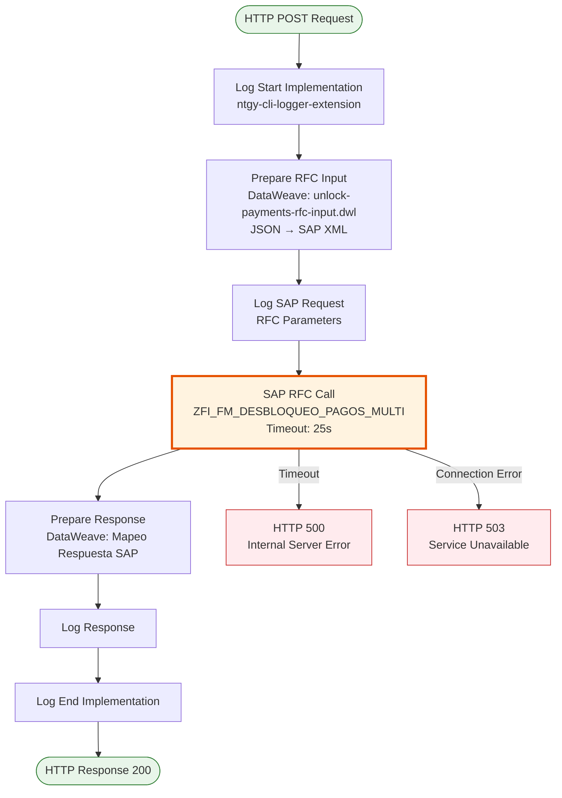
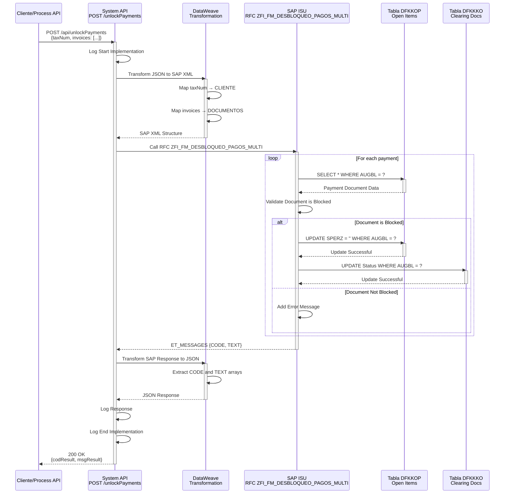
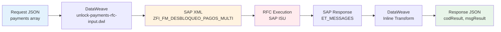

# POST /unlockPayments

## 📌 Descripción General

### Propósito del Endpoint

Desbloquea documentos de pago que han sido bloqueados en SAP ISU, permitiendo su procesamiento y compensación. Este endpoint invoca el RFC `ZFI_FM_DESBLOQUEO_PAGOS_MULTI` para liberar pagos bloqueados, facilitando la gestión de excepciones en el proceso de cobros.

El endpoint soporta:
- **Desbloqueo de Múltiples Pagos**: Libera documentos de pago bloqueados en lote
- **Validación de Cuenta Contrato**: Verifica que la cuenta contrato exista en SAP ISU
- **Actualización de Estado**: Modifica el estado del documento de pago en las tablas DFKKOP y DFKKKO
- **Respuesta Detallada**: Retorna el resultado de la operación con código y mensaje descriptivo

### Tipo de API

**Capa:** System API (API-Led Connectivity)

**Función:** Integración directa con SAP ISU para gestión de desbloqueo de pagos bloqueados en el módulo FI-CA (Financial Contract Accounting).

### Patrón de Integración

**Tipo:** Request-Reply Síncrono con SAP RFC

**Descripción:** Recibe la solicitud con información de pagos a desbloquear, transforma los datos al formato SAP mediante DataWeave, invoca el RFC `ZFI_FM_DESBLOQUEO_PAGOS_MULTI`, procesa la respuesta de SAP y retorna el resultado en formato JSON estandarizado.

### Arquitectura API-Led Connectivity



---

## 💼 Propósito del Negocio

### Casos de Uso Principales

1. **Desbloqueo de Pagos Rechazados**
   - Un pago fue bloqueado por error en el sistema bancario
   - El agente de cobros necesita desbloquearlo para reprocesarlo
   - Se invoca el endpoint para liberar el documento de pago

2. **Corrección de Pagos Duplicados**
   - Se detecta un pago duplicado que fue bloqueado automáticamente
   - El departamento de facturación valida que es un error
   - Se desbloquea el pago para permitir su compensación correcta

3. **Gestión de Excepciones de Cobro**
   - Un pago fue bloqueado por superar límites de crédito
   - Tras análisis, se aprueba el desbloqueo
   - Se libera el pago para continuar con el proceso de cobro

### Contexto Empresarial

- **Dominio:** Gestión Financiera y Cobros
- **Sector:** Energía - Utilities
- **División:** Naturgy España - NewCo
- **Proceso de Negocio:** Gestión de Cobros y Compensación de Pagos
- **Módulo SAP:** FI-CA (Financial Contract Accounting)

### Stakeholders

- **Departamento de Cobros**: Necesita desbloquear pagos para gestionar excepciones y errores
- **Agentes de Atención al Cliente**: Requieren resolver incidencias de pagos bloqueados
- **Departamento de Facturación**: Necesita corregir errores de compensación de pagos
- **Administradores SAP ISU**: Supervisan y auditan operaciones de desbloqueo

### Valor de Negocio

- **Agilidad Operativa**: Reduce el tiempo de resolución de incidencias de pagos bloqueados
- **Mejora de Cash Flow**: Permite procesar pagos bloqueados rápidamente, mejorando el flujo de caja
- **Reducción de Errores**: Automatiza el proceso de desbloqueo, reduciendo intervención manual en SAP
- **Trazabilidad**: Registra todas las operaciones de desbloqueo para auditoría y control

### Consumidores Potenciales

Este endpoint puede ser consumido por:
- Process APIs de gestión de cobros y pagos
- Sistema Omega (gestión de pagos)
- Portales de agentes de atención al cliente
- Sistemas de gestión de excepciones financieras
- Flujos automatizados de corrección de pagos

---

## 🔧 Especificación Técnica

### URLs por Ambiente

| Ambiente | URL Base | URL Completa |
|----------|----------|--------------|
| **Local** | `http://localhost:8081` | `http://localhost:8081/api/unlockPayments` |
| **Development** | `https://ntgy-newco-s-sap-isu-dev.us-e2.cloudhub.io` | `https://ntgy-newco-s-sap-isu-dev.us-e2.cloudhub.io/api/unlockPayments` |
| **UAT** | `https://ntgy-newco-s-sap-isu-uat.us-e2.cloudhub.io` | `https://ntgy-newco-s-sap-isu-uat.us-e2.cloudhub.io/api/unlockPayments` |
| **Production** | `https://ntgy-newco-s-sap-isu-pro.us-e2.cloudhub.io` | `https://ntgy-newco-s-sap-isu-pro.us-e2.cloudhub.io/api/unlockPayments` |

### Método HTTP

```
POST /api/unlockPayments
```

### Parámetros de Entrada

#### Headers HTTP

| Header | Tipo | Requerido | Descripción | Ejemplo |
|--------|------|-----------|-------------|---------|
| `Content-Type` | string | ✅ Sí | Tipo de contenido del request | `application/json` |
| `Accept` | string | ❌ No | Tipo de contenido esperado en response | `application/json` |
| `client_id` | string | ✅ Sí | Client ID de Anypoint Platform | `a1b2c3d4e5f6` |
| `client_secret` | string | ✅ Sí | Client Secret de Anypoint Platform | `A1B2C3D4E5F6` |

#### Body Parameters

El body debe contener un objeto JSON con la información de los pagos a desbloquear:

| Campo | Tipo | Requerido | Descripción | Ejemplo | Validaciones |
|-------|------|-----------|-------------|---------|--------------|
| `taxNum` | string | ✅ Sí | Número de identificación fiscal del cliente | `"12345678A"` | Longitud: 1-20 caracteres |
| `invoices` | array | ✅ Sí | Lista de facturas/documentos de pago a desbloquear | Ver ejemplo abajo | Mínimo 1 elemento |
| `invoices[].invoiceId` | string | ✅ Sí | Número de documento de pago a desbloquear (AUGBL) | `"1900000123"` | Longitud: 10 caracteres |

**Ejemplo de Request Body:**

```json
{
  "taxNum": "12345678A",
  "invoices": [
    {
      "invoiceId": "1900000123"
    }
  ]
}
```

### Respuestas

#### Respuesta Exitosa (200 OK)

```json
{
  "codResult": ["OK"],
  "msgResult": ["Pagos desbloqueados exitosamente"]
}
```

**Campos de Respuesta:**

| Campo | Tipo | Descripción | Valores Posibles |
|-------|------|-------------|------------------|
| `codResult` | array[string] | Array de códigos de resultado | `["OK"]`, `["ERROR"]` |
| `msgResult` | array[string] | Array de mensajes descriptivos | Texto descriptivo |

#### Respuesta de Error de Negocio (200 OK con error)

```json
{
  "codResult": ["ERROR"],
  "msgResult": ["El documento de pago no está bloqueado"]
}
```

#### Respuesta de Error Técnico (400 Bad Request)

```json
{
  "result": {
    "codResult": "0001",
    "msgResult": "Parámetros de entrada inválidos: taxNum e invoices son requeridos"
  }
}
```

#### Respuesta de Error Técnico (500 Internal Server Error)

```json
{
  "result": {
    "codResult": "0002",
    "msgResult": "Error al invocar RFC ZFI_FM_DESBLOQUEO_PAGOS_MULTI: Connection timeout"
  }
}
```

### Códigos de Estado HTTP

| Código | Descripción | Cuándo Ocurre |
|--------|-------------|---------------|
| `200` | OK | Operación procesada (éxito o error de negocio) |
| `400` | Bad Request | Parámetros de entrada inválidos o faltantes |
| `401` | Unauthorized | Credenciales de autenticación inválidas |
| `500` | Internal Server Error | Error técnico en SAP o en la integración |
| `503` | Service Unavailable | SAP ISU no disponible |

### Autenticación y Autorización

- **Tipo:** Client ID & Client Secret (Anypoint Platform)
- **Autorización SAP:** El usuario SAP configurado debe tener permisos para:
  - Ejecutar RFC `ZFI_FM_DESBLOQUEO_PAGOS_MULTI`
  - Acceso de lectura a tabla `DFKKOP` (Open Items)
  - Acceso de escritura a tabla `DFKKOP` (para actualizar estado)
  - Acceso de lectura/escritura a tabla `DFKKKO` (Clearing Documents)
  - Objeto de autorización `F_FICA_ROP` (FI-CA: Open Items)

### Timeouts

| Tipo | Valor | Descripción |
|------|-------|-------------|
| **Request Timeout** | 30 segundos | Tiempo máximo de espera para la respuesta del RFC |
| **Connection Timeout** | 10 segundos | Tiempo máximo para establecer conexión con SAP |
| **RFC Execution Timeout** | 25 segundos | Tiempo máximo de ejecución del RFC en SAP |

---

## 🏗️ Implementación Técnica

### Arquitectura del Flow



### Componentes del Flow

#### 1. HTTP Listener
- **Configuración:** `HTTP_Listener_config`
- **Path:** `/api/unlockPayments`
- **Método:** POST
- **Puerto:** Configurable por ambiente (`${http.newco.port}`)

#### 2. Logger Start
- **Componente:** `ntgy-cli-logger-extension`
- **Nivel:** DEBUG
- **Mensaje:** "Start implementation flow for unlock payments"
- **Contexto:** Request payload, correlation ID

#### 3. Transformación de Entrada (DataWeave)

**Archivo:** `src/main/resources/dw/unlock-payments-rfc-input.dwl`

```dataweave
%dw 2.0
output application/xml
---
{
  "ZFI_FM_DESBLOQUEO_PAGOS_MULTI": {
    "import": {
      "IS_DATOS_BLOQUEO": {
        "CLIENTE": payload.taxNum,
        "DOCUMENTOS": {
          "row": payload.invoices map (invoice) -> {
            "N_DOCUMENTO": invoice.invoiceId
          }
        }
      }
    }
  }
}
```

**Mapeo de Campos:**

| Campo JSON | Campo SAP | Tipo | Descripción |
|------------|-----------|------|-------------|
| `taxNum` | `CLIENTE` | CHAR(20) | Número de identificación fiscal del cliente |
| `invoices[].invoiceId` | `N_DOCUMENTO` | CHAR(10) | Número de documento de pago (AUGBL) |

#### 4. SAP RFC Call

**Configuración:**
```xml
<sap:synchronous-remote-function-call 
    key="ZFI_FM_DESBLOQUEO_PAGOS_MULTI" 
    config-ref="SAP_Config"
    doc:name="Synchronous Remote Function Call">
    <sap:input-parameters><![CDATA[#[payload]]]></sap:input-parameters>
</sap:synchronous-remote-function-call>
```

**RFC:** `ZFI_FM_DESBLOQUEO_PAGOS_MULTI`

**Descripción:** RFC personalizado de Naturgy para desbloqueo de múltiples pagos en SAP ISU.

**Módulo SAP:** FI-CA (Financial Contract Accounting)

**Parámetros de Exportación:**
- `ET_MESSAGES`: Tabla con mensajes de resultado
  - `CODE`: Código de resultado
  - `TEXT`: Texto descriptivo del resultado

#### 5. Transformación de Salida (DataWeave Inline)

```dataweave
%dw 2.0
output application/json

var in = payload.ZFI_FM_DESBLOQUEO_PAGOS_MULTI.export.ET_MESSAGES
---
{
    "codResult": in..CODE,
    "msgResult": in..TEXT
}
```

#### 6. Logger End
- **Componente:** `ntgy-cli-logger-extension`
- **Nivel:** DEBUG
- **Mensaje:** "Finished implementation flow for unlock payments"
- **Contexto:** Response payload, execution time

### Tablas SAP Involucradas

#### DFKKOP - Open Items (Partidas Abiertas)

**Descripción:** Contiene las partidas abiertas (documentos de pago pendientes) en FI-CA.

**Campos Relevantes:**
- `VKONT`: Número de cuenta contrato
- `AUGBL`: Número de documento de compensación
- `BLDAT`: Fecha del documento
- `BUDAT`: Fecha de contabilización
- `BETRW`: Importe en moneda del documento
- `WAERS`: Moneda
- `XBLNR`: Número de referencia
- `SPERZ`: Indicador de bloqueo

**Operaciones:**
- `READ`: Consulta del estado actual del documento
- `UPDATE`: Actualización del indicador de bloqueo (SPERZ)

#### DFKKKO - Clearing Documents (Documentos de Compensación)

**Descripción:** Contiene los documentos de compensación de pagos en FI-CA.

**Campos Relevantes:**
- `AUGBL`: Número de documento de compensación
- `AUGDT`: Fecha de compensación
- `VKONT`: Número de cuenta contrato
- `BETRW`: Importe compensado
- `WAERS`: Moneda

**Operaciones:**
- `READ`: Consulta de información del documento de compensación
- `UPDATE`: Actualización del estado de compensación

### Diagrama de Secuencia Detallado



### Diagrama de Transformación de Datos



### Manejo de Errores

#### Estrategia de Error Handling

**1. Errores de Validación (400 Bad Request)**
- Parámetros faltantes o inválidos
- Formato de datos incorrecto
- Validaciones de negocio fallidas

**2. Errores de Conexión SAP (503 Service Unavailable)**
- SAP ISU no disponible
- Timeout de conexión
- Red no accesible

**3. Errores de Ejecución RFC (500 Internal Server Error)**
- RFC no encontrado
- Error en ejecución del RFC
- Permisos insuficientes

**4. Errores de Transformación (500 Internal Server Error)**
- Error en DataWeave
- Estructura de datos inesperada
- Campos faltantes en respuesta SAP

#### Configuración de Error Handler

```xml
<error-handler>
    <on-error-propagate type="SAP:CONNECTIVITY">
        <ee:transform>
            <ee:set-payload>
                {
                  "result": {
                    "codResult": "5001",
                    "msgResult": "SAP ISU temporalmente no disponible"
                  }
                }
            </ee:set-payload>
            <ee:set-attributes>
                <ee:set-attribute attributeName="httpStatus">503</ee:set-attribute>
            </ee:set-attributes>
        </ee:transform>
    </on-error-propagate>
    
    <on-error-propagate type="SAP:EXECUTION">
        <ee:transform>
            <ee:set-payload>
                {
                  "result": {
                    "codResult": "9002",
                    "msgResult": "Error ejecutando RFC en SAP ISU"
                  }
                }
            </ee:set-payload>
            <ee:set-attributes>
                <ee:set-attribute attributeName="httpStatus">500</ee:set-attribute>
            </ee:set-attributes>
        </ee:transform>
    </on-error-propagate>
</error-handler>
```

---

## 💻 Ejemplos de Uso

### Ejemplo 1: Desbloqueo Exitoso de Pagos

#### cURL

```bash
curl -X POST "https://ntgy-newco-s-sap-isu-dev.us-e2.cloudhub.io/api/unlockPayments" \
  -H "Content-Type: application/json" \
  -H "client_id: YOUR_CLIENT_ID" \
  -H "client_secret: YOUR_CLIENT_SECRET" \
  -d '{
    "taxNum": "12345678A",
    "invoices": [
      {
        "invoiceId": "1900000123"
      }
    ]
  }'
```

#### Respuesta (200 OK)

```json
{
  "codResult": ["OK"],
  "msgResult": ["Pagos desbloqueados exitosamente"]
}
```

---

### Ejemplo 2: Error - Documento No Bloqueado

#### cURL

```bash
curl -X POST "https://ntgy-newco-s-sap-isu-dev.us-e2.cloudhub.io/api/unlockPayments" \
  -H "Content-Type: application/json" \
  -H "client_id: YOUR_CLIENT_ID" \
  -H "client_secret: YOUR_CLIENT_SECRET" \
  -d '{
    "taxNum": "12345678A",
    "invoices": [
      {
        "invoiceId": "1900000999"
      }
    ]
  }'
```

#### Respuesta (200 OK con Error de Negocio)

```json
{
  "codResult": ["ERROR"],
  "msgResult": ["El documento de pago no está bloqueado o no existe"]
}
```

---

### Ejemplo 3: Error - Parámetros Inválidos

#### cURL

```bash
curl -X POST "https://ntgy-newco-s-sap-isu-dev.us-e2.cloudhub.io/api/unlockPayments" \
  -H "Content-Type: application/json" \
  -H "client_id: YOUR_CLIENT_ID" \
  -H "client_secret: YOUR_CLIENT_SECRET" \
  -d '{}'
```

#### Respuesta (400 Bad Request)

```json
{
  "result": {
    "codResult": "0001",
    "msgResult": "Parámetros de entrada inválidos: payments es requerido"
  }
}
```

---

### Ejemplo 4: JavaScript (Fetch API)

```javascript
const unlockPayments = async (taxNum, invoices) => {
  const url = 'https://ntgy-newco-s-sap-isu-dev.us-e2.cloudhub.io/api/unlockPayments';
  
  const requestBody = {
    taxNum: taxNum,
    invoices: invoices
  };

  try {
    const response = await fetch(url, {
      method: 'POST',
      headers: {
        'Content-Type': 'application/json',
        'client_id': 'YOUR_CLIENT_ID',
        'client_secret': 'YOUR_CLIENT_SECRET'
      },
      body: JSON.stringify(requestBody)
    });

    const data = await response.json();
    
    if (data.codResult && data.codResult[0] === 'OK') {
      console.log('✅ Desbloqueo exitoso:', data.msgResult[0]);
      return { success: true, data };
    } else {
      console.error('❌ Error de negocio:', data.msgResult);
      return { success: false, data };
    }
    
  } catch (error) {
    console.error('❌ Error técnico:', error);
    throw error;
  }
};

// Uso
const taxNum = '12345678A';
const invoicesToUnlock = [
  {
    invoiceId: '1900000123'
  }
];

unlockPayments(taxNum, invoicesToUnlock)
  .then(result => {
    if (result.success) {
      console.log('Pagos desbloqueados correctamente');
    }
  });
```

---

### Ejemplo 5: Python (requests)

```python
import requests
import json

def unlock_payments(tax_num, invoices):
    """
    Desbloquea pagos en SAP ISU
    
    Args:
        tax_num (str): Número de identificación fiscal del cliente
        invoices (list): Lista de facturas a desbloquear
        
    Returns:
        dict: Respuesta del API
    """
    url = 'https://ntgy-newco-s-sap-isu-dev.us-e2.cloudhub.io/api/unlockPayments'
    
    headers = {
        'Content-Type': 'application/json',
        'client_id': 'YOUR_CLIENT_ID',
        'client_secret': 'YOUR_CLIENT_SECRET'
    }
    
    data = {
        'taxNum': tax_num,
        'invoices': invoices
    }
    
    try:
        response = requests.post(url, headers=headers, json=data, timeout=30)
        response.raise_for_status()
        
        result = response.json()
        
        if result.get('codResult', [])[0] == 'OK':
            print(f'✅ Desbloqueo exitoso: {result.get("msgResult", [])[0]}')
            return {'success': True, 'data': result}
        else:
            print(f'❌ Error: {result.get("msgResult", [])}')
            return {'success': False, 'data': result}
        
    except requests.exceptions.HTTPError as http_err:
        print(f'❌ Error HTTP: {http_err}')
        raise
    except Exception as err:
        print(f'❌ Error: {err}')
        raise

# Uso
tax_num = '12345678A'
invoices_to_unlock = [
    {
        'invoiceId': '1900000123'
    }
]

result = unlock_payments(tax_num, invoices_to_unlock)
if result['success']:
    print('Pagos desbloqueados correctamente')
```

---

### Ejemplo 6: Java (Spring RestTemplate)

```java
import org.springframework.http.*;
import org.springframework.web.client.RestTemplate;
import java.util.*;

public class UnlockPaymentsClient {
    
    public static void main(String[] args) {
        String url = "https://ntgy-newco-s-sap-isu-dev.us-e2.cloudhub.io/api/unlockPayments";
        
        RestTemplate restTemplate = new RestTemplate();
        
        // Preparar headers
        HttpHeaders headers = new HttpHeaders();
        headers.setContentType(MediaType.APPLICATION_JSON);
        headers.set("client_id", "YOUR_CLIENT_ID");
        headers.set("client_secret", "YOUR_CLIENT_SECRET");
        
        // Preparar body
        Map<String, Object> invoice = new HashMap<>();
        invoice.put("invoiceId", "1900000123");
        
        List<Map<String, Object>> invoices = new ArrayList<>();
        invoices.add(invoice);
        
        Map<String, Object> requestBody = new HashMap<>();
        requestBody.put("taxNum", "12345678A");
        requestBody.put("invoices", invoices);
        
        HttpEntity<Map<String, Object>> request = new HttpEntity<>(requestBody, headers);
        
        try {
            ResponseEntity<Map> response = restTemplate.exchange(
                url,
                HttpMethod.POST,
                request,
                Map.class
            );
            
            Map<String, Object> result = response.getBody();
            List<String> codResult = (List<String>) result.get("codResult");
            
            if (codResult != null && "OK".equals(codResult.get(0))) {
                System.out.println("✅ Desbloqueo exitoso");
                List<String> msgResult = (List<String>) result.get("msgResult");
                System.out.println("Mensaje: " + msgResult.get(0));
            } else {
                System.err.println("❌ Error de negocio");
                List<String> msgResult = (List<String>) result.get("msgResult");
                System.err.println("Mensaje: " + msgResult);
            }
            
        } catch (Exception e) {
            System.err.println("❌ Error técnico: " + e.getMessage());
            e.printStackTrace();
        }
    }
}
```
